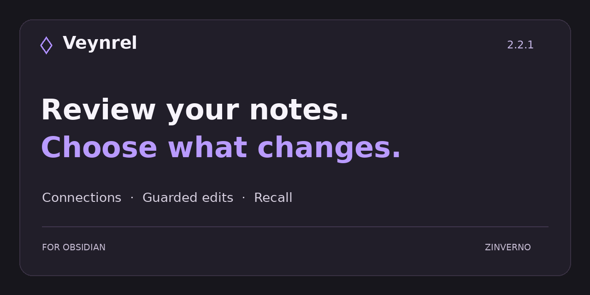
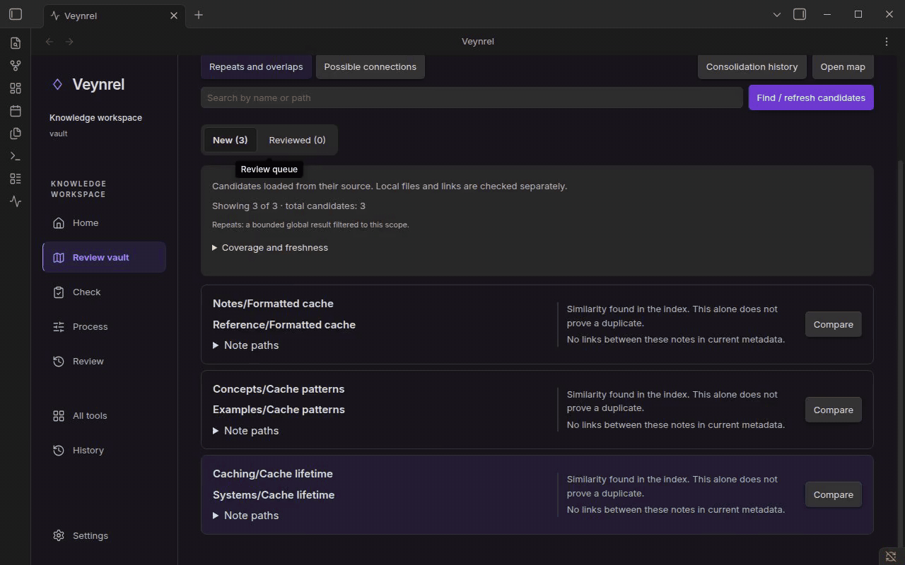
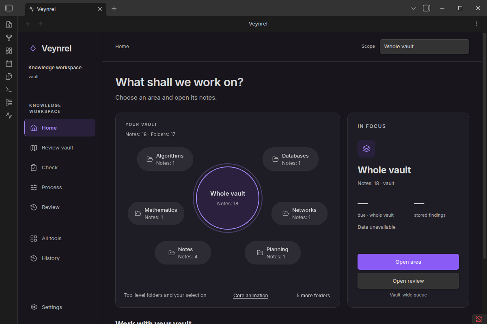
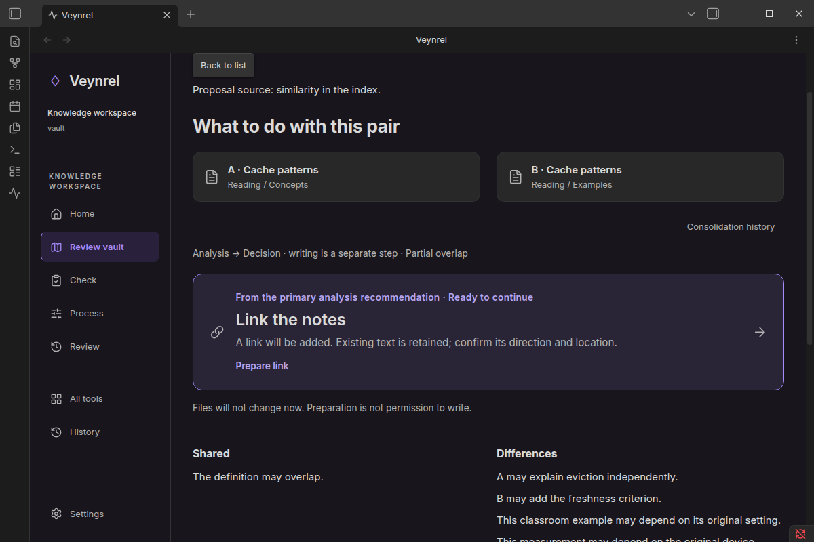
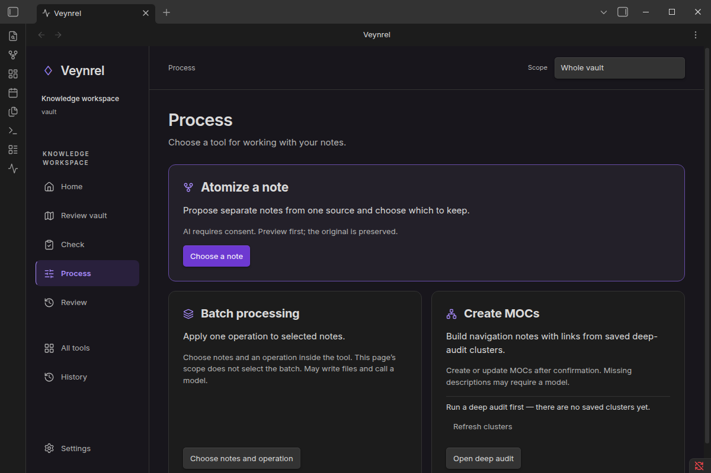
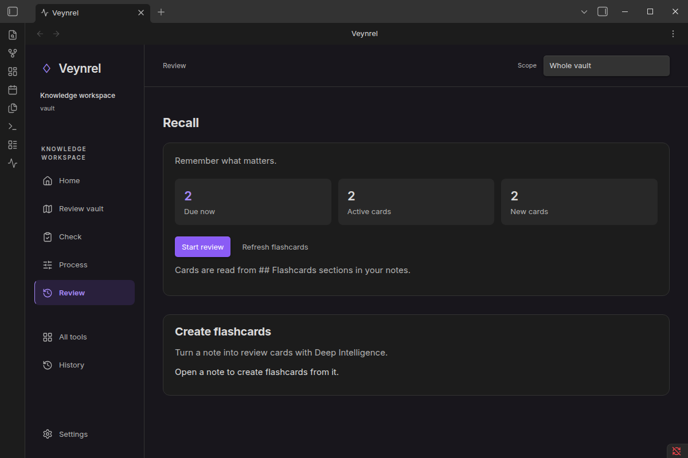

# Veynrel



**Find connections worth reviewing. Decide what to keep, link or change in your Obsidian notes.**

Veynrel brings a candidate list, evidence-led pair review, guarded Markdown changes and native spaced repetition into one workspace. Start with local checks; add semantic search and AI analysis when you need them.

[Install](#installation) · [2.2.1 release notes](docs/releases/2.2.1.md) · [Releases](https://github.com/zinverno/veynrel/releases) · [MIT license](LICENSE)

<p align="center"><a href="assets/showcase/2.2.1/review-to-apply.gif"></a></p>

*Veynrel 2.2.1 in real Obsidian, using synthetic notes and a local controlled model response. These demonstrations show the workflow, not AI quality. [Media details](assets/showcase/2.2.1/README.md).*

## From a candidate to a considered change

1. **Choose an area.** Home shows your folders; **More folders** reveals the rest.
2. **Review a pair.** Find repeats, overlaps or possible connections. Compare the saved notes before deciding whether to request AI analysis.
3. **Inspect the recommendation.** Confirm the displayed request first. The result shows evidence and a primary action; availability is checked before preparation.
4. **Review the exact change.** Choose the missing parameters, inspect the before/after preview, then separately confirm **Apply**.
5. **Keep control.** Supported consolidation operations have History and a separate guarded **Undo**. Or choose **Leave as is**: the decision survives restart for those exact saved versions and can be restored from **Reviewed**.

Adding a link updates local facts; it does not declare an overlap solved. A high similarity score does not prove duplication.

## Inside the workspace

<table>
<tr>
<td width="50%"><a href="assets/showcase/2.2.1/home.png"></a><br><strong>Choose an area</strong> — a clear starting point for your vault.</td>
<td width="50%"><a href="assets/showcase/2.2.1/recommendation.png"></a><br><strong>Make a decision</strong> — inspect the evidence and prepare the proposed action.</td>
</tr>
<tr>
<td><a href="assets/showcase/2.2.1/processing.png"></a><br><strong>Process deliberately</strong> — each tool explains its effect before you begin.</td>
<td><a href="assets/showcase/2.2.1/recall.png"></a><br><strong>Remember what you wrote</strong> — local FSRS-6 review.</td>
</tr>
</table>

More: [candidate list](assets/showcase/2.2.1/review.png) · [atomization proposals](assets/showcase/2.2.1/atomization-preview.png) · [History → Undo](assets/showcase/2.2.1/history-undo.gif) · [atomization workflow](assets/showcase/2.2.1/atomization.gif) · [Recall workflow](assets/showcase/2.2.1/recall.gif).

## Find useful relationships

- **Local Health** finds broken links, structural issues and exact duplicates without an AI provider. Findings retain evidence and coverage information.
- **Semantic search and Similar Notes** use an embedding index to surface related material. The optional map combines known links, semantic neighbors and tag membership; opening Review starts with the list.
- **Connection rules** can suppress suggestions within a tag or folder, or exclude that group from connection search. They run **before top-K**: exercises can still connect to explanations even when the five closest results are other exercises. Duplicate discovery remains separate.
- **Pair analysis** uses two saved sources, explicit consent and locally checked evidence. Model interpretation remains a suggestion for you to assess.

[Connection rules](docs/review-stage-2.md) · [Semantic search and index](docs/global-semantic-map.md) · [Relationship Analyzer](docs/relationship-analyzer-v1.md).

## Prepare changes, not surprises

Supported consolidation routes include links, embeds, copying selected material with **Merge**, and preserving context with **Group** or **Bundle**. They are bounded Markdown operations, not automatic full-file fusion. Preflight and the final review can refuse unsupported structures or changed sources. Archiving is a separate reviewed operation with its own dependencies.

**Atomize a note** proposes separate notes from one source. Select the note, confirm AI analysis, review each proposal, exclude unwanted ones, then confirm the exact files and source-link block. The original content stays. **Generative atomization has no universal Undo** and reports partial writes explicitly.

**MOC creation** uses saved deep-audit clusters and confirms destinations, create/update effects and any model use before execution. **Batch processing** has its own file selection and confirmation. Neither inherits the consolidation journal's Undo contract.

[Safe Apply and Undo](docs/safe-apply-undo-v1.md) · [Generative atomization](docs/processing-atomization.md) · [Processing and MOC](docs/processing-ux-followup.md).

## Recall without an AI provider

Write one `Question::Answer` per line under a heading named exactly **Flashcards**:

```markdown
## Flashcards

What does a cache store?::Reusable results.
Why invalidate a value?::Its source may have changed.
```

Open **Review** in the sidebar (the Recall screen), find your flashcards and start a session. Reveal the answer, then rate **Again / Hard / Good / Easy** with buttons or keys **1–4**. Local FSRS-6 schedules survive restart. AI card generation is optional.

[Recall guide](docs/recall-review-experience.md).

## Start small

1. Install Veynrel and open it from the ribbon or **Open Veynrel Health** command.
2. Choose an area on Home. Run a local check from **Check**; no provider is needed.
3. For semantic features, configure an embedding provider in Settings and explicitly build the first index.
4. Open **Review vault** and refresh candidates. Configure the language model only if you want pair analysis or generative tools.
5. Use **Review / Recall** for authored flashcards. **All tools** keeps advanced audits, Ask your Vault, tag tools and existing editor commands available.

[Optional self-hosted Companion](docs/veynrel-connect.md) provides a disclosed mirror and a proposal workflow for external clients. It is separate from local Review.

## Data and limits

| Work | Where it runs |
| --- | --- |
| Local Health, topology, Recall and saved decisions | On your device; no AI provider needed. |
| Existing-index maps and connection comparison | Local vectors and link metadata; no new embedding request. |
| Indexing and semantic text search | The configured embedding endpoint receives chunks or the query. Ollama can be local. |
| Pair analysis and generative tools | The configured language-model endpoint receives the disclosed input. Remote providers may charge. |
| Enabled Companion | Your configured server receives the disclosed mirror; proposals require review in Obsidian. |

- Semantic similarity is **not** a probability, proof of duplication or a verdict on note quality.
- The exact semantic overview and connection comparison support **up to 500 eligible notes**. Choose a smaller area above the limit; rules do not bypass it.
- The first index build is explicit. After configuration, incremental indexing and enabled Companion synchronization can run on later changes.
- Undo is operation-specific. Changed files or dependencies can block it. Generative atomization, Batch and MOC do not have universal rollback; keep backups.
- AI evidence checks verify source binding, not the truth of an interpretation. Synthetic demos do not validate a real model.
- Native acceptance and these captures use Linux / Obsidian 1.13.7. The manifest declares Obsidian 1.8.7+ and mobile support, but physical mobile, Windows/macOS, screen readers and native 1.8.7 were not verified in this media pass.

## Installation

In Obsidian, open **Settings → Community plugins → Browse**, search for **Veynrel**, then install and enable it.

For manual installation, download `main.js`, `manifest.json` and `styles.css` from the **same** [stable release](https://github.com/zinverno/veynrel/releases/latest), and place them in:

```text
<your-vault>/.obsidian/plugins/ai-knowledge-hub/
```

Reload Obsidian and enable Veynrel. The plugin ID is still **ai-knowledge-hub**; do not create a second `veynrel` folder or replace your settings/index/journal files.

[Installation, update and rollback](docs/release-2.2.1-install.md) · [EN/RU release notes](docs/releases/2.2.1.md).

## Development and support

```bash
npm ci
npm test
npm run typecheck
npm run lint
npm run audit:proposals
npm run build
```

[Documentation](docs/) · [Report an issue](https://github.com/zinverno/veynrel/issues) · [Star Veynrel](https://github.com/zinverno/veynrel/stargazers) · [Support development](https://boosty.to/veynrel)

[MIT](LICENSE) © 2026 Zinvernix
