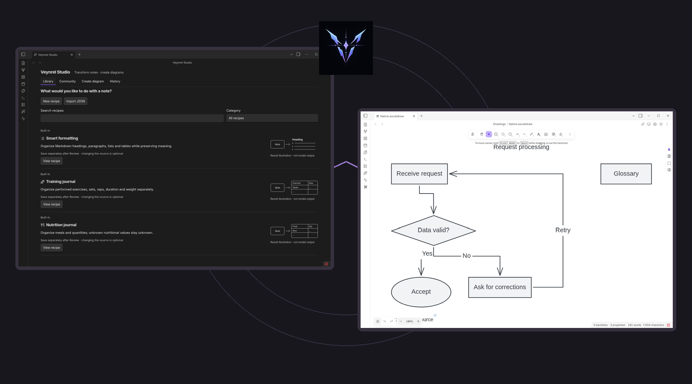
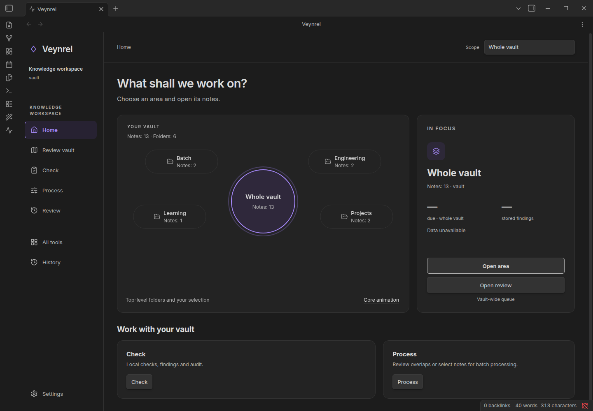
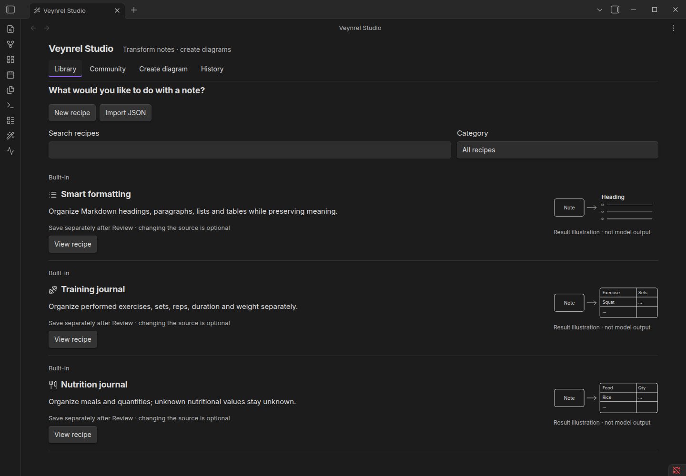
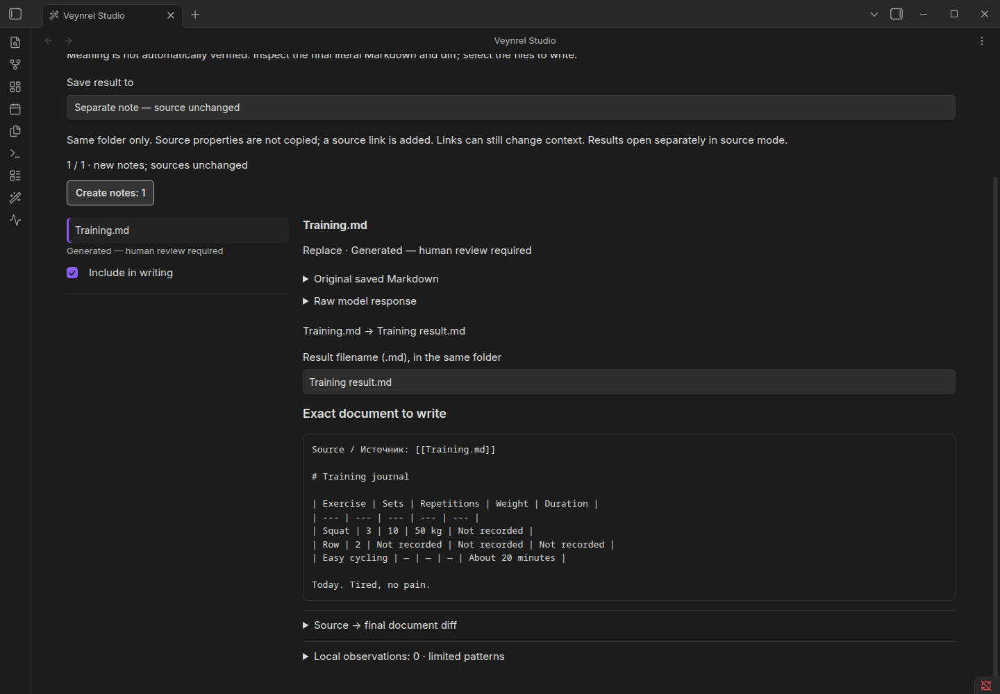
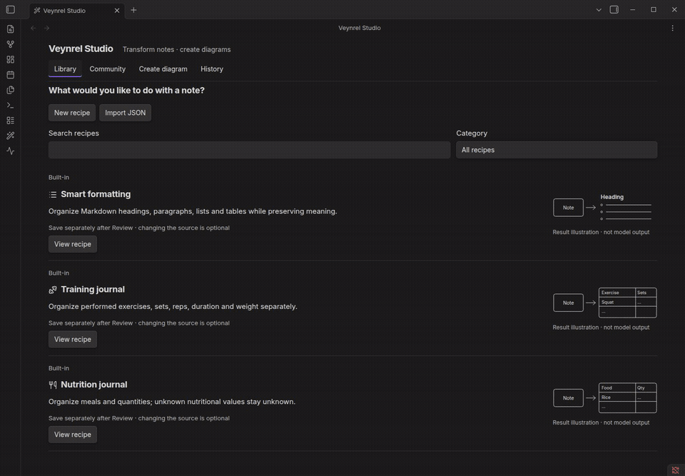
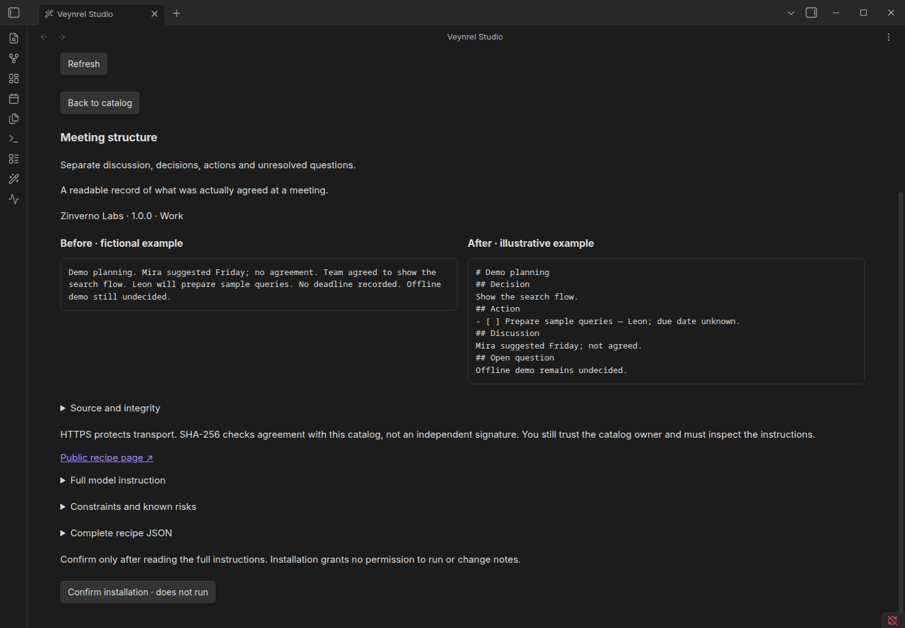

# Veynrel

**Review your vault. Shape a note. Keep the decision yours.**

Veynrel brings vault health, connection review and spaced repetition to Obsidian, alongside a separate Studio for reusable note recipes and editable diagrams.



[Install](#installation-and-updates) · [Quick start](#start-without-an-ai-key) · [User guide](docs/wiki/Home.md) · [Wiki](https://github.com/zinverno/veynrel/wiki) · [Community recipes](https://zinverno.github.io/veynrel-recipes/) · [Release notes](docs/releases/2.3.0.md)

> **2.3.0 release candidate.** The published stable release is **2.2.1**. Studio and the media below describe this candidate; install stable from Releases or review the candidate preparation PR before testing it in a disposable vault.

## Three ways to work

### Review a vault

Open the **Veynrel workspace** to choose an area, run local Health checks, inspect note pairs and review supported changes. Start with broken links and exact duplicates; add an embedding index for semantic candidates. Similarity suggests a pair to inspect — it does not prove duplication or low note quality.



### Transform a note

Open **Veynrel Studio**, choose a recipe and saved notes, then inspect the recipient and request before generation. Review the result and local preservation observations. The default creates a **separate Markdown note**, linked to its source; source properties are not cloned into the new result.







[Static result](assets/showcase/2.3.0/studio-result.png) · [Studio guide](docs/wiki/Studio-recipes.md)

*Workflow demonstration with synthetic notes and controlled responses; not a model-quality benchmark. Captured in real Obsidian. Timing is edited for readability.*

### Create an editable diagram

Studio can turn one saved note into a structure diagram or flowchart. Inspect the preview, explicitly create a new file, then move shapes, edit labels and keep working in Excalidraw. Requires **Excalidraw 2.29.0** and verified structured-output capabilities through **public OpenRouter**. Other Markdown providers do not imply diagram support.


[Move a node and edit its label](assets/showcase/2.3.0/diagram.gif) · [Static edited result](assets/showcase/2.3.0/diagram-edited.png) · [Prerequisites and limits](docs/wiki/Excalidraw-diagrams.md)

*Workflow demonstration with synthetic notes and controlled responses; not a model-quality benchmark. The diagram remains a separate file; creation has no automatic delete/Undo.*

## Add a recipe, then decide when to run it

Browse Community from Studio. Inspect instructions, author, version and compatibility, then install a local copy. Installation does not process notes. Updates are explicit; a matching SHA-256 checks catalog bytes, not an independent author's signature.



[Community guide](docs/wiki/Community-library.md) · [Contribute a recipe](https://github.com/zinverno/veynrel-recipes)

## Start without an AI key

1. Open **Veynrel: Open Veynrel** from the command palette, or use its ribbon icon.
2. Choose a folder or the whole vault on Home; open **Check** and run local checks.
3. For Recall, add authored cards under a heading named exactly `Flashcards`:

```markdown
## Flashcards
What does a cache store?::Reusable results.
When should a cached value expire?::When its source changes.
```

4. Open **Review** in the workspace sidebar (Recall), find cards and start a session. Reveal the answer and rate Again / Hard / Good / Easy. FSRS scheduling stays local.

For Studio, configure a language model in Veynrel settings, then use **Open Veynrel Studio**. For semantic discovery, configure an embedding provider and explicitly build the first index. These are separate setup paths. [Getting started](docs/wiki/Getting-started.md)

## Data and decisions

| Task | Data flow | Decision boundary |
| --- | --- | --- |
| Local Health, topology and Recall | Local vault and local state | No LLM required |
| Semantic indexing/search | Note chunks or query to the configured embedding endpoint | Initial index build is explicit; later incremental work may run |
| Studio Markdown and pair analysis | Disclosed selected text to the configured model endpoint | Confirm request, inspect output, separately confirm writes |
| Diagram capability discovery | Model/endpoint metadata from public OpenRouter; no note body in discovery | Generation separately sends the selected note |
| Community catalog | Public catalog/recipe GET requests; no note body or provider key | Install and update explicitly, run separately |
| Optional Companion | Disclosed mirror to the configured server | Separate opt-in integration |

Local preservation observations are lexical checks, **not factual verification**. Explicit Studio source changes retain supported original YAML literally and have guarded, operation-specific Undo. New notes, diagrams, Batch, MOC and generative atomization do not share a universal rollback. Local operation journals can contain plaintext note content; preserve backups. Remote providers may charge even when a local request times out or is cancelled.

[Providers and privacy](docs/wiki/Providers-and-privacy.md) · [History and recovery](docs/wiki/Safety-history-and-recovery.md) · [Media provenance and coverage](assets/showcase/2.3.0/README.md)

## Installation and updates

For the published stable version, open **Settings → Community plugins → Browse**, search for **Veynrel**, install and enable. For manual installation, use `main.js`, `manifest.json` and `styles.css` from the **same** [stable release](https://github.com/zinverno/veynrel/releases/latest).

Place only those runtime files in `<vault>/<configDir>/plugins/ai-knowledge-hub/` (`configDir` is normally `.obsidian`). Keep the existing plugin folder, `data.json`, indexes and journals when updating. Back up first; do not replace the whole directory. Candidate testing belongs in a disposable vault. [Installation and recovery](docs/wiki/Installation-and-updates.md)

The manifest retains Obsidian **1.8.7+** and its existing platform declaration. Current native evidence is Linux desktop / Obsidian 1.13.7 with built-in light and dark themes; it does not establish physical mobile, every OS/theme or screen-reader support.

[Contributing](CONTRIBUTING.md) · [Support](SUPPORT.md) · [Security](SECURITY.md) · [Documentation index](docs/README.md) · [MIT license](LICENSE)
