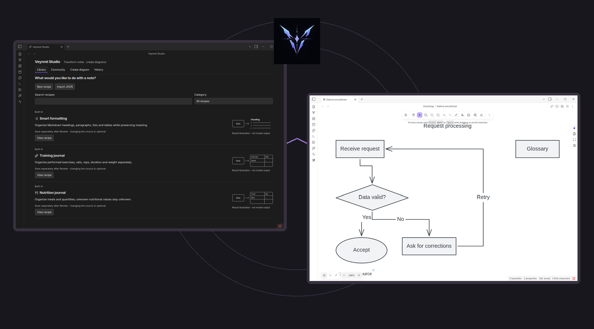
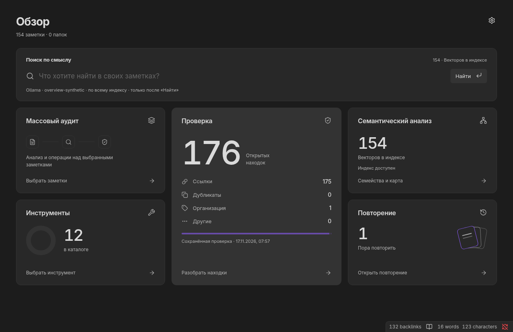
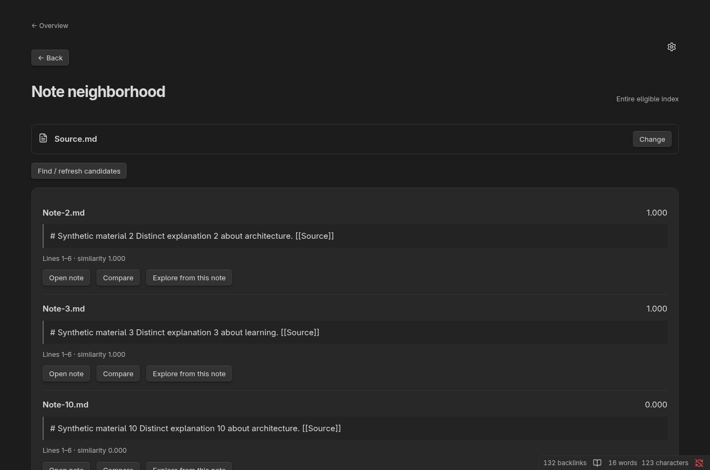
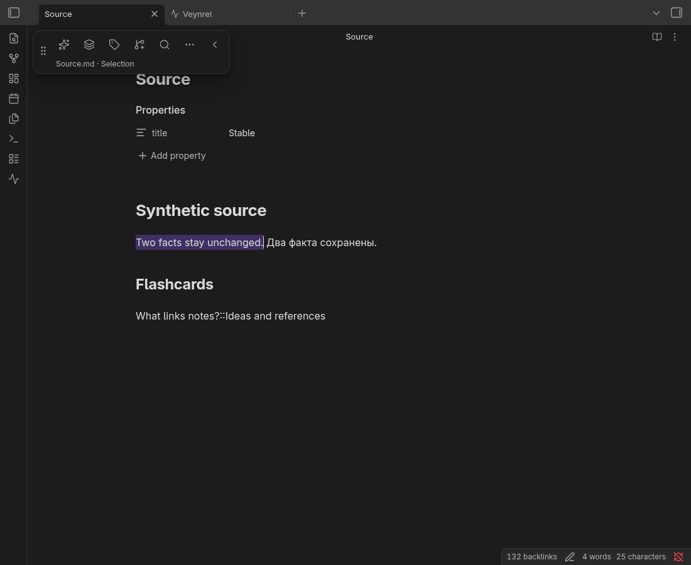

# Veynrel

**Understand your vault. Find ideas by meaning. Make changes on your terms.**

Veynrel is an Obsidian plugin for local vault checks, semantic search and exploration, safe note actions, and spaced repetition. Start with the overview, investigate a finding, or open a tool directly from your note.

[**Install in Obsidian**](#install) · [Get started](#get-started) · [Explore the tools](#what-you-can-do) · [Privacy](#privacy-and-control) · [Releases](https://github.com/zinverno/veynrel/releases) · [Report an issue](https://github.com/zinverno/veynrel/issues)

## At a glance

Open **Veynrel → Overview** to see your vault's current findings, semantic index status, Recall queue and the main tools. The figures are observations from your own vault; missing data is shown as missing, not scored as healthy.



*Recorded in Obsidian using synthetic notes. Counts in the screenshot are not benchmarks or results from a user's vault.*

## What you can do

| Area | Purpose | Needs an AI provider? |
| --- | --- | --- |
| **Overview** | A compact starting point for checks, search, tools and Recall | No |
| **Vault Check** | Inspect broken wiki-links and supported structural findings; filter, open evidence and prepare fixes | No for local checks |
| **Semantic search** | Find passages by meaning, even when they use different words | Yes: a configured embedding model (local Ollama or a remote provider) |
| **Semantic exploration** | Explore the map, overlapping families, note pairs, neighborhoods, possible connections, global focus and similar notes | Requires an existing semantic index for semantic results |
| **Tools & Bulk Audit** | Choose supported note actions, Deep Audit, atomization and MOC preparation | Depends on the action |
| **Recall** | Practice existing Markdown flashcards using FSRS-based scheduling | No; generation of *new* cards requires a configured model |

### Review relationships instead of guessing

Semantic similarity is an **invitation to inspect** a pair, not proof of a duplicate, topic or error. The semantic area has seven separate entry points: **Map, Families, Notes & Pairs, Neighborhood, Connection Opportunities, Global Focus, and Similar Notes**. Structural Markdown links and semantic proximity are shown as different evidence. Global focus keeps its documented computation limit rather than silently sampling a subset.



### Work from the note you are editing

Enable the optional **Veynrel floating actions** command to open a movable toolbar inside Obsidian. It includes style suggestions with **preview → apply → native undo**, flashcard generation, tags, atomization and semantic search. The toolbar remembers the originating editor and selection; switching notes does not authorize writing to the new one.



The ring-shaped **Tools** selector shows an explanation before opening an operation. Bulk Audit, Deep Audit, atomization and MOC retain distinct execution and confirmation flows; they do **not** all share a universal Undo guarantee.

## Get started

1. Open Obsidian's **Command palette** and choose **Veynrel: Open Veynrel**, or use the Veynrel ribbon action.
2. On **Overview**, open **Check** and run a local vault check. A model/API key is not needed.
3. Select a finding to inspect its source note. Supported changes open a separate preparation/confirmation flow.
4. To search by meaning, configure an embedding provider in **Settings → Veynrel** and explicitly build the first index. Search queries use the configured provider; indexing may send note chunks to that provider.
5. To use the floating toolbar, invoke its show/hide command while a Markdown note is active. No shortcut is assigned automatically.

### Recall without AI

Put manually authored cards in a Markdown note under a `Flashcards` heading:

```markdown
## Flashcards
What does a cache store?::Reusable results.
When does a cached value expire?::When its source changes.
```

Then open **Recall** from Overview to practice. The generated-card workflow is optional and asks before calling a model or modifying the note.

## Privacy and control

- **Local Health, link structure and Recall** can work without an AI provider. Opening Overview does not automatically scan all notes, build embeddings or issue a model request.
- **Embeddings** are generated by the endpoint you configure. A remote provider may receive note chunks and queries; a local model can keep inference on your device.
- **Generative actions** require explicit initiation and have operation-specific preview, confirmation and recovery rules. Source changes are checked before supported edits. AI suggestions are not factual verification.
- **No built-in telemetry** is used to track your vault activity. An optional Companion connection is a separate opt-in integration.
- Models or providers may charge for requests even if you cancel locally. Review your provider's privacy and billing terms before sending private notes.

[Provider and privacy details](docs/wiki/Providers-and-privacy.md) · [Safety, history and recovery](docs/wiki/Safety-history-and-recovery.md)

## Install

This guide describes the 2.4.0 release candidate. Check the [published releases](https://github.com/zinverno/veynrel/releases/latest) for the version currently distributed.

### Obsidian Community directory

In Obsidian, open **Settings → Community plugins → Browse**, search for **Veynrel**, then install and enable it. If the directory is still processing a new release, check the [GitHub releases](https://github.com/zinverno/veynrel/releases) for its published status.

### Manual installation

Download `main.js`, `manifest.json` and `styles.css` **from the same GitHub release**. Place them in the existing plugin directory:

```text
<your-vault>/.obsidian/plugins/ai-knowledge-hub/
```

Keep the existing `data.json`, semantic indexes, Recall data and operation journals. Back up the plugin data and vault before upgrading; do not delete the folder or rename it to `veynrel`. The plugin ID remains `ai-knowledge-hub`.

**Compatibility:** The 2.4.0 candidate requires Obsidian 1.13.7 or newer. The compatibility index retains 2.3.1 for older hosts down to 1.8.7. Mobile remains eligible under the manifest. Current native evidence focuses on Obsidian 1.13.7 on Linux desktop; it does not establish physical mobile, every theme, screen reader or operating system support.

## What's temporarily unavailable

**Studio and its online Community catalog are hidden in this version** while that experience is reconsidered. Existing Studio recipes and stored user data are not intentionally removed. The earlier **Excalidraw diagram generator** is also retired; existing drawings are yours and remain untouched. These features may appear in older screenshots and guides, but they are not current entry points.

The header art is retained from an older release and still mentions *Editable diagrams*; that label is historical and does not describe the current feature set.

## Contribute and support

Found a broken link, unexpected AI behavior or a difficult workflow? [Open a GitHub issue](https://github.com/zinverno/veynrel/issues) with steps to reproduce, Obsidian version and a sanitized screenshot. Please don't upload private notes, credentials, API keys or personal vault indexes.

[Contributing](CONTRIBUTING.md) · [Security](SECURITY.md) · [Support](SUPPORT.md) · [License (MIT)](LICENSE) · [Release history](https://github.com/zinverno/veynrel/releases)
