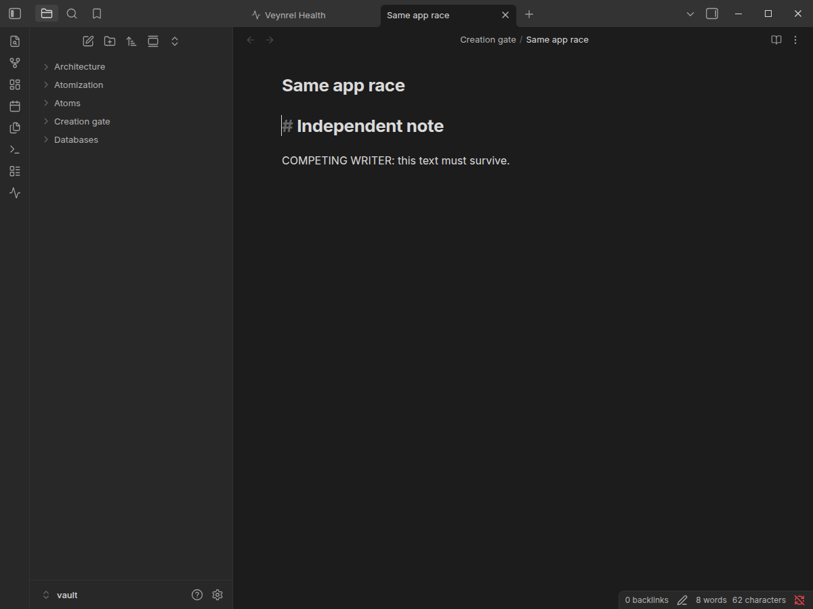
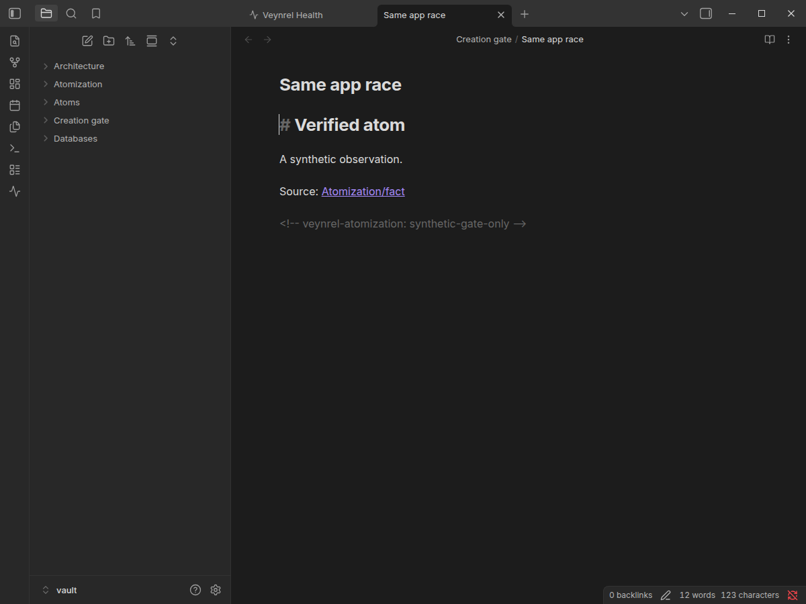

# Atomization Apply & Undo: native creation gate report

**Feature status: BLOCKED.** On real Obsidian, the candidate public creation API overwrote competing content. Per the task's explicit stop condition, no Atomization Apply/Undo executor was connected. A successful harness result below means the blocker was reproduced and the existing planner regression passed; it does not mean Apply/Undo acceptance passed.

Protocol and unimplemented recovery design: [atomization-apply-undo-protocol.md](atomization-apply-undo-protocol.md).

## Provenance and reproduction

- Base: current `main` at `87da22d49f69de30a316759fb86da7ac8f8eb2ea`, merge of PR #97. GitHub merged timestamp: `2026-10-18T21:35:05Z`.
- Run: 2026-10-19 Europe/Moscow; native Linux Obsidian **1.13.7**, Electron **43.6.0**, default filesystem adapter. Fresh synthetic vault/profile, no credentials or personal vault.
- Exact installed plugin build SHA-256: `65b4ffa6448eb7917973c07e4ac92e6d2b20ab84c3ce73b6e8126ca64d80ffd1`. Production code is unchanged from main.
- PR #92 corpus SHA-256 remains `dc7cfdf692791552abd9b06c128f6a2c78f666882b159412b647ef747ef0cda8`. Labels and fixtures are unchanged.
- [Full native report](atomization-create-evidence/report.json), [gate outcomes, exact payloads, source hashes and timing samples](atomization-create-evidence/atomization-create-gate.json).

```sh
npm run build
node scripts/pair-inspector-native.mjs /tmp/pair-inspector-atomization-create-new \
  --atomization --atomization-create-gate
```

Use a new, nonexistent `/tmp/pair-inspector-*` directory each time. The harness starts the real `/usr/bin/electron43 /usr/lib/obsidian/app.asar` with its own profile and local CDP port 9274, verifies the synthetic vault path, enables only the fixture plugin, and terminates its owned process. A GUI-capable session is required; do not bypass Electron sandboxing. The gate requires `--atomization` so it can call the actual planner's observation closure without copying its implementation into a benchmark mock.

The probe deliberately invokes public `Vault.create()` on synthetic targets. It never adds that capability to the planner. The final run records **26 test create calls** and zero fetch/XHR calls. Fixture installation and scale-file generation use the harness process; they are not plugin planning writes. The network counters do not claim OS-wide/requestUrl interception. Analyzer responses in the existing planner scenario are scripted controls, not paid model calls or model-quality evidence.

## Creation result

| Scenario | Native result |
|---|---|
| Existing loaded TFile | `File already exists`; original bytes preserved. |
| Target appears after preview, before `Vault.create` | Rejected; competing bytes preserved. |
| Two simultaneous, unmodified public `Vault.create` calls | **10/10** pairs both fulfilled at the same path; competing text was replaced. |
| First create paused after native absence check; second public create finishes | Both fulfilled; first replaced the second's complete Markdown after resuming. |
| Independent disk writer creates after native absence check | First create fulfilled and replaced the disk writer's complete Markdown. |

The decisive same-process test can be expressed as `Promise.allSettled([vault.create(path, first), vault.create(path, second)])` on a fresh path. The barrier test additionally demonstrates that the competing note had fully committed and was readable before the overwrite. The barrier forwards to the original adapter writer unchanged; no direct `adapter.write()` fallback is implemented. Native-source fingerprints are included in the JSON; full installed-source diagnostics remain in the disposable run directory.

Before resuming the first creation, a real editor displayed the competing note; it was detached before the first call resumed. The after screenshot shows its replacement. Full exact strings and hashes are in the gate JSON, which supplies the evidence that screenshots alone cannot establish.

| Competing note before resumption | Target after resumption |
|---|---|
|  |  |

The marker in the probe payload is explicitly synthetic (`synthetic-gate-only`), not a v2 operation ID or ownership receipt. It demonstrates that a marker and intended content cannot prevent an overwrite. No product preview silently acquires a marker.

## Planner regression and source preservation

The same final run passed **98 atomization planner assertions** and **18 base inspector assertions**. It exercised whole paragraphs, conditions, H1/H2/H3 context, Unicode/CRLF, protected ranges, conflicting versions, target/name/link collisions, missing MetadataCache, source edits, cancel/reopen, close during reads and late asynchronous results. The exact existing planner retained no Apply control. The legacy `ai-atomize-note` command remained registered.

During planning: zero new scripted completions after entering the planner, zero Markdown writes, zero journal writes and zero fetch/XHR calls. Planner before/after hashes were equal, including restoration of deliberately edited fixtures. The creation-gate phase separately hashes every preexisting Markdown/journal file outside its dedicated `Creation gate/` fixtures and verifies equality afterwards. No original note was changed by a creation probe. Full source strings remain in the fixture/plans in the native JSON; source hashes are included in the gate report.

Native layout coverage is RU/EN × light/dark × 1200/390 px, with overflow assertions. These are desktop widths, not physical mobile acceptance.

| Language/theme | 1200 px | 390 px |
|---|---|---|
| EN/light | [screenshot](atomization-create-evidence/atom-en-theme-light-1200.png) | [screenshot](atomization-create-evidence/atom-en-theme-light-390.png) |
| EN/dark | [screenshot](atomization-create-evidence/atom-en-theme-dark-1200.png) | [screenshot](atomization-create-evidence/atom-en-theme-dark-390.png) |
| RU/light | [screenshot](atomization-create-evidence/atom-ru-theme-light-1200.png) | [screenshot](atomization-create-evidence/atom-ru-theme-light-390.png) |
| RU/dark | [screenshot](atomization-create-evidence/atom-ru-theme-dark-1200.png) | [screenshot](atomization-create-evidence/atom-ru-theme-dark-390.png) |

## Empty cache and large-vault measurement

A real unrelated empty Markdown file produced native cache `{}` without `sections`. Before adding it, the actual observation had `metadataComplete: true` and no conflicts. Afterwards it had `metadataComplete: false` with the same empty conflict list. **One empty note currently blocks planning elsewhere.** This is a reproduced availability limitation, not a safe absence-of-dependencies result. It is documented rather than bypassed by treating missing metadata as `sections: []`. Added unit cases preserve the distinction for both zero-byte and nonempty unknown notes.

A future fix needs explicit, fresh evidence that an apparently empty note really has no content/dependencies, or a documented native cache-completion contract; a cached size of zero alone cannot waive stale/missing metadata checks. Such a fix must also account for the planner's current two-source-read boundary. No product fallback is added in this blocked PR.

For scale, the harness generated real synthetic notes with frontmatter aliases, a paragraph and an unresolved link, waited for native cache sections, then called the actual `readAtomizationObservation` closure. Each size uses one warm-up and seven measured passes. Timings include inventory sorting, metadata/alias/link scanning, dependency snapshot copying and native destination-absence observation; they exclude fixture creation/indexing and the extra JSON sizing step. Zero Markdown reads occurred inside every measured observation.

| Added scale notes | Inventory entries | Median | Max of 7 | Serialized observation |
|---|---:|---:|---:|---:|
| 1,000 | 1,040 | 11.4 ms | 15.8 ms | 264,636 bytes |
| 10,000 | 10,040 | 120.1 ms | 122.8 ms | 2,622,678 bytes |

This is one machine/run, not a latency SLA or a full Apply benchmark. The inventory is scanned/sorted per observation; synchronous work at 10,000 notes can delay rendering. Repeated preflight checks and duplicating full inventories in recovery copies would multiply latency/storage. No speculative cache optimization or weakened dependency check is introduced.

## Error log and validation

| Attempt | Observed failure | Resolution |
|---|---|---|
| Initial API inspection | No functional failure; found separate absence/write phases. | Proceeded to empirical race tests. |
| `creation-gate-01` | Test harness used top-level `await` inside a CDP expression; stopped after the existing-file control. | Replaced with a returned Promise; preserved [error evidence](atomization-create-evidence/first-harness-error.json). No product change. |
| Initial full test run | Three existing tests exceeded 5-second timeouts while native scale work, typecheck and proposal audit were running concurrently. | Retained [timeout log](atomization-create-evidence/initial-test-timeouts.log); reran the unchanged full suite alone. No timeout increase or test weakening. |
| Initial lint | New deserialization regression assigned `JSON.parse` to inferred `any`. | Typed the untrusted saved value as `unknown`; validation still receives and rejects the same JSON. |
| `creation-gate-02`, final | Reproduced overwrite; final also captured both screenshots and read counts. | Gate remains blocked; no Apply wiring. |

Local validation: `npm test` **4,011/4,011**, 153 files; `npm run typecheck`; `npm run lint`; `npm run build`; `npm run audit:proposals` **5/5**; `git diff --check`. Lint retains the preexisting `api.ts:404` fetch advisory. GitHub CI is recorded in the PR checks.

**NOT RUN / blocked:** product final creation consent, v2 marker confirmation, seven-family journal/interlock/corruption tests, real Apply/Undo, system/local trash, repeated Apply/Undo, source/atom edits after an actual operation, new backlinks after creation, popout or separate-window Apply, all nine SIGKILL/restart checkpoints, and history-based Undo after restart. No automatic recovery behavior is claimed. Existing group/bundle unit regressions run in the full suite; their native Apply matrix was not rerun for this production-code-unchanged blocker PR.

The feature remains read-only. Resolving the exclusive-creation gate and the subsequent ownership/trash/recovery gates is required before delivering Apply & Undo.
