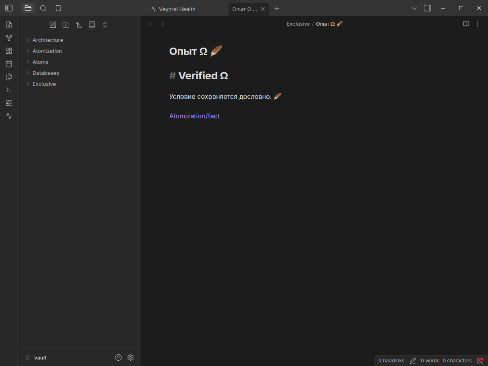
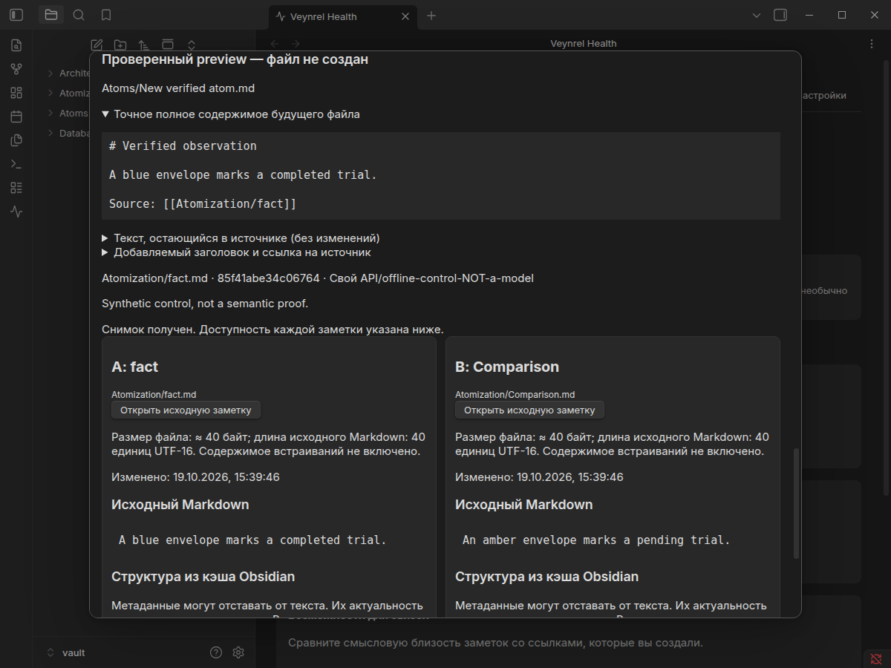

# Exclusive creation v2: Linux native gate

**Decision: do not connect Atomization Apply yet.** `wx` solves Veynrel's overwrite of an earlier competitor, but moving the pinned parent outside the original vault before open creates an empty entry there. `applyReady` remains false. `PASS` in the harness means the asserted results, including that blocker, were reproduced; it is not Apply acceptance.

Design, limitations, empty-note proof and next-PR contract: [capability protocol](atomization-exclusive-create-v2.md). Historical baseline: [unchanged PR #98 report](atomization-create-gate-native.md).

PR #98's historical harness also asserts the old empty-cache refusal. That availability assertion is intentionally superseded by the new verified-empty case; use the v2 command below for current acceptance. Its unsafe public-creator race is independently reproduced unchanged in principle here, rather than relabeling the old evidence as safe.

## Provenance and reproduction

- PR [#98](https://github.com/zinverno/veynrel/pull/98) was verified merged at `2026-10-19T10:48:42Z`. Branch `feat/atomization-exclusive-create-v2` starts from its current-main merge `d9e06b82d282864b4a207fd28e83e09c82a690a8`.
- Final run: 2026-10-19, Linux desktop, Obsidian **1.13.7**, Electron **43.6.0**, Node **24.20.0**, real `FileSystemAdapter`, Btrfs (`0x9123683e`). No personal vault, credentials, paid model or custom theme.
- Installed production plugin SHA-256: `26e3e852435b27b66db6e444d05041be56bb1fc776781668128c69d92587ccfd`. The candidate is absent from `.esbuild/meta.json` production inputs. A disposable helper bundles the actual candidate source separately; exact source/harness SHA-256 values are in the gate JSON.
- Frozen PR #92 corpus SHA-256: `dc7cfdf692791552abd9b06c128f6a2c78f666882b159412b647ef747ef0cda8`, unchanged. Its Relationship Analyzer/copy regressions run in the full suite; labels are not modified.
- [Full native report](atomization-exclusive-evidence/report.json), [46 gate cases, source hashes, MetadataCache and timing samples](atomization-exclusive-evidence/exclusive-create-v2.json), [artifact hashes](atomization-exclusive-evidence/sha256.json).

```sh
npm run build
node scripts/pair-inspector-native.mjs /tmp/pair-inspector-exclusive-fresh \
  --atomization --exclusive-create-v2
```

Use a nonexistent `/tmp/pair-inspector-*` profile/report directory. For this flag only, the vault is created under the checkout's ignored `.esbuild/<run-name>/vault`, so the test uses the actual local Btrfs filesystem rather than `/tmp` tmpfs. A second disposable synthetic vault under the same run directory receives the deliberate relocation probe; separate synthetic symlink sentinels live in the run directory. No existing user vault is opened. The helper requires confirmed fixture ownership, not a generic claim that all Btrfs paths are safe.

The existing harness starts `/usr/bin/electron43 /usr/lib/obsidian/app.asar` with a dedicated profile and CDP port 9274, verifies the vault path, accepts trust only for that fixture, waits for layout/plugin registration, and stops its owned process. It SIGKILLs only that process for the crash test. A real GUI-capable session is required; no sandbox bypass is used. Do not run two instances of this port-bound harness concurrently.

## Old and candidate creators

| Native scenario | Observed result |
|---|---|
| Original unmodified public `Vault.create` concurrent pairs | **10/10** pairs both fulfilled; the second complete body replaced the competitor. Original red gate remains red. |
| Existing file / file appears after preview | Candidate refuses; full competitor bytes preserved. |
| Independent harness process creates immediately before candidate's `wx` | Candidate paused at the open boundary; other process completed `wx`; candidate got `EEXIST`, `mayHaveCreated: false`; competitor preserved. |
| Two candidate exclusive creates of exactly one path | **10/10** pairs: one successful creator, one refusal, winning bytes intact. |
| Concurrent public Vault creator wins at that boundary | Candidate refuses and preserves the Vault-created body. |
| Independent process changes an already created file | Candidate's subsequent verification refuses. |
| A stale public Vault creator resumes after exclusive creation | The public API still overwrites afterwards; candidate re-verification refuses. This does not undo the writer's action or pretend to lock it. |
| Unicode filename and CRLF/Unicode content | Exact disk/Vault bytes equal; Obsidian discovers file without a second create call. Heading, section offsets and resolved source link agree. Discovery/cache check completed in **58 ms** in this run, not a timing guarantee. |
| Existing different-case filename | Refusal, existing bytes unchanged. Unit tests additionally cover NFKC collisions. |
| Symlink parent, final symlink, dangling symlink, traversal/absolute path | Refused; outside sentinel unchanged, no redirected target created. |
| Missing parent / directory mode `0500` | Refused without creation; permission case reports `EACCES`. No folder creation. |
| Parent renamed inside vault and replaced with symlink | No write through escaping symlink. Refusal after open; empty entry retained in moved directory. |
| Parent relocated to second synthetic vault at open boundary | **BLOCKER:** empty entry appears outside original vault. No knowledge body or preexisting foreign bytes are written, but containment fails. |
| Injected `EIO` after empty create, before body | Refusal with possible creation; empty entry retained, all returned descriptors closed. |
| Another process deletes/recreates synthetic source | Existing saved-source guard rejects missing/replaced TFile even with identical recreated text; test driver does not dispatch a target creation. This is not an implemented Apply executor. |
| Real SIGKILL after empty creation, before write | Empty entry remains after restart; no automatic create/cleanup; explicit second attempt refuses occupied path. No journal/recovery ownership is inferred. |

Native fault hooks wrap only the candidate's injected test IO. One test temporarily delays the actual `adapter.write` behind a stale public `Vault.create` and restores it in `finally`; it is a diagnostic barrier, never a production creator. The implementation contains no global patch. Concurrent same-path control pairs use no barrier. Independent-process cases use the separate Node harness process while the creator runs in Obsidian's renderer.

All returned descriptors were observed closed before crash and after ordinary tests. The killed process's open descriptor is not a claim about graceful close. Unit injection additionally covers sync and close failures, attempts to close every handle, and refusal after target modification/removal/replacement. OS power loss, torn physical-media writes and platform-specific close failures were not simulated.

Unknown/network/synchronized storage scopes and a non-FilesystemAdapter refuse in native tests. Mobile, Windows/macOS and unverified filesystem rejection are unit-tested; those platforms were not natively exercised. The allowlist is limited to measured Btrfs, and `available` never changes `applyReady: false`.



## Empty notes, planner regression and IO boundary

The final run passed **102 Atomization Planner assertions** and **18 base inspector assertions**, including an unrelated truly empty note permitting a complete read-only plan. Only the two source notes and that exact empty candidate were read during this case. The target file was not created. Native post-restart `{v:1}` cache bookkeeping also passed the exact empty-byte/stat proof, without manufacturing sections. Nonempty missing metadata and proof-time changes remain unit refusals.



Existing planner coverage includes paragraphs, conditions, H1/H2/H3 context, protected Markdown, conflicting versions, missing cache, name/path/link collisions, Unicode/CRLF, source changes, close/cancel during reads and reopening. `ai-atomize-note` remains registered. The read-only phase asserts zero Markdown API writes, zero Markdown adapter writes, zero journal writes and zero new completion calls after planner entry. The fixture uses 31 scripted Analyzer responses before those plans; they are not paid calls or model-quality evidence. Fetch/XHR counters remain zero; the harness does not claim OS-wide/requestUrl interception.

Planner before/after Markdown/journal hashes match after restoring deliberate stale-source fixtures. The exclusive gate separately hashes all preexisting Markdown outside its dedicated `Exclusive/` namespace and checks byte identity at the end. Test fixtures, native workspace/cache writes and intentional fault probes are distinct from planner IO. No original note is edited by the creator. The source deletion test is explicitly synthetic fault injection under `Exclusive/`.

RU/EN × light/dark × 1200/390 desktop-width overflow assertions passed. These are not physical mobile tests. Screenshots of the unchanged planner are retained for regression:

| Language/theme | 1200 px | 390 px |
|---|---|---|
| EN/light | [image](atomization-exclusive-evidence/atom-en-theme-light-1200.png) | [image](atomization-exclusive-evidence/atom-en-theme-light-390.png) |
| EN/dark | [image](atomization-exclusive-evidence/atom-en-theme-dark-1200.png) | [image](atomization-exclusive-evidence/atom-en-theme-dark-390.png) |
| RU/light | [image](atomization-exclusive-evidence/atom-ru-theme-light-1200.png) | [image](atomization-exclusive-evidence/atom-ru-theme-light-390.png) |
| RU/dark | [image](atomization-exclusive-evidence/atom-ru-theme-dark-1200.png) | [image](atomization-exclusive-evidence/atom-ru-theme-dark-390.png) |

## Performance and strict repeat validation

Real indexed notes each contain an alias, paragraph and unresolved link. After native cache readiness, the actual observer runs once for warm-up and seven measured times. Times include inventory sorting, metadata/alias/link inspection, dependency snapshotting, target absence checks and the exact-read empty proof; fixture creation/indexing and the subsequent JSON sizing are excluded. Normal metadata-backed Markdown is not read. Each measured scan reads only `Exclusive/Confirmed empty.md`.

| Added scale notes | Inventory entries incl. fixtures/folders | Median | Maximum of 7 | Full serialized observation |
|---|---:|---:|---:|---:|
| 1,000 | 1,060 | 15.0 ms | 18.0 ms | 249,469 bytes |
| 10,000 | 10,060 | 137.7 ms | 161.8 ms | 2,436,530 bytes |

PR #98 measured 11.4/120.1 ms medians without the empty-note proof on a different fixture/temporary filesystem. These runs are not controlled performance comparisons. Both show a scan cost and multi-megabyte observation at 10,000 notes. Repeated validation must still scan loaded names/stats, aliases, cache completeness, resolver and resolved/unresolved dependencies, plus freshly prove exceptional empty notes and reread both analysis sources. Serializing all unrelated inventory into each future recovery copy would duplicate about 2.44 MB per observation here. The [next-contract section](atomization-exclusive-create-v2.md#next-applyundo-contract-prerequisites-not-implementation) describes a fresh-scan digest boundary without implementing or trusting a cached digest. Synchronous scan work can still delay the UI at this scale; no latency SLA is claimed.

## Error log and checks

[Preserved development errors](atomization-exclusive-evidence/development-errors.json) distinguish harness defects, the empty-note fix and the real remaining blocker.

| Run/check | Failure or finding | Resolution |
|---|---|---|
| `v2-01` | Native renderer could not fetch dynamic `node:fs` import. Also mistakenly ran an extra preexisting corpus scenario through a broad harness flag condition. | Guarded runtime require; corrected scenario routing. No public API monkeypatch as creator. |
| `v2-02` | CDP could not serialize the returned native TFile (`Object reference chain is too long`). | Await completion and return null, preserving the actual public create call. |
| `v2-03` / `v2-04` | Empty proof failed after restart. Waiting for caches did not solve it; diagnostics showed stable `{v:1}` bookkeeping with exact zero bytes. | Require absence of public parsed fields and stable cache, plus fresh exact bytes/stat/identity/dependencies. No `sections: []` substitute. Added regression. |
| Focused lint | A defensive require-rule suppression was unused under the repository's desktop-guard rule. | Removed suppression; no lint configuration change. |
| Initial proposal audit | Sandboxed child test returned empty stdout, so the audit assertion failed. | Preserved [failure log](atomization-exclusive-evidence/sandbox-audit-error.log); reran the unchanged audit outside sandbox: 5/5 mutations killed, restored tests pass. |
| Final public API review | Empty-proof field list omitted footnotes, footnote references and reference links. | Added all three refusal checks and regressions; repeated the full native gate on the final build and refreshed evidence. |
| `v2-05`, final | Exclusive overwrite tests pass; relocating the parent creates an empty entry outside original vault. | Keep candidate isolated and `applyReady: false`; retain unit/native blocker. Final run adds exact source fingerprints and an independent-process boundary competitor. |

Local validation: `npm test` **4,059/4,059**, 154 files; `npm run typecheck`; `npm run lint` (includes production build); `npm run build`; `npm run audit:proposals` **5/5**; `git diff --check`. GitHub CI is recorded in the PR checks. The preexisting `api.ts:404` fetch advisory remains unchanged.

**Not implemented or claimed:** product Apply/Undo, consent tickets, v2 ownership marker, seventh journal, trash, durable ownership after restart, popout/multi-window Apply, all journal SIGKILL checkpoints, power-loss durability, other platforms/filesystems, automatic sync detection or protection from later independent writes. Versions, settings, release and legacy atomization behavior are unchanged.
