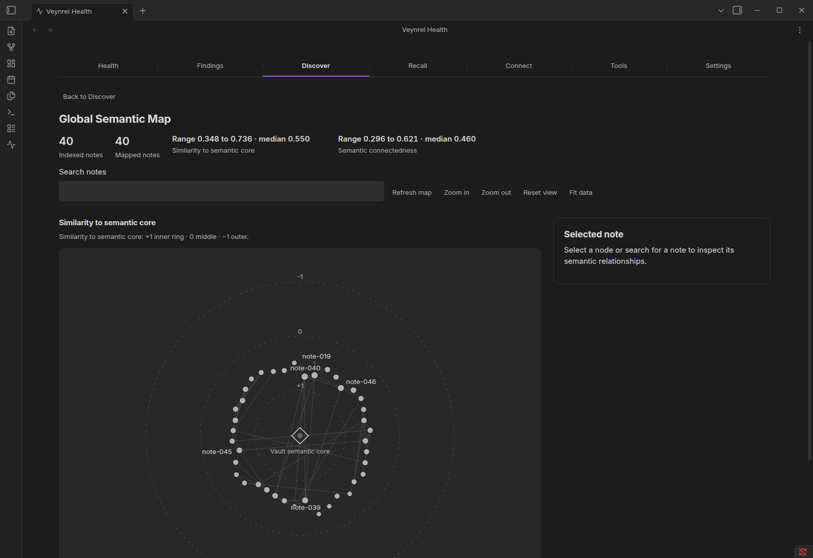
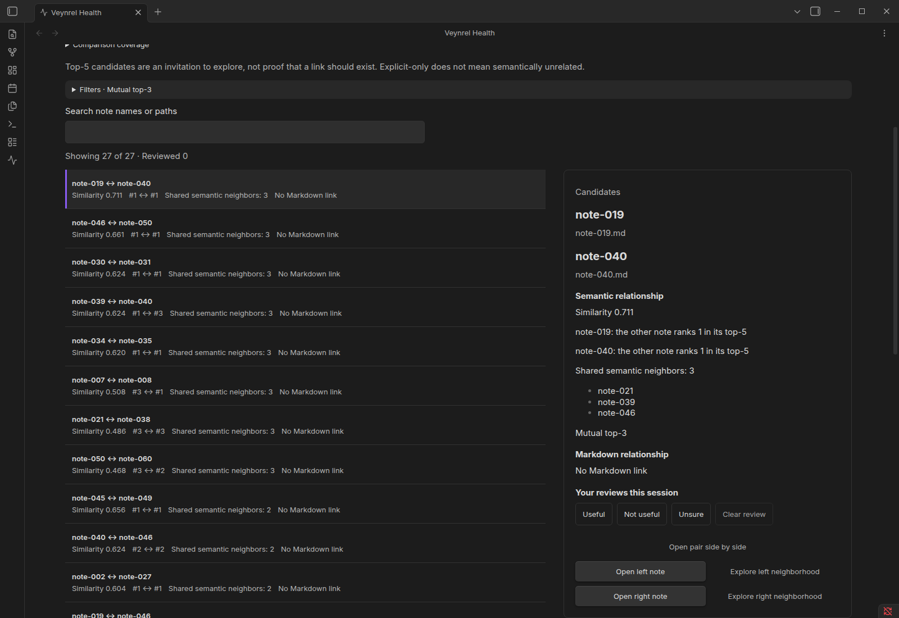
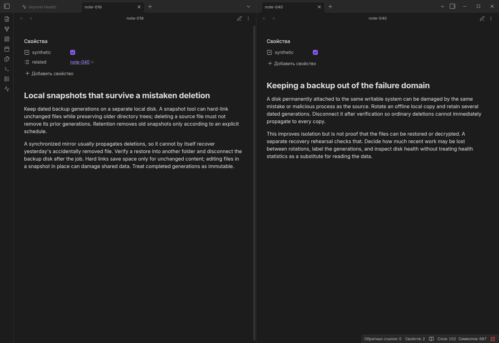

# Десять кандидатов на связь: проверяемый опыт Veynrel

Эта страница описывает исходный baseline со смешанным языковым составом.
[Русскоязычное продолжение](ru/README.md) пока находится на этапе обсуждения
пяти адаптированных заметок об архитектуре и обучении моделей;
новых результатов у него ещё нет. Это уже не сравнение только языков.

**Синтетический корпус, настоящий Obsidian, сохранённые реальные embeddings.**
На 40 учебных заметках Veynrel показал 139 пар без исходной Markdown-ссылки.
Первые десять mutual top-3 разобраны по содержимому. Одна ссылка добавлена
исследовательским сценарием в отдельную копию и проверена переходом к заметке.
Человеческая полезность и новизна этих предложений пока не измерены.

## Зачем смотреть на такие пары

Ручные ссылки показывают уже оформленные отношения между заметками.
Connection Opportunities сопоставляет их с ближайшими семантическими соседями.
Полученный Candidate — повод открыть два текста и решить, нужен ли контекст.
Плагин не создаёт ссылку автоматически.

## Что наблюдалось

Исходно: **139 Candidate, 5 Aligned, 1 Explicit-only**. Из 139 кандидатов 27
попали в mutual top-3. Взяты первые десять без перестановок; полный список и
обоснования доступны в [evidence.csv](evidence.csv).

Первой оказалась пара о датированных локальных резервных копиях и изоляции
резервного диска от общей области отказа. После чтения двух текстов в тестовый
Markdown добавили `related: [[note-040]]` в форме YAML-списка. После обновления
пара стала Aligned: итоговые числа **138 / 6 / 1**. Native-ссылка открыла адресат.

В той же десятке есть очевидное двуязычное повторение DNS/QUIC и пары, где
решения различаются: пересоздать дешёвую сборку или сохранить прогресс дорогой
конвертации. Поэтому близость не равна необходимости создать ссылку.

## Повторить

1. [Установить Veynrel](../../../README.md#installation). Для точного опыта
   использовать checkout этой исследовательской ветки и собрать plugin.
2. Выполнить `node scripts/connection-case-study.mjs /tmp/veynrel-connections-demo`
   из корня после `npm ci` и `npm run build`. Путь должен быть новым.
3. Открыть созданный vault в изолированном Obsidian. Подробный запуск, кэш,
   native-сценарий и отсутствие платных запросов — в [протоколе](experiment.md).
4. Discover → Connection Opportunities → Candidate → Mutual top-3. До любых
   изменений первая пара — `note-019` / `note-040`; в инспекторе 0.711, ранги 1/1,
   три общих соседа. Прочитать обе заметки и вынести собственную оценку.
5. Записать оценки до refresh/закрытия: Useful / Not useful / Unsure живут
   только в текущем view. Для автоматического воспроизведения всех проверок и
   одного действия запустить native-скрипт по протоколу.

## Что можно заключить

Технический путь от отсутствующей ссылки до проверенной навигации работает на
этом корпусе. Как часто он помогает человеку в его собственном хранилище,
опыт не устанавливает: все десять человеческих verdicts пока
`Requires human review`. Исходные ссылки подготовлены искусственно, а не
унаследованы из истории реального пользователя. О доходах и спросе данных нет.

Материалы: [результаты и ошибки](results.md), [протокол](experiment.md),
[исходники алгоритма](implementation-audit.md), [корпус](corpus/),
[сырые наблюдения](observations/), [проверки](validation.md),
[основа поста на Хабре](habr-materials.md).
