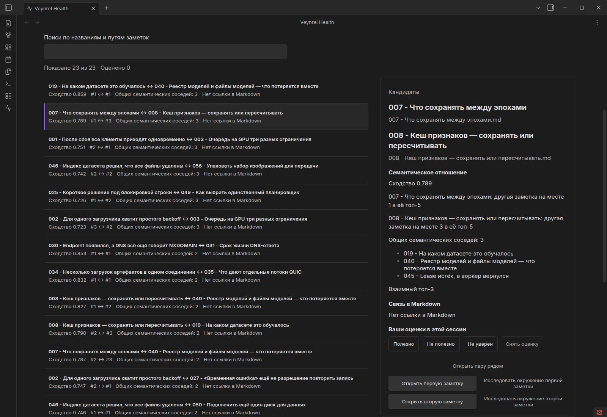
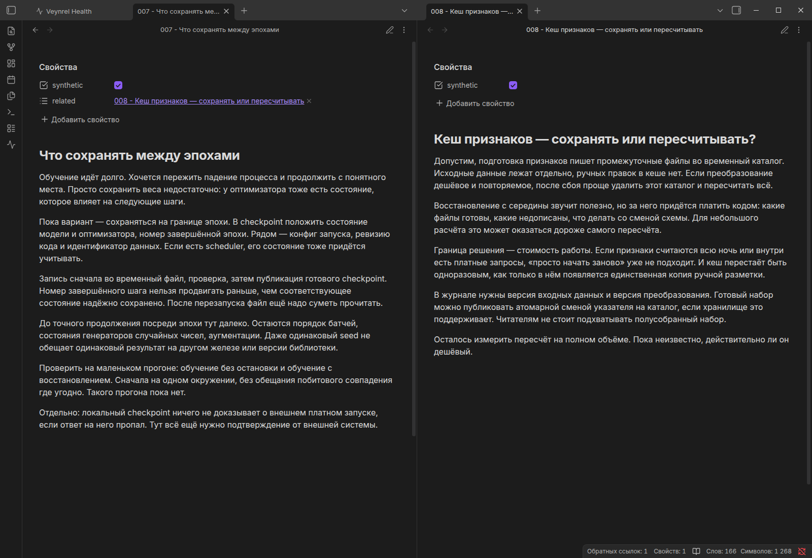

# Найденная пара и сохранённая ссылка: русский опыт Veynrel

В заметках о разных решениях бывает общий контекст, который ещё не оформлен
ссылкой. Connection Opportunities сравнивает ближайших семантических соседей
с существующими Markdown-связями и предлагает открыть пары для проверки.
Сходство само по себе не устанавливает полезность и не создаёт ссылку.

В этом опыте использованы **40 синтетических русских заметок** об архитектуре
и обучении моделей, локальная multilingual MiniLM и настоящий Obsidian.
Исходно получены **143 Candidate, 5 Aligned, 1 Explicit-only**. Candidate означает
семантическую пару без известной Markdown-ссылки, Aligned — наличие обеих связей,
Explicit-only — ручную связь вне top-5 обоих концов, а не плохую ссылку.

Из первых десяти mutual top-3 без перестановок для практического действия
выбрана RU02: «Что сохранять между эпохами» и «Кеш признаков — сохранять или
пересчитывать?». Её ранги — 1 и 3, cosine — 0.788691, общих соседей — три.
Один текст рассматривает сохранение дорогого состояния обучения, другой —
возможность пересчитать производные данные. Это технический контраст;
стоимость пересчёта в заметках ещё не измерена.

В отдельной копии vault в свойство `related` заметки 007 добавлена настоящая
ссылка на 008. MetadataCache её распознал, обновлённое сравнение показало
**142 / 6 / 1**, RU02 стала Aligned. Клик открыл именно 008. Изменилась одна
заметка, остальные 148 классифицированных пар и семантическая карта не изменились.
Результат воспроизведён на двух свежих копиях. YAML исключён из текста чанка;
из-за сдвига его позиций индексатор запросил тот же русский вектор локально.

Третий кадр показывает реальную ссылку и тексты после проверенного перехода.
Категория Aligned и текст её инспектора сохранены в [native-данных](observations/native-action.json).
«Оценено 0» на втором кадре относится к UI-сессии: ответы автора получены отдельно
и в интерфейс не вводились. С разрешения автора ниже приведены только сводка
и три кратких пересказа.

## Что решил автор

Автор оценил первые десять mutual top-3 из исходных 143 кандидатов:

- Полезность: **9 Useful, 1 Unsure, 0 Not useful**.
- Создание Markdown-ссылки: **4 Да, 4 Возможно, 2 Нет**.

RU02 автор считает полезной и создал бы ссылку: заметки дополняют друг друга.
RU04 также получила Useful, но прямую ссылку автор не создавал бы, поскольку
заметки решают разные задачи. Для полезного совпадения RU07 автор предпочёл бы
связать заметки или рассмотреть их объединение; объединение не выполнялось.

Это разрешённые пересказы, не дословные ответы. Полезность совпадения и желание
создать ссылку — разные решения. Синтетический корпус, один оценщик и
неслучайный отбор десяти mutual top-3 не позволяют считать 9/10 точностью
алгоритма или долей полезных связей среди всех 143 кандидатов. Индивидуальные
оценки остальных семи пар не публикуются. [Подробности](results.md#оценка-автора-разрешённая-сводка).

## Как повторить

1. [Установить Veynrel](../../../../README.md#installation). Для точного повтора
   собрать эту ветку по [протоколу](experiment.md), а не открывать личный vault.
2. Создать отдельный корпус командой `prepare`. Сохранённые новые русские
   embeddings привязаны к хешам текстов; платный API не нужен.
3. Запустить изолированный Obsidian, открыть «Открытия», карту и сравнение.
   Candidate → mutual top-3: RU02 — вторая строка исходного порядка.
4. Выполнить [сценарий RU02](experiment.md#воспроизведение-действия-ru02), проверить
   MetadataCache, Aligned и клик по ссылке. Каждый повтор начинается с новой копии.

## Что можно заключить

Проверена работа сопоставления двух графов и сохранение одной явной связи в
тестовом vault. Сама ссылка не является новым знанием. 143 кандидата — результат
объединения top-5, а не 143 полезные находки. Первые десять отобраны по рангу,
не случайно. Один автор оценивал синтетические заметки; оценок других людей
или личных хранилищ нет. Baseline отличается языком, содержанием и моделью,
поэтому это не языковой A/B-тест. Финансовая ценность проекта не подтверждена.

Исходные материалы: [40 заметок](corpus/), [происхождение](sources.csv),
[модель и хеши](vectors.json), [протокол](experiment.md), [результаты](results.md),
[все исходные пары](pairs.csv), [десятка](evidence.csv), [действие RU02](action.md),
[переходы категорий](action-results.csv), [проверки](validation.md),
[бриф для статьи](habr-materials.md). [Исходный baseline](../index.md) сохранён отдельно.
