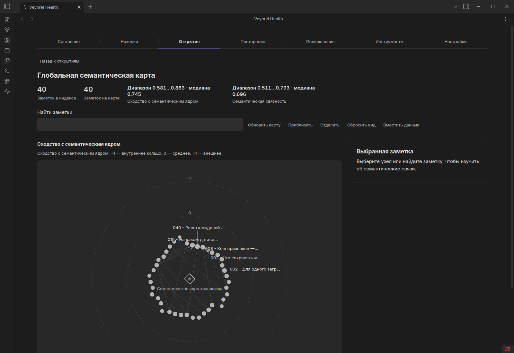
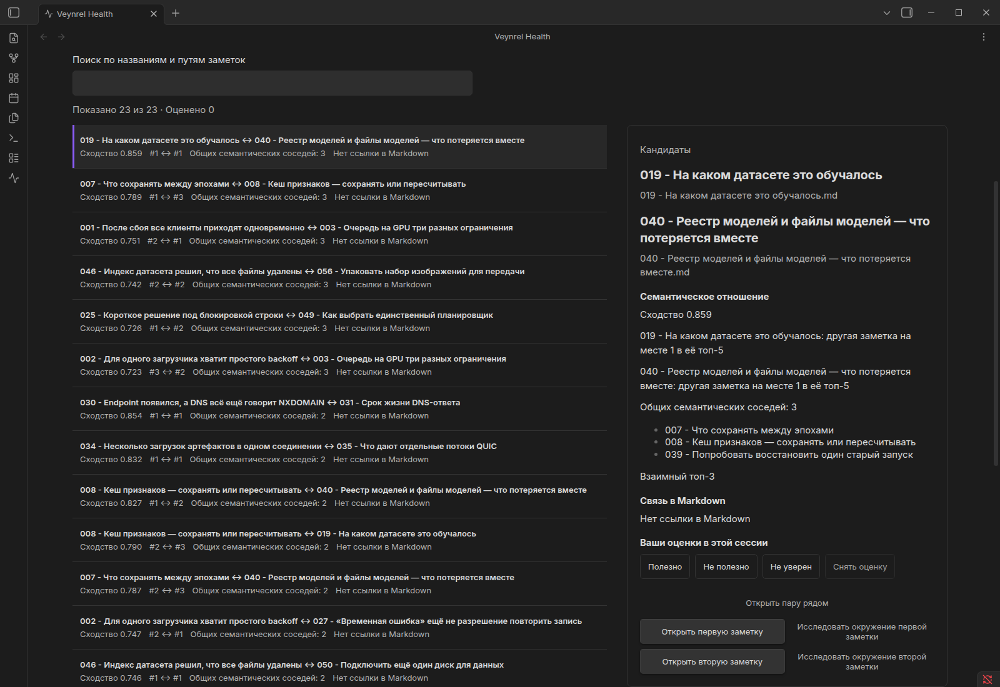

# Что предложил Veynrel для 40 русских рабочих заметок

**Техническая часть проверена; оценка человеком ещё идёт.** Это синтетический
корпус об архитектуре и обучении моделей, адаптированный из предыдущего опыта.
Задача — отделить найденное сходство от связи, которую человеку стоит сохранить.

В настоящем Obsidian получены **143 Candidate, 5 Aligned, 1 Explicit-only**.
Первые десять mutual top-3 взяты в неизменённом порядке. Есть пересечения
про восстановление обучения и пересчёт признаков, а также очевидные повторы
DNS и QUIC. Пользовательских оценок пока нет; ссылки автоматически не создаются.

Чтобы повторить: [установить Veynrel](../../../../README.md#installation), собрать
эту ветку и выполнить команды из [протокола](experiment.md). Сохранённые векторы
получены заново локальной MiniLM и привязаны к хешам русских текстов. Платный API
не нужен. В тестовом Obsidian открыть «Открытия → Открыть сравнение связей», выбрать
кандидатов и взаимный top-3. Первая пара — 019 / 040, сходство в UI 0.859.

Оценивать удобно по [десяти карточкам](review-cards.md). Полные материалы:
[40 заметок](corpus/), [источники и адаптации](sources.csv), [результаты](results.md),
[все 149 пар](pairs.csv), [техническая таблица](evidence.csv),
[сырые наблюдения](observations/), [модель и хеши](vectors.json).

Корпус, язык и модель изменены вместе, поэтому это не измерение эффекта перевода.
Практическое действие, третий снимок и окончательные выводы ждут автора.
Данных о финансовой поддержке проекта этот опыт не даёт.
