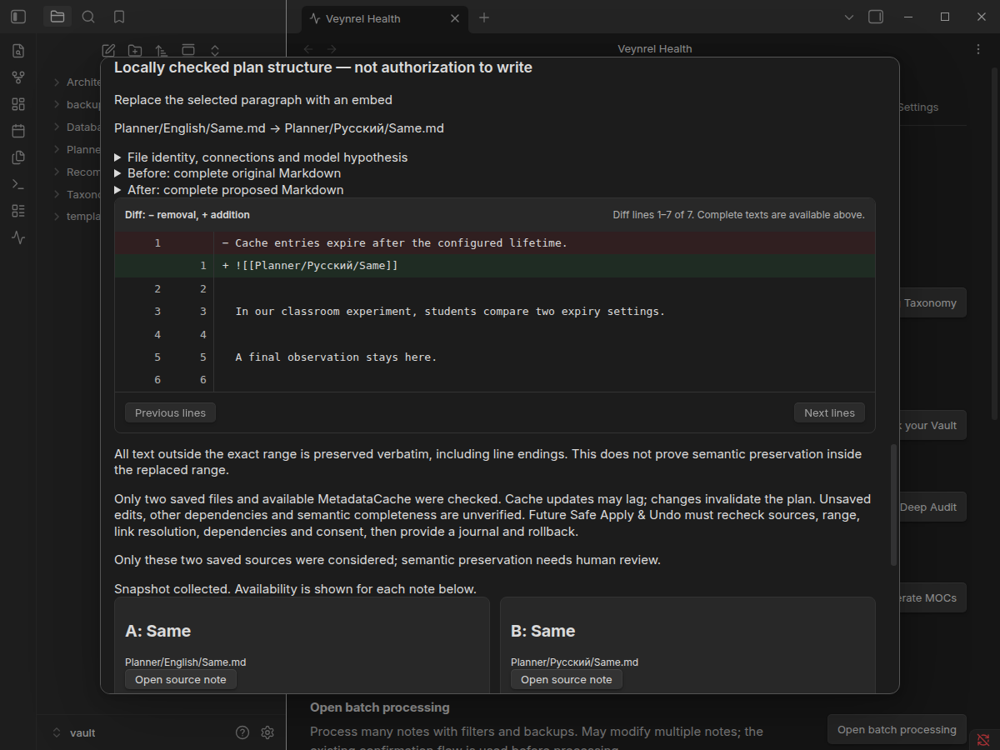
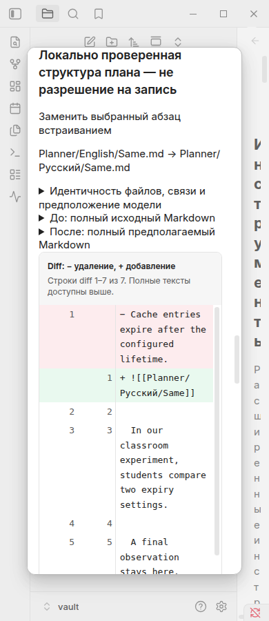

# Change Planner v1: native verification

**PASS**, Linux desktop, Obsidian package **1.13.7-2** (`pacman -Q obsidian`),
Electron **43.6.0**. A newly generated synthetic vault and isolated application
profile were used, with no real notes, credentials or paid model requests.

Branch: `feat/change-planner-v1`, from `main` at
`a0e632e91406f4f972b0e813f2c78b3ba0466b33`, after confirming PR #82 was merged.
The [machine-readable report](change-planner-evidence/native-report.json) records
all assertions, instrumentation limits and SHA-256 hashes of the production
`main.js`, `styles.css` and `manifest.json` copied into Obsidian. Those bytes were
compared with the checkout artifacts. Version remains 2.1.0.

Reproduce after `npm run build`, using a directory that does not exist:

```sh
node scripts/pair-inspector-native.mjs /tmp/pair-inspector-change-planner-fresh \
  --relationships --taxonomy --tag-recommendations --change-planner
```

The existing harness opens actual Discover → Potential duplicates → Pair Inspector.
The planner scenario uses the same inspector/controller with two extra synthetic
homonyms: `Planner/English/Same.md` and `Planner/Русский/Same.md`. They share a
paragraph; A also has a contextual classroom example and another observation.
Only Relationship Analyzer's completion dependency is replaced with a scripted
response. Planning itself has no completion dependency. The extra notes are created
**after** the taxonomy inventory assertions, preserving those fixtures' exact counts.

## Observed outcomes

- **51 Change Planner assertions passed**, plus **18 Pair Inspector**, **51
  Relationship Analyzer**, **28 Taxonomy** and **118 Tag Recommendations** checks.
- Enter activates local plan construction. Both source paths, complete saved text,
  explicit range confirmation, model provenance and limitations are available.
  RU/EN × light/dark × 1200/390 px passed overflow checks for controls, source text
  and diff. Full action and range text remains readable outside clipped select labels.
- Both ordinary link directions work across the native homonyms, using exact
  vault-relative paths and native destination resolution. No heading is created.
- The embed plan replaces only the manually chosen paragraph. The unique context
  and subsequent text remain verbatim; the diff has one removed and one added line.
- Changing a selection drops the plan and confirmation. No-change produces equal
  before/after without a diff. Cancel drops snapshots and plans; closing while a
  delayed read is pending blocks late publication. A double build reads once.
- Cache events invalidate the plan; model settings changes remove its originating
  analysis and plan. Actual saved-source changes and target renames remove results.
- Existing links, a direct embed cycle, an unreviewed target transclusion and a
  contextual example inside the replacement paragraph produce explicit refusals.
- **Zero planner provider requests, zero observed plugin Markdown writes and zero
  fetch/XHR/provider-network calls.** Every planner preparation read exactly the
  two selected notes. Fixture setup and simulated user changes use the test driver's
  filesystem operations, separate from plugin write counters. Synthetic source
  contents were also compared after the scenarios.

The old native screenshot helper now moves the pointer away before waiting for
notices: hovering an Obsidian Notice pauses its dismissal. No assertion was removed
or timeout increased. The existing main-window focus helper and settings-render
wait were also reused after language changes. The first narrow-screen trial found style scoping and long
select-label overflow; both were corrected and the full matrix rerun.

## Automated checks

- `npm test`: **3,167 tests / 126 files passed**.
- `npm run typecheck`, `npm run lint`, `npm run build`, `git diff --check`: passed.
- Lint retains only the existing reviewed streaming-fetch advisory at `api.ts:404`.
- `npm run audit:proposals`: **5/5 mutations killed**, restored tests passed.
  The sandbox run returned empty child Vitest output; the unchanged command passed
  outside the sandbox. Proposal/application sources were restored and unchanged.
- One concurrent full-suite attempt hit an existing 5-second taxonomy import timeout;
  a standalone full-suite rerun passed without changing any test timeout or assertion.

Unit tests additionally cover frontmatter/code/headings/lists/tables/HTML/unknown
sections, embeds/block IDs/link references, unsafe target tokens, unavailable cache,
partial ranges, repeated identical text, exact selected occurrences, CRLF, silent
content/path/stat/identity changes, removed targets, read failures, and whole-source
clearing after read errors. Existing Decisions and consolidation regressions remain
in the full suite.

## Screenshots

All captures are native Obsidian with the standard themes, not browser mockups.
Scripted model prose intentionally remains English under the Russian host UI.

| Locale | Light 1200 | Dark 1200 | Light 390 | Dark 390 |
| --- | --- | --- | --- | --- |
| RU | [View](change-planner-evidence/planner-ru-theme-light-1200.png) | [View](change-planner-evidence/planner-ru-theme-dark-1200.png) | [View](change-planner-evidence/planner-ru-theme-light-390.png) | [View](change-planner-evidence/planner-ru-theme-dark-390.png) |
| EN | [View](change-planner-evidence/planner-en-theme-light-1200.png) | [View](change-planner-evidence/planner-en-theme-dark-1200.png) | [View](change-planner-evidence/planner-en-theme-light-390.png) | [View](change-planner-evidence/planner-en-theme-dark-390.png) |

[RU range confirmation](change-planner-evidence/planner-ru-selection.png) ·
[EN range confirmation](change-planner-evidence/planner-en-selection.png) ·
[RU full before/after](change-planner-evidence/planner-ru-before-after.png) ·
[EN full before/after](change-planner-evidence/planner-en-before-after.png)




## Limits of the evidence

Fake model responses verify contracts and UI, not semantic classification quality
or preservation of information inside a deleted range. Native counters cover
fetch/XHR and explicit fake provider dependencies, not global `requestUrl` traffic;
unit tests separately check provider dispatch boundaries. No real paid calls were
made. Linux desktop widths are not physical mobile acceptance. Other operating
systems, mobile devices, popouts, screen readers and custom themes were not tested.

There is no writer, operation journal or undo implementation. MetadataCache may lag;
other dependencies and unsaved editor buffers are unverified. See the explicit
[Safe Apply & Undo prerequisites](change-planner-v1.md#deferred-safe-apply--undo).
