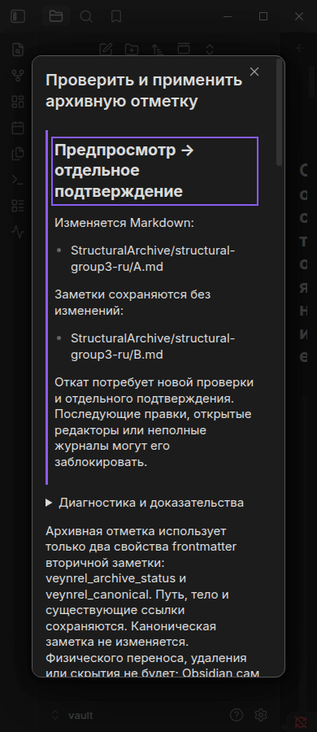

# Unified Consolidation UX v1 — acceptance evidence

Final native status: **PASS**, 2026-10-20. See [completion-status.json](completion-status.json).
All six suites used the identical production artifact
`50b53c5b2a32a5ad482aee6ef625b94f38e712e51c38dbf33cb8e9de1965314d`.

| Suite | Result | Base + suite assertions | Original report |
| --- | --- | --- | --- |
| merge-archive | PASS | 18 + 58 | [merge-archive-report.json](merge-archive-report.json) |
| ux | PASS | 18 + 48 | [ux-report.json](ux-report.json) |
| single | PASS | 18 + 25 | [single-report.json](single-report.json) |
| multi | PASS | 18 + 39 | [multi-report.json](multi-report.json) |
| structural | PASS | 18 + 172 | [structural-report.json](structural-report.json) |
| empty-atom | PASS | 18 + 168 | [empty-atom-report.json](empty-atom-report.json) |

UX, Single, Multi and Merge Archive reports were retained from their successful
final runs and were not repeated. Structural Archive was interrupted after twelve
cycles; its full host rerun passed 172 assertions, including RU popout. Empty Atom
completed on a separate new synthetic vault. Both new runners exited 0.

`recovery-status.json`, `blocked-*` and `structural-interrupted*` preserve the earlier
incomplete snapshot and failed environment starts. They are superseded by the new
completed reports, not relabelled as product PASS. Exit 143 alone was not treated as
an implementation failure. Electron sandbox errors occurred before product checks;
authorized execution on the native host worked without weakening the sandbox.

The prior full unit suite passed (4455 tests / 162 files). The final test-only edit
passed 24 focused tests. ESLint completed after the interrupted process with zero
errors and the existing approved fetch warning. Typecheck/build and the proposal
audit (all five mutations killed, restored baselines passed) retain their evidence.
Public executors and journal formats are unchanged.

The four older native runs retain reports; their temporary vaults/screenshots did
not survive the interruption. The PNGs committed here are from the two new host runs:
pair inspector, archive review/diff/Undo, editor refusal, Empty Atom and incomplete
recovery history. RU/EN, both built-in themes and 1200/390 px are covered. These are
synthetic Linux desktop captures, not physical mobile acceptance.

Examples:

| Screen | English | Russian |
| --- | --- | --- |
| Pair inspector | [Light, 1200](inspector-en-theme-light-1200.png) | [Dark, 390](inspector-ru-theme-dark-390.png) |
| Structural archive review | [Light, 1200](structural-group3-en-theme-light-1200.png) | [Dark, 390](structural-group3-ru-theme-dark-390.png) |
| Exact YAML diff / Undo | [YAML diff](structural-group3-en-diff.png) | [Separate Undo](structural-group3-ru-undo.png) |
| Empty Atom review | [Light, 1200](empty-atom-en-theme-light-1200.png) | [Dark, 390](empty-atom-ru-theme-dark-390.png) |
| Editor refusal | [Popout](editor-en-true.png) | [Popout](editor-ru-true.png) |

No real-vault, screen-reader, custom-theme, other-OS or live paid-provider acceptance
is claimed. Network instrumentation covers fetch/XHR and synthetic provider factories,
not system-wide traffic or requestUrl. Checksums cover all files in this directory.
`source-snapshot.json` is the earlier recovery snapshot; `delivery-source-snapshot.json`
records the final source and documentation. GitHub CI belongs to the exact PR commit
and is reported on the PR, independently of these native artifacts.
