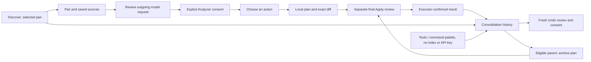

# Unified Consolidation UX v1

## Baseline and UX decision (before implementation)

Base: `main` at `292a81e00b2f6c5210f5d172bc6c4798b098d042`. PRs #100, #101 and #102 are merged and their merge commits are ancestors of this base.

Before: Discover opens the pair inspector; explicit Analyzer consent produces a result; a separate button opens a planner with a flat operation select. Each executor has its own final modal. History is available through the command palette, Tools and the inspector, but lists journal families separately. Archive records are visually detached from parents. Some action labels still describe Group/Bundle as plan-only. Long source/provenance panels obscure the next step.

The smallest coherent change keeps these owners and their tickets. It adds grouped human-readable action choices, a shared review summary, and a history presentation that nests an archive under its exact typed parent. Existing planners continue to determine eligibility; the UI never derives permission from a model recommendation or from visual grouping.

UI categories map to existing operations: link notes (Single link/embed, Multi reciprocal links); copy information (Merge paragraphs, Group heading branch, Bundle with context); extract knowledge (read-only Atomization Preview separately from writing to an existing empty note); archive only from eligible completed parent history; leave unchanged. Nothing is preselected from model output. Unsupported selections retain the existing planner's exact refusal.

Review presents changed and preserved note paths, literal Before/After and diff, existing scope/limitations and conditional Undo. Hashes, record IDs and raw journal details remain available in collapsed diagnostics. The final modal stays separate from local planning and model consent.

History groups only records with an exact typed immutable parent match. A claimed but unverified relationship stays separate and is labelled as unverified. UI grouping never grants Undo. All actions call existing services for a new review. Existing journal timestamps describe preparation, not necessarily execution: show them as preparation times rather than inventing completion times.

## Implementation and validation

### Scope and architecture

`consolidationActions.ts` provides the grouped native select and consequences. `consolidationUx.ts` contains presentation-only summaries, diagnostics and focus handling. `consolidationHistory.ts` groups exact typed parent records; it does not calculate Apply/Undo permission. `ReviewLifetime` revokes an unconsumed review on vault, MetadataCache and workspace changes. The eight executor families, serialized formats, receipt validation, recovery and identity checks are unchanged.

Final reviews remain separate modal instances. Closing or cancelling discards their service ticket immediately. Navigation and the parent refresh wait for the pending review/dispatch to settle, avoiding a recursive or competing acquisition of the shared execution owner. Cancelling an archive review leaves its read-only planner open and does not refresh the lower history; returning through the result's History action closes the planner and refreshes history. History loads families sequentially, abandons stale generations between reads and prevents overlapping Refresh. It never subscribes an automatic retry. A lower history cannot take focus away from the active child modal.

For Single/Multi/Merge/Group/Bundle/Archive v1, event listeners detach when consent is dispatched; the existing executor continues every validation during writing. This prevents its own successful write from replacing the result with a spurious stale error. Empty Atom and Structural Archive retain their executor-specific lifetime handling. Success is rendered only after the executor resolves. A failed or interrupted execution is not relabelled as success.

### Supported routes

| Choice | Existing owner | Effect and limitations |
| --- | --- | --- |
| Link one note | Single Apply | Adds the reviewed link; other note stays unchanged. |
| Link both notes | Multi Apply | Two checked writes; partial completion and its existing recovery actions remain visible. |
| Replace with an embed | Single Apply | Exact selected replacement; disabled when the existing analysis-direction rule does not permit it. |
| Copy paragraphs | Merge | Literal selected ranges into canonical; secondary preserved. |
| Copy a heading branch | Group | Existing supported heading/context selection; unsupported structures retain planner refusal. |
| Copy a contextual bundle | Bundle | Existing Code/List/Quotation with approved context. |
| Preview an atomic note | Atomization Preview | Read-only; never an Apply control. |
| Write an atomic note | Empty Atom Apply | Only an existing eligible empty destination; source notes preserved. |
| Mark archived | Merge Archive v1 / Structural Archive v2 | Offered from a completed eligible parent in history; in-place YAML edit, no move/delete/hide. |
| Leave unchanged | Existing no-change plan | No Markdown or journal writes. |

Availability in the menu is not authorization. Selecting ranges, direction or dependencies can still produce a precise planner refusal. Unknown refusal reasons are stated as unknown instead of incorrectly blaming an open editor. The existing model recommendation is advisory and never selects an action. The outgoing request preview and model consent remain explicit. History is independently available from Discover, Tools and the existing command ID `consolidation-operation-history`, including without a semantic index or API key.

### UI states and consent

| State | User-facing behavior | Next transition |
| --- | --- | --- |
| Pair / empty or unavailable source | Exact paths, saved source disclosures, explicit limitations | Refresh or open source; no automatic analysis |
| Model request preview | Exact outgoing payload and separate confirmation | Confirm or cancel |
| Waiting for model | Existing running state and cancel | Result, error or cancellation; no hidden retry |
| Model error / cancelled | Explicit status; late result cannot recreate consent | New explicit analysis |
| Choosing an action | Empty grouped select, human consequence, availability disclosure | User chooses direction and exact ranges |
| Read-only preview | Literal content and limitations; labelled as read-only | Change choice or close |
| Ready write plan | Exact before/after/diff and preserved information | Separate final review |
| Checking / final review | Existing fresh service review; never creates journal | One-use confirmation or cancel |
| File/cache/editor change | Review revoked; stale status; no old confirmation button | Replan or explicitly refresh history |
| Applying / undoing | Working status in active modal; double dispatch blocked | Executor result only |
| Complete | Confirmed result and history navigation | Fresh separately confirmed Undo if service permits |
| Incomplete / damaged / conflicting | Existing recorded state, surviving evidence and manual recovery warning | Only actions returned by the existing safe service |
| Empty history | Explicit empty state and Refresh | Close or refresh; no writes |

Every checkbox starts unchecked. Changing selections, closing a modal or stale asynchronous work invalidates the old choice. The full Markdown remains available in native disclosures; the precise diff is visible without expanding them. SHA-256, operation IDs and journal diagnostics stay accessible but collapsed. Plan/record fields are rendered literally; the UI does not reconstruct edits or dependencies heuristically.

### History and Undo chains

Related records are shown as one parent with its archive below. Both the journal family and complete immutable parent record must match. Damaged, missing or mismatched claims remain separate with an explicit unverified-parent warning. Multiple archive claims receive a conflict warning. Visual nesting never grants eligibility and never hides journal damage. Parent actions are still obtained from the authoritative services.

The displayed sequence is `Copy → Archive mark → Archive Undo → Parent Undo`, for both Merge and Group/Bundle. An active archive displays the reason the parent Undo must wait. A completed archive is retained as evidence and does not invite another archive from that parent row. Incomplete restoration evidence never gains an Undo button through grouping. The original narrow timestamp exception and receipt chain validation are unchanged.

Record `createdAt` is labelled **Prepared**, not execution time. Existing receipts generally contain file metadata rather than an independent execution timestamp; no completion time is invented from `mtime`. If a service cannot establish a specific reason for an unavailable Undo, history says so and asks for a fresh check after resolving the conflict.

### Validation and real-vault boundary

Tests include the actual safe services for Group/Bundle Archive Undo → History → Parent Undo, exact typed Merge/Group/Bundle parent-record grouping, no automatic model selection, read-only navigation, deferred review/refresh races, archive cancel/reopen, late results and consent revocation.

The native harness uses actual Obsidian 1.13.7 / Electron 43.6.0 on Linux, a fresh vault and isolated profile per suite, real `Vault.process`, on-disk snapshots and owned-process SIGKILL. Model responses are local synthetic fixtures reached only after explicit outgoing-data consent. Screenshots cover RU/EN, both built-in themes and 1200/390 px. Network counters cover fetch/XHR and the fixture provider factories; they are not a system-wide traffic capture or `requestUrl` instrumentation.

During acceptance, cancellation of the Archive final review exposed a competing history-read race; the fix and a real-service regression are included. An older native negative test attempted to click a confirmation which the new UI had already revoked; it now asserts visible revocation and attempts the saved detached button, verifying zero writes. Full-source native checks explicitly expand the new disclosures before comparing every literal before/after string. These updates retain the original safety assertions.

Initial concurrent test/tool runs exceeded some 5-second unit timeouts. The complete final suite runs with four workers and unchanged test timeouts/assertions. The proposal mutation audit's child Vitest emitted no output inside this sandbox; the unchanged audit passed outside it, killing all five mutations and passing each restored baseline.

This is synthetic-vault acceptance. Remaining checks before release: user comprehension on representative real notes, realistic large histories, screen-reader use, custom themes/editors and other operating systems. A 390 px desktop window is not a physical mobile test. Known dependencies retain the planners' completeness limits; no new promise of semantic completeness or exhaustive incoming links is introduced.

### Final acceptance — 2026-10-20

All six native suites passed on the same production artifact. The final two runners
exited 0 on the native host. The four already completed suites were not repeated.

| Check | Evidence and actual outcome |
| --- | --- |
| `npm test -- --maxWorkers=4` | PASS: 4455 tests / 162 files. Successful full run retained; final test-only edit also passed the focused 24-test suite. |
| `npm run typecheck` | PASS: both tsc checks in the lint chain, before production build. |
| `npm run build` | PASS: reproduced the exact artifact installed in every completed native run. |
| `npm run lint` | Typecheck/build passed; the original ESLint process was interrupted (143). The unchanged remaining `node scripts/lint-obsidian.mjs` check then exited 0: no errors, one existing approved `api.ts` fetch warning. |
| `npm run audit:proposals` | PASS outside sandbox: 5/5 mutations killed; every restored baseline passed. Original successful tool output retained. |
| `git diff --check` | PASS. |
| Native Unified UX | PASS: 48 suite assertions + 18 base inspector assertions. Actual Discover → consent → plan → Apply → same-history Undo; cancellation, late result, errors, corrupt journal, focus and no hidden writes/requests. |
| Native Single | PASS: 25 + 18 assertions; link/embed, Undo, editors and interruption/recovery. |
| Native Multi | PASS: 39 + 18 assertions; complete cycle, partial recovery, competing tickets and corrupt scope. |
| Native Merge Archive | PASS: 58 + 18 assertions; Merge → Archive → restart → Archive Undo → restart → Merge Undo and negative/recovery cases. |
| Native Structural Archive | PASS: 172 + 18 assertions; twelve RU/EN H1/H2/H3 and Code/List/Quotation cycles, both originals restored, changed secondary mtime, all four main/popout refusal cases. |
| Native Empty Atom | PASS: 168 + 18 assertions; RU/EN paragraph/conditional/H1/H2/H3, separate Apply/Undo, editors/popouts, stale source/target/cache, competing tickets and nine actual SIGKILL points. |
| GitHub CI | Runs against the published PR commit; exact-head results are reported on the PR. |

The validated production SHA-256 is
`50b53c5b2a32a5ad482aee6ef625b94f38e712e51c38dbf33cb8e9de1965314d`.
[Reports, screenshots, source snapshots and checksums](consolidation-unified-ux-v1-evidence/README.md)
are committed with this change.

The interrupted Structural run had twelve completed cycles but no final report.
Exit 143 and its GPU-process log were not treated as proof of a product defect.
Sandbox-only retry attempts failed before any product assertion; authorized execution
on the native host completed both remaining suites without a sandbox workaround.
The earlier incomplete and blocked evidence is retained, explicitly superseded by
`completion-status.json`. No product changes were needed during this final recovery.

The four older suites retain their completed reports; their temporary vaults and
screenshots were unavailable after interruption. Committed screenshots come from
the two fresh host runs and cover the pair inspector, archive review/diff/Undo,
Empty Atom, editor refusal and incomplete recovery history in RU/EN, both built-in
themes and 1200/390 px. They are narrow desktop tests, not physical mobile tests.
All owned native runners exited; no automatic journal cleanup or recovery ran.
