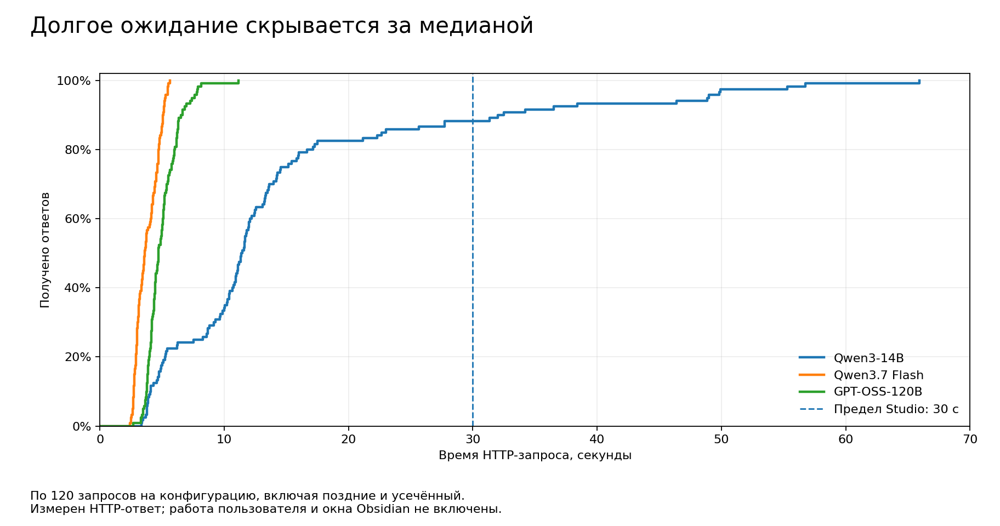

# Приложение: разметка, человеческая проверка и ожидание

Исходный [корпус 360 запусков](https://github.com/zinverno/veynrel/tree/8669fb301dba9dcbd8233e48353f67ff5901451a/docs/experiments/studio-20261101) не изменялся. Это дополнение к нему. Приведённые здесь цифры не являются результатами новых обращений к моделям.

## Как выбраны ответы

Из 359 полных ответов случайно выбраны по два из каждого из 18 сочетаний задачи, варианта и модели. Ещё четыре сочетания выбраны случайно, из каждого добавлен один ответ. Порядок перемешан, прежние оценки при отборе не использовались. Это стратифицированная выборка, а не простая случайная выборка из всего корпуса.

Первую форму читал автор продукта. Названия моделей, провайдеров, прежние метки и технические статусы были скрыты; вариант входа и стиль ответа оставались видны. Первоначальная выгрузка содержит 32 полностью заполненные карточки из 40. После обсуждения расхождений автор дополнил пустые поля, добавил пояснения и изменил две отметки о пропусках. Уточнение не является новой независимой слепой проверкой.

SHA-256 выборки: `98880b6d5e6b8288f8ad509d5901b17ae534d74f64c9a78950b0e501cf27f0a2`.

В [human-review-decisions.json](human-review-decisions.json) сохранены номера ответов, исходные метки, первые и уточнённые человеческие решения. Личные комментарии в публикационную проекцию не включены. Смысловые оценки всего корпуса поставлены ассистентами `gpt-6-astra` / OpenAI / `xhigh`, которые видели названия оцениваемых моделей.

## Совпадения и направление расхождений

| Признак | Совпало после уточнения | Человек: «Спорно» | Ассистент: «Да», человек: «Нет» | Ассистент: «Нет», человек: «Да» |
| --- | ---: | ---: | ---: | ---: |
| Пропуски | 26/40 (65%) | 8 | 5 | 2 |
| Подмена меры | 26/40 (65%) | 12 | 2 | 0 |
| Добавления | 34/40 (85%) | 2 | 2 | 0 |
| Потеря времени | 14/20 (70%) | 5 | 0 | 2 |
| Потеря ужина | 18/20 (90%) | 1 | 0 | 1 |

Последние два столбца показывают только однозначные разногласия; случаи с «Спорно» туда не входят. Сравнение человеческого решения с ассистентом не устанавливает автоматически, какая сторона права.

**Все 34 совпадения по добавлениям были «Нет / Нет».** На двух ответах, где ассистенты поставили «Да», человек выбрал «Нет». Положительных совпадений в выборке нет; оставшиеся четыре расхождения включают «Спорно» с одной из сторон. Общие 85% не подтверждают обнаружение добавлений и не являются точностью классификатора. На положительном классе состоялось только два сравнения и оба закончились разногласием; это не отсутствие проверки вообще, а отсутствие подтверждённых положительных совпадений.

В уточнении остаются прямые расхождения с текстом: у R29 перед таблицей есть «Дата: сегодня (дата не записана)», но человек отметил потерю времени; у R10 есть «Ужин: Пропущен», но человек отметил отсутствие ужина. В некоторых комментариях неудобное расположение сведений трактуется как их потеря или подмена меры. Исходные решения сохранены; автоматического исправления человеческих меток не делалось.

## Исходные категории ошибок

| Задача / конфигурация | Полных ответов | Пропуски | Подмена меры | Добавления |
| --- | ---: | ---: | ---: | ---: |
| Тренировка / Qwen3-14B | 60 | 56/60 | 0/60 | 0/60 |
| Тренировка / Flash | 60 | 7/60 | 0/60 | 0/60 |
| Тренировка / GPT-OSS | 60 | 49/60 | 0/60 | 0/60 |
| Питание / Qwen3-14B | 59 | 26/59 | 1/59 | 9/59 |
| Питание / Flash | 60 | 0/60 | 0/60 | 20/60 |
| Питание / GPT-OSS | 60 | 38/60 | 22/60 | 1/60 |

Это неизменённые метки ассистентов, а не человечески подтверждённые частоты. Категории пересекаются. Суммируются три варианта каждой задачи. Один усечённый ответ исключён, полные поздние ответы включены. [Разбивка по 18 условиям](errors-by-cell.csv) и [по типам](errors-by-type.csv).

Все 23 ответа с исходной меткой подмены меры (22 GPT-OSS, один Qwen) не прошли отдельную человеческую приёмку. Колонка убрана из основной статьи; утверждать её подтверждение по общей выборке нельзя. «Яблоко» → «1 шт.» — вывод из грамматического числа, который можно считать допустимым либо неподтверждённым; он отличается от придуманного объёма супа 250–300 мл. Эти оценки нельзя объединять с пропущенным ужином без описания правил.

## Поиск времени

Поиск `\bсегодня\b` без учёта регистра на 60 чистых тренировочных ответах даёт отсутствие в 19/20 Qwen, 2/20 Flash, 4/20 GPT-OSS. Это буквальная метрика. Из 120 ответов на тренировочные входы **с цитатой** исходная разметка отмечает потерю времени в 73: Qwen 36, Flash 2, GPT-OSS 35. В 37 из этих 73 ответов буквальное слово «сегодня» присутствует (17, 2 и 18 соответственно), но относится к чужой цитате по исходным оценкам. Проверка только наличия слова пропустила бы 37/73 = 50,68% отмеченных потерь. Это совпадение с исходной контекстной разметкой, а не новая человеческая оценка. [Построчный пересчёт](temporal-intersection.csv).

## Ожидание

График перенесён из предыдущего пакета без изменения исходных частот. PNG и [SVG](latency-distribution.svg) относятся к историческим попыткам с пределом Studio 30 секунд.

| Конфигурация | Попыток | Цена USD | Медиана HTTP, с | p95, с | Максимум, с | Принято Studio |
| --- | ---: | ---: | ---: | ---: | ---: | ---: |
| Qwen3-14B / DeepInfra | 120 | 0.02515272 | 11.40 | 48.86 | 65.92 | 106/120 |
| Qwen3.7 Flash / Alibaba | 120 | 0.005264296 | 3.60 | 5.23 | 5.65 | 120/120 |
| GPT-OSS-120B / Near AI | 120 | 0.00886710 | 4.71 | 7.40 | 11.14 | 120/120 |

Использованы все HTTP-попытки, включая поздние и усечённые. Квантили: NumPy linear. Время измерено посредником от отправки до полного ответа, а не в окне Obsidian. [CSV](latency-tail.csv).

Все 14 непринятых Qwen-запросов завершились таймаутом Studio. Позднее пришли 13 полных текстов и один ответ `qwen-C-quote_control-09` с `finish_reason=length` через 32.507 с. Хотя длительности всех четырнадцати HTTP-запросов меньше 90 секунд, более длинный предел не устраняет усечение и не доказывает, что будущие запросы будут успешны. Старые статусы не изменены. Эти исторические строки не являются результатом испытания 2.3.1; отдельная локальная проверка исправления описана ниже.

### Локальная проверка выпущенной 2.3.1

В [Veynrel 2.3.1](https://github.com/zinverno/veynrel/releases/tag/2.3.1) Markdown Studio ждёт до 90 секунд. Выпущенный код: [`cd9e8fc4048b4a17d0dc68993bd8b340d9da4720`](https://github.com/zinverno/veynrel/commit/cd9e8fc4048b4a17d0dc68993bd8b340d9da4720). Публичные assets скачаны без авторизации и побайтно сверены со сборкой этого merge SHA; `SOURCE_COMMIT` указывает на тот же исходник.

Все 14 сохранённых Qwen-случаев воспроизведены локально: из видимого текста и `finish_reason` восстановлены синтетические HTTP-envelopes, записанные задержки отыграны fake timers через текущий парсер API и Markdown runner. Получены 13 полных результатов `generated` и один `incomplete`: доступный фрагмент с предупреждением и копированием, без Apply/замены исходника и штатного создания заметки. Это проверка обработки сохранённых данных, а не новые ответы провайдера или новая оценка качества. [Построчный результат и хеши](https://github.com/zinverno/veynrel/blob/cd9e8fc4048b4a17d0dc68993bd8b340d9da4720/docs/release-2.3.1-evidence/replay.json).

Автоматические проверки: 5 230 тестов, typecheck/build/lint и mutation audit 5/5. В отдельном синтетическом vault настоящего Obsidian loopback-проверка прошла 46 утверждений, включая реальные задержки 66 и 33 секунды, RU/EN-копирование, запрет записи неполного ответа, отмену, историю и Undo. [Методика, границы и native-кадры](https://github.com/zinverno/veynrel/blob/cd9e8fc4048b4a17d0dc68993bd8b340d9da4720/docs/release-2.3.1-verification.md). Вызовов внешних моделей не было. Исторические 106/120 и 14 timeout сохранены без изменений.

## Не выполнено

Контроль старой инструкции питания и варианты с русской формулировкой времени или обязательной строкой «Время:» не выполнялись. Их эффект неизвестен. Новых запросов и расходов при подготовке приложения нет. Для текущей комбинации Qwen / питание / инъекция имеется 0/20 по первоначальным меткам; односторонняя точная верхняя 95%-граница — `1 - 0.05^(1/20) = 0.13910834` при независимых попытках, постоянной вероятности и верной классификации.
