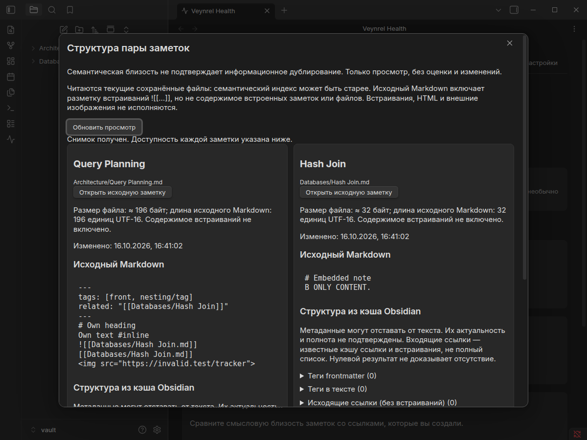
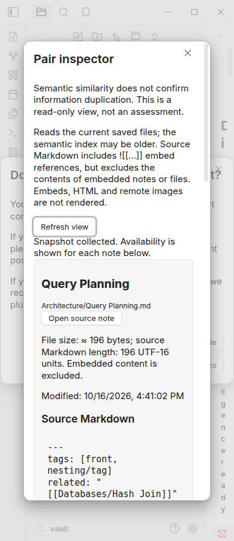

# Read-only Pair Inspector

Open **Veynrel → Discover → Potential duplicates**, then choose **Inspect structure**
(RU: **Изучить структуру**) on a pair. The existing duplicate list still needs a
usable local semantic index. Pair Inspector needs neither Decisions nor an API key
and makes no embedding or LLM requests. Semantic similarity does not establish
information duplication.

Each side shows the basename and full vault-relative path, current saved Markdown,
approximate file size, source length in UTF-16 units and modification time.
**Open source note** uses the existing exact-path Obsidian navigation;
**Refresh view** explicitly reads both files again. Closing discards the view.
Unsaved editor buffers and comparison against the original index are outside this view.

The preview is literal text, not rendered HTML or Markdown. `![[B]]` remains an
embed reference: B's content is never read through A, added to A's size or claimed
as A's authored text. HTML, images, embeds and Markdown postprocessors cannot
execute in this preview. The file itself includes frontmatter, markup and links;
its length is not a measure of original ideas or authorship.

## Ownership and reuse

- `semantic/semanticDiscoveryModal.ts`: one additional explicit pair action;
  existing similarity results, source navigation and Decisions action are preserved.
- `ObsidianSemanticController.inspectPair`: opens the window without consulting
  Decisions or initializing a semantic runtime.
- `consolidation/pairSnapshot.ts`: `isCanonicalMarkdownPath`, exact-path `TFile`
  lookup and `Vault.read`. Two selected files only; no vault Markdown enumeration,
  custom parser, persistent index, network client or write API.
- Obsidian `getFileCache`, `parseFrontMatterTags` and `resolvedLinks`: frontmatter
  and inline tags, ordinary links, frontmatter references, embed references,
  headings, block IDs, property names, sections and known incoming source paths.
- `PairInspectorModal`: the existing generation/close pattern from discovery
  modals, `openDiscoveryResult`, theme variables, card styling and RU/EN i18n.

`OverlapSession` is deliberately not reused: it owns provider settings, fragment
preparation and paid assessment. Connection Opportunities owns a comparison of
published semantic/topology snapshots, not source text. Deep Audit and
`NoteIndexManager` own model-derived summaries and persistence; neither is a
source of current authored text or needed for this inspector.

## Availability and bounds

The current saved file is read on every open/refresh, even when semantic results
are older. A file deleted, moved, replaced or modified while being read produces
an explicit per-note state. The other side remains available. No basename fallback
is used. Read errors omit system error details.

Metadata is a separately labelled cache observation. The public cache API does
not provide a source revision that proves it matches the read text. Cache freshness
and completeness are therefore **unverified**, including when a list is empty.
Incoming references use positive `resolvedLinks` entries with still-existing source
paths; they may include embeds and do not establish complete backlink coverage.
Unavailable caches are shown as unavailable, not zero.

Any vault create/modify/delete/rename or metadata changed/resolved event invalidates
the view without reading anything. Explicit refresh is required, including when
an unrelated file changes (it could affect incoming references). A pending read
cannot publish after invalidation, a newer refresh, close or reopen. Event listeners
are removed on close.

The source preview is limited to 12,000 UTF-16 units, preserving a surrogate pair
at the boundary. Each metadata list shows at most 100 entries, with at most 500
units per displayed entry. Truncation is labelled. `Vault.read` still reads each
selected file in full; this bounds display, not memory needed for reading huge files.
There is no claim of a full note assessment.

## Validation

Focused snapshot/modal/controller tests cover distinct exact paths, frontmatter and
inline tags, embeds versus own source, empty/long text, missing/mutating files,
unknown caches, close/reopen, refresh races, listener cleanup, no automatic reads,
no Markdown writes or network requests, and the independent Decisions action.
The existing Decisions and semantic discovery suites remain regression gates.

Verified on 2026-10-16: **2,935 tests / 116 files**, `npm run typecheck`,
`npm run lint`, `npm run build`, and `git diff --check` passed. Lint reports only
the previously reviewed `api.ts` streaming-fetch advisory.

The [native report](pair-inspector-evidence/native.json) records an isolated Linux
Obsidian run (installed package 1.13.7-2, Electron 43.6.0), with synthetic vectors
from the existing fixture and the real Discover/discovery engine. It covers
Decisions disabled, current native cache tags/backlinks, literal embeds/HTML,
RU/EN, light/dark, 1200/390 px, exact source navigation, stale/refresh/deletion,
reopen and close during a pending read. Native write counters stayed at zero;
fetch/XHR and Decisions/Rerank factory counters stayed at zero. `requestUrl` is
checked in unit tests, not instrumented in the native harness.

To reproduce with the installed Linux `/usr/bin/electron43` and
`/usr/lib/obsidian/app.asar`, run `npm run build`, then
`node scripts/pair-inspector-native.mjs /tmp/pair-inspector-fresh-name` in a desktop
session. The output directory must not exist. It creates only a disposable
profile/vault and writes its report/screenshots there. No live or paid provider
is used. A narrow desktop viewport does not verify physical mobile; other OSes,
screen readers, popout windows and custom themes were not tested.

## Later work

No classification, editing, merge/delete, embed insertion, atomic-note creation,
tag recommendations, transactions, journal, rollback, API settings or Health
Findings integration. These require separate designs and PRs.
