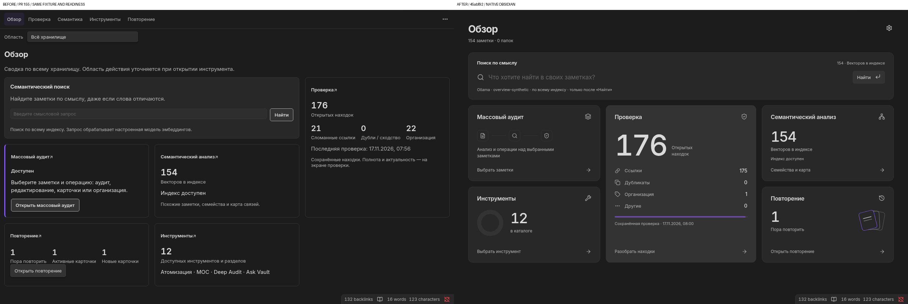
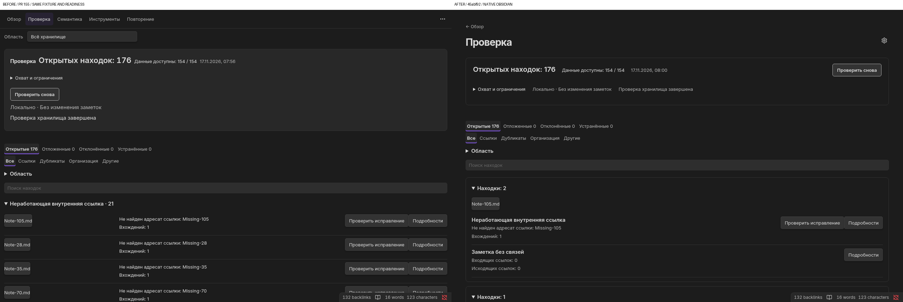
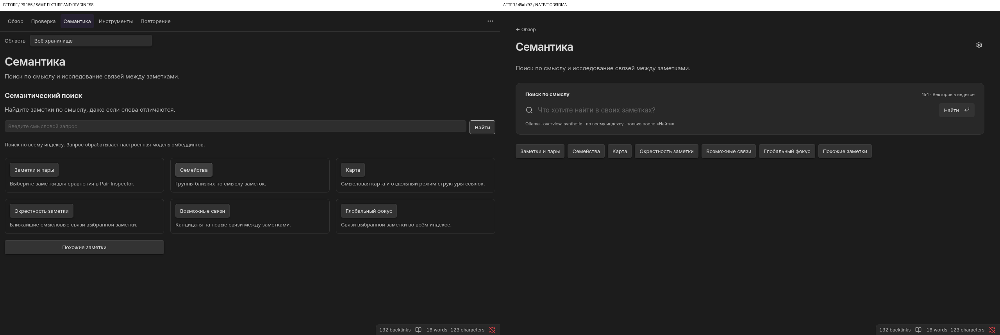
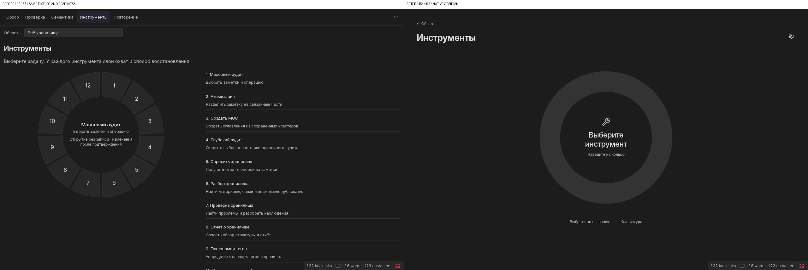
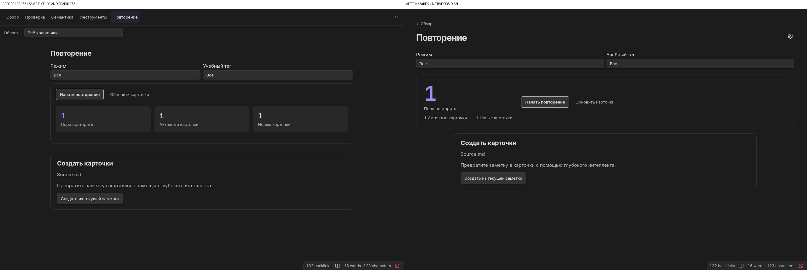

# Visual reference implementation — owner review draft

This is a limited implementation of `Veynrel_UI_refs`, dependent on #155. The owner has not accepted the design. No merge, release, version or dependency change.

## Verified base and scope

At start and before publication, #155 was open, draft and unmerged, HEAD `2b0273cf3c9f444e11d9f4dec19ebc859cd12791`, branch `feat/ux-recovery-v2-overview`. Its ancestor chain #151–#154 was also open/draft, not merged. This branch does not rewrite any of those branches or their evidence. Implementation source: `9f5a900544658adb8cc3b42f4215c3ed3e906352`; final native source/harness HEAD: `45abf92e45cebfa8d081f1b5444a48f2b017f37f`. The later evidence commit changes only documentation.

The seven required public PNGs were opened with an image viewer before implementation; the four secondary screen references were also inspected. The actual offline HTML prototype was exercised with Chromium mouse/keyboard events. All three specs were read. `preview.css` colors and font assets were not imported. Private reference screenshots were not opened or published. Reference input hashes are in [reference-hashes.json](evidence/visual-reference/reference-hashes.json).

## What was wrong with #155

The five persistent tabs, global folder selector and equal dashboard tiles did not match the supplied composition. The central Check panel was not the visual anchor. The old segmented ring had numbers, a permanent list, and a separate detail step rather than a continuous circle with the explanation at its center. Previously collected screenshots also used unequal data readiness across the before/after runs.

## Changes

- Overview is the sole main entry: full-width semantic query, left Audit/Tools, central two-row Check, right Semantic analysis/Recall. All five panels are whole links. On narrow panels the DOM and visual order agree: search, Check, Audit/Semantics, Tools/Recall. Subsections return via `← Overview`; existing commands and routes remain.
- Ring uses one continuous base circle and invisible hit zones from the existing catalog. Exactly one arc is emphasized; center content changes on pointer/focus. Arrow/Home/End navigate; Enter/Space open the existing owner. Touch selects first, then the explicit center button opens. Native fuzzy tool search is optional; editor commands remain discoverable there with their existing invocation instructions. No permanent list or numbered sectors.
- Search hands the query to the existing consent-aware semantic search. Typing does not index or search. Provider/model and whole-index scope are explicit. Results remain in the existing search modal. Analysis routes are compact controls, not another catalog of explanatory cards; map, families, true global inspector, Neighborhood, Opportunities and Pair Inspector owners remain.
- Check retains all findings, pagination, filters, details and actions, groups by complete source sets, shows the source once per group and separates problem/action. Coverage limits and saved-versus-current receipts remain. Overview breakdown uses the existing Inbox categories: Links includes isolation/link findings, not only broken targets; category-count differences from #155 are presentation, not a changed analyzer.
- Bulk Audit presents the existing material/operation/result path; Batch, Deep Audit, Atomization and MOC keep separate owners and their distinct guarantees. No universal Review/Undo promise was added.
- Recall has one large due count and Start; active/new are subordinate. FSRS, topics, dictionaries, card generation and review behavior are unchanged.
- The folder picker appears in the operation where it applies, as a native searchable popup. Overview metrics and search do not claim folder scope. Existing global-operation acknowledgement and stale-action guards remain.
- Studio remains hidden by the existing flag; no Studio data or services were removed.

Only presentation, its callers/tests and the new native harness changed. No algorithms, embeddings, index formats, consent, source freshness, Review/Apply/Undo, journals or settings persistence changed.

## Visual review and evidence

The first native stage covered Overview and idle/hover/focus ring at **actual plugin content sizes 1280×830 and 390×1090** (initial stage), before secondary routes were changed. These native images were opened and compared to the supplied PNG composition. Final paired captures match the reference sizes exactly: 1280×830 wide; 390×1089 Overview; 390×780 ring. Secondary narrow captures are 390×1090. Before and after use the same host theme, zoom, synthetic fixture and readiness. Color differences from the offline palette are intentional: the installed Obsidian theme owns the palette.

Both baseline and final: 154 synthetic Markdown notes, an explicit local check, one explicit Recall inventory refresh, and the same synthetic stored vector index enabled through the settings owner. Counts are observed data; vector count is not presented as indexed-document coverage. Timestamps naturally differ. No invented health percentage or decorative pulse.

Evidence links and exact final build hashes are recorded in [engineering.json](evidence/visual-reference/engineering.json) and [SHA256SUMS](evidence/visual-reference/SHA256SUMS). The original native receipts are preserved; failed attempts are not overwritten.

## Remaining limits

- Owner acceptance is pending. Composition was inspected visually; there was no user study or proof of semantic quality.
- Actual semantic results remain in the existing modal, not an embedded result pane. The secondary screens are a bounded presentation pass, not a new execution UI.
- Screen reader, physical touch, actual Obsidian Mobile, GPU/custom frames, IME and third-party themes were not tested here. Touch evidence is CDP emulation. Accessibility names and keyboard behavior are tested, not screen-reader announcements.
- No live/paid provider, destructive Batch, new Apply/Undo end-to-end or personal embeddings were run. The synthetic search uses one loopback embedding request.
- A new reproducible `e.isShown` trigger was found on SVG `aria-label` hover. Native Obsidian tooltip code assumes HTMLElement methods. SVG titles/`aria-labelledby` avoid that trigger and repeated delayed-hover checks passed. This does **not** close historical `e.isShown` cases, Community document ownership, cold10k, or other historical gates. Studio-OFF does not fix Community.
- The ring keeps the existing catalog and launch prerequisites. This pass does not add a new dynamic availability service. Some operations open their existing configuration/selection modal.
- Linux native validation uses the installed Obsidian 1.13.7 / Electron 43, isolated Xvfb/Openbox. Other platforms are not covered.

## Private-material boundary

The actual path of the pre-existing isolated notes copy under the local cache was checked with realpath, and symlinks were rejected. A disposable derivative used fresh disabled-provider settings; the original New Life 2.0 was never opened. Passive native walkthrough: 154 Markdown plus 3 Canvas source files hash-verified unchanged, zero provider requests. Only [aggregate evidence](evidence/visual-reference/private-aggregate.json) is public; paths, note names, private images and raw logs remain outside Git.

## Reproduce

```sh
npm ci --ignore-scripts
npm test -- --maxWorkers=2
npm run lint
npm run audit:proposals
node --test scripts/native/session-check.mjs
python3 -m unittest scripts/native/test_runner.py
python3 scripts/native/run.py visual after . --timeout 240
```

Use `visual before <built-155-worktree>` for the paired baseline. The native launcher creates a fresh synthetic vault/profile and a private display; it must not be pointed at a personal original.

## Observed final results

- 5,432 tests / 213 files PASS with two workers; no assertion or timeout was weakened. Typecheck, production build and lint PASS (two existing fetch warnings). Proposal mutations 5/5; native session 2/2; native runner 3/3.
- Final copy follow-up: 229/229 UI tests and build PASS; removed stale references to the former global folder selector. Final native and private walkthroughs use the updated assets.
- 124 native checks PASS, zero unfiltered exceptions, 154 synthetic Markdown files byte-identical. One explicit loopback query embedding request; typing itself made no provider request. Paired baseline: 71 checks PASS using the same harness hashes.
- Native RU/EN, builtin dark/light, wide/narrow, keyboard, pointer, emulated touch, reduced motion, split and popout. Actual map/families/full inspector entry routes exercised.
- Seven reference/native contact sheets were opened and inspected. Composition, proportions, central panel, continuous ring, center description, absence of the permanent list and narrow order match the supplied direction. Palette, corner radius and font rendering follow the host theme. Live counts and provider text intentionally differ from illustrative reference data. No owner acceptance is inferred.

| Screen | #155 vs implementation |
| --- | --- |
| Overview |  |
| Check |  |
| Semantics |  |
| Tools |  |
| Recall |  |

Reference comparisons: [Overview dark](evidence/visual-reference/comparisons/01_overview_dark.png), [Overview light](evidence/visual-reference/comparisons/02_overview_light.png), [390 px Overview](evidence/visual-reference/comparisons/03_overview_390.png), [idle ring](evidence/visual-reference/comparisons/04_tools_idle_dark.png), [dark hover](evidence/visual-reference/comparisons/05_tools_hover_dark.png), [light taxonomy hover](evidence/visual-reference/comparisons/07_tools_hover_light.png), [390 px ring](evidence/visual-reference/comparisons/08_tools_390.png).

[All final native frames](evidence/visual-reference/after) · [Uncut native video](evidence/visual-reference/after/journey.mp4) · [Half-speed viewing copy](evidence/visual-reference/after/journey-slow.mp4) · [Original failure receipts](evidence/visual-reference/attempts/index.json).
