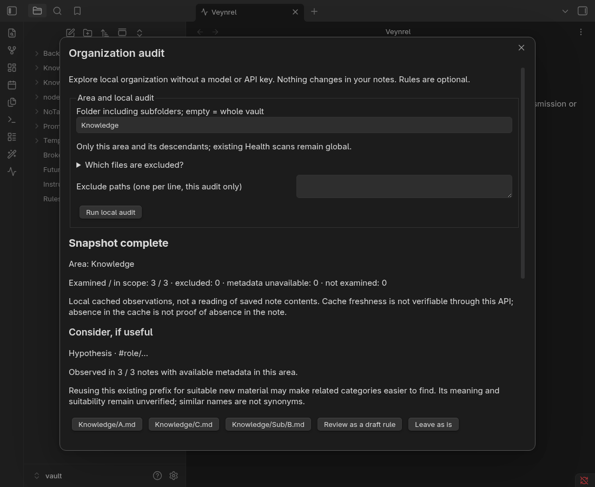
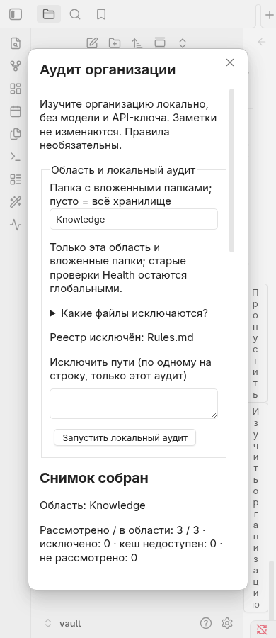

# R04 verification — advisory organization audit

Base: `abef6366cc83611382baa36c688da109e573c178` (R03 and native isolation merged).
Runtime source: `9bcf8236c50111c86fb783df411932faa4a20b21`.
Completed native harness/tests: `0895473578bccf4d74378bd9ac99d2da6f82720a`.
The final evidence commit also corrects video encoding; it is validated against
the same captured frames, without another UI run.
The following documentation/evidence commit does not change runtime bytes.
[Artifact and harness hashes](evidence/source.json) · [SHA-256 manifest](evidence/SHA256SUMS).

**Acceptance remains conditional.** The final isolated R04 workflow passes all
44 assertions, but an intermittent first-modal opening failure remains unresolved.
The raw failures are retained below; this report does not turn a successful repeat
into a claim that the failure was fixed. Merge remains an explicit owner decision.

**2026-11-15 follow-up:** [first-modal lifecycle investigation](modal-lifecycle-investigation.md).
Six fresh, isolated RU/EN profiles compared pre-R04 Tag Taxonomy, R04 Workspace
and initial onboarding. All six first openings and six repeat openings closed
with Escape; settings/Markdown were preserved, with no passive scan or model
request. The original retained-instance/no-DOM failure was not reproduced and
its cause remains unassigned. **The gate is still open; runtime is unchanged.**
Debugger-induced/affected attempts and setup failures are retained separately.
New checks: 187 targeted tests, 5,204 full-suite tests, typecheck/build/lint,
mutation audit and launcher checks. The delivery evidence and 44-scenario results
below are historical and were not rerun for this focused investigation.

Public stable was independently rechecked as **2.3.1**, published
2026-11-02T19:32:17Z. Development manifest stays **2.4.0**, unpublished. No release,
tag, Marketplace update, deployment, dependency change or personal-vault install
was performed. The R01–R15 release policy is unchanged.

## Local checks

| Check | Actual result | Evidence |
| --- | --- | --- |
| Targeted R04/owner/UI/AI tests | 247 passed; separate final audit fixture run: 14 passed | [targeted](evidence/checks/targeted.log), [audit](evidence/checks/audit-final.log) |
| Full suite, `--maxWorkers=2` | 198 files, 5,204 tests passed | [full output](evidence/checks/suite.log) |
| Typecheck, production build, lint | Passed; only the two pre-existing reviewed `fetch` advisories | [output](evidence/checks/lint.log) |
| Proposal mutation audit | 5/5 killed; restored tests passed | [output](evidence/checks/mutation-audit.log) |
| Native session guards | 2 passed | [output](evidence/checks/session-guards.log) |
| Native process lifecycle | 3 passed in the serial repeat | [output](evidence/checks/runner-lifecycle.log) |

The 42 tests above the 5,162-test base are: audit 14, registry-document contracts
10, registry lifecycle 11, settings-owner transactions 3, Workspace entry 1 and
AI boundary regressions 3. Existing R03 Review tests remain unchanged. The
settings AST expectation changes only for the new optional preferences field;
old defaults and control callbacks remain frozen. A cold dynamic import was moved
to test setup, retaining the original test timeout and every assertion.

Early development checks caught and corrected a Health dependency-boundary
violation (translation now stays in `i18n.ts`), deterministic traversal ordering
and type/lint issues. [Original full-suite failures](evidence/checks/suite-development-failures.log)
remain available. One sandbox full-suite attempt ended with SIGTERM/exit 143 and
no report; it is [retained](evidence/checks/suite-interrupted-143.log), not counted
as a pass. The first mutation invocation produced no child-test output in the
sandbox; its [failure](evidence/checks/mutation-sandbox-failure.log) is separate
from the completed audit. No assertions were removed; existing unit-test timeouts remain unchanged. The new harness setup-wait adjustment is documented below.

CI results belong to the exact pushed PR HEAD, not these earlier local commits.
The PR description records the final workflow run and its three jobs after they
finish; the workflow also repeats the full suite, typecheck/build/lint and audit.

## Final-bundle native checks

All commands use the shared `scripts/native/run.py` launcher, private
Xvfb/Openbox, disposable profiles, Native frame and kernel-assigned CDP ports.
No `--desktop` run was made. Versions: Obsidian **1.13.7**, Electron **43.6.0**,
Chromium **150.0.7871.250**, Xvfb **21.1.24**, Openbox **3.6.1**, Linux/X11.
GPU is disabled. [Recorded environment](evidence/organization/isolation/environment.json).

| Scenario | Result | Receipt |
| --- | --- | --- |
| `organization --timeout 300` | 44 assertions; 0 uncaught exceptions and 0 console errors | [R04](evidence/organization/report.json) |
| `smoke` | 21 assertions; 0 uncaught exceptions | [smoke](evidence/regressions/smoke/report.json) |
| `studio --timeout 300` | 66 assertions; 0 uncaught exceptions | [Studio](evidence/regressions/studio/native-report.json) |
| `recall` | 45 assertions; 0 uncaught exceptions | [Recall](evidence/regressions/recall/report.json) |
| `community /tmp/veynrel-native-catalog-20261115` | 47 assertions; 0 uncaught exceptions | [Community](evidence/regressions/community/report.json) |

All five receipts match the final `main.js` SHA-256
`a5be23390eb25d9bdcf8c8223737af55aba8315d17c79f16294084485f2bf360`.
The pinned local Community fixture is
`2c9de8caede80fc91b46f49f18548c7f38b24fd4`; the launcher forces local catalog use.
Studio/Recall responses are synthetic loopback contracts, not live-model quality
results. R04 makes no model request at all. Successful isolation receipts confirm
closed CDP listeners and cleanup of only each run's process group. Every live
session used a dynamically assigned port, including restarts.

R04 covers the real Workspace entry, native modal, saved-profile Review/Save,
registry preview/refusal/create/connect/disconnect, opening an actual example,
keyboard Enter/Tab/Escape, 1100px and 390px viewports, RU/EN, built-in light/dark
themes, reduced motion, actual split/popout, focus return and an Obsidian restart.
A missing-cache fault is explicitly synthetic: one MetadataCache lookup returns
null; the DOM, window system, vault and event loop remain real. Rename/modify
faults use the synthetic files on disk. No exception filter or host patch exists.

[Continuous native journey, 13.67 seconds](evidence/organization/journey-cfr.mp4):
choose the organized area → audit → review literal evidence → open a note → leave
one suggestion as is → review/save a draft rule → preview/refuse/create an optional
registry. Frames keep their native timestamps and deliberate reading pauses; no
cuts or synthetic model answer. Capture is the full main client area, padded for
encoding, not the operating-system decorations. The original variable-frame-rate
MP4 had an inconsistent 12-second container duration despite 13.29 seconds of CDP
frame timestamps. It is retained unchanged as `journey.mp4`. The linked 30fps
copy uses the same ordered frames and original durations (no cuts), includes the
completed creation state, and was decoded/inspected at the end. The harness now
uses that encoder mode. [Encoding receipt](evidence/organization/encoding.json).

[All full-size screenshots](evidence/organization) include empty/tagless results,
partial/stale/cancelled/missing-scope states, all registry errors and conflicts,
rule review, all eight language/theme/width combinations and the real popout.

## Fixtures, preservation and measured limits

| Acceptance group | Demonstrated behavior and boundary |
| --- | --- |
| A — empty | True empty vault, no key/profile; complete enumeration of zero notes, no invented categories |
| B — tagless | Three native diary/ordinary notes without YAML/tags; folder observations, no invented taxonomy; unit negative control uses an unconventional folder name |
| C — organized | Three scoped notes, nested folder, two literal knowledge prefixes, separate `flashcards` namespace and YAML `type`; similarly named sibling excluded |
| D — user profile | Explicit Review/Save; unchanged after rescan and restart; stable dismissals under reordered enumeration; unit control retains a permitted tag observed only once |
| E — registry | Allowed unused tag retained; missing/malformed/future schema distinguished; concurrent Markdown edit rejected; creation refusal writes nothing; creation and connection separate; dormant legacy profile restored only by explicit disconnect |
| F — size | 1,000 notes in real Obsidian; separate deterministic 1,000/5,000-note metadata tests, bounded examples and cooperative yields |
| G — uncertainty | Null cache → partial, no hypotheses; modify → stale; explicit rescan; selected-folder rename → failed rather than empty; public cache freshness always unverified |
| H — exclusions/cancel | Whole-vault fixture: 16 notes, 7 examined, 9 excluded; service markers, selected registry, templates/backups/node_modules/explicit paths excluded; actual Cancel never complete |

The final 1,000-note native audit took **133.43 ms** including harness round trips;
renderer heap increased by **4,542,632 bytes** across that observation. These are
single synthetic observations, not a performance budget, sustained-memory bound
or weak-laptop benchmark. The independent 5,000-note metadata measurement is in
[benchmark JSONL](evidence/checks/metadata-benchmark.jsonl), with elapsed time,
heap delta and yields. GC and fixture construction affect heap measurements.

Passive entry: **0 note reads, 0 metadata lookups, 0 writes/creates, 0 model
requests**; one existing Workspace path enumeration. For each of 22 explicit
audit calls, the receipt records before/after IO counters: **0 note reads, 0
writes/creates and 0 model requests**. The 1,000-note pass performs 1,000 metadata
lookups and one path enumeration. These counters exclude no recorded exceptions
or writes. The raw total also includes Obsidian's reads while ingesting externally
seeded fixtures, explicit source opening and registry reads; it must not be
mislabelled as audit IO. Harness readiness polling contributes to total enumeration
and metadata counters. Settings use the existing plugin persistence owner and
are intentionally outside the Markdown-write counter.

All **1,015 original synthetic Markdown files** finish byte-identical. Only the
reviewed `Created rules.md` is created; it is not connected automatically. R04
itself creates no Studio journal. Its empty journal baseline is not evidence for
handling existing journals; the full Studio regression separately verifies actual
Apply/Undo, history, partial failure and recovery. Runtime Studio/Recall/semantic
algorithms, journals, manifests, dependencies and release policy have no diff.

## Failed attempts and unresolved gates

Original JSON receipts are copied byte-for-byte; their artifact/harness hashes
identify their own development revision. They are not final-build acceptance.

| Attempt | Actual outcome |
| --- | --- |
| [attempt1](evidence/development-attempts/attempt1/report.json) | Harness instrumentation used an unavailable renderer `require('obsidian')`; replaced with a loopback request counter |
| [attempt2](evidence/development-attempts/attempt2/report.json) | First modal did not become visible; the early receipt lacks enough lifecycle detail to assign a cause |
| [attempt3](evidence/development-attempts/attempt3/report.json) | 31 checks passed on an earlier UI/bundle |
| [attempt4](evidence/development-attempts/attempt4/report.json) | 17 checks passed, then the 1,000-note fixture's cache readiness exceeded the original 10-second setup wait; bounded setup wait became 30 seconds, same completion assertion |
| [final](evidence/development-attempts/final/report.json) | 44 checks passed before the final typecheck cleanup; video too fast for comfortable review |
| [visual](evidence/development-attempts/visual/report.json) | 44 checks passed with reading pauses, on that earlier bundle |
| [delivery](evidence/development-attempts/delivery/report.json) | Final bundle: initial Enter, keypress and click reached the button; one modal object existed but its DOM did not appear; no uncaught exception |
| [delivery2](evidence/development-attempts/delivery2/report.json) | Final bundle: 44 checks passed after a one-second startup settle and added diagnostic capture |
| [final counters run](evidence/organization/report.json) | Same final bundle: 44 checks passed, with per-audit IO deltas and the same startup settle |

There were **nine bounded R04 invocations**: five complete successes and four
failures at the different points above. Two initial-modal failures occurred among
the eight invocations that reached that step; on the final runtime, one of three
invocations failed there. This small, changing harness sample is **not** a failure
rate estimate. The settle delay is not proven to fix the cause. It is not yet
known whether the intermittent first-modal issue belongs to host startup, harness
scheduling or Veynrel. A minimal next authorized experiment is a short first-open
control with modal connection/onOpen lifecycle diagnostics, repeated against the
base taxonomy modal and the R04 entry under identical startup conditions. Do not
repeat a full UX experiment to answer that question.

The first concurrent infrastructure lifecycle run also saw an Openbox startup
failure ([raw logs](evidence/development-attempts/openbox-startup)); its serial
repeat passed all three process-cleanup tests. No retry wrapper or suppression was
added. Initial failure and successful control remain separate evidence.

Xvfb does **not** establish GPU/compositor behavior, IME, physical display scaling,
real-desktop pointer reliability or Obsidian/Hidden custom-frame correctness.
Native frame is configured only inside disposable profiles; it is the documented
host workaround, not an Obsidian fix. The earlier intermittent first pointer click
from R03 remains a separate limitation; the new failure above contains a delivered
keyboard click and must not be conflated with it.

No real-user utility or live-model quality study was performed. File-backed
extensions are intentionally not passed through Tag Recommendations v1. Existing
registry updates/merging and safe changes to notes remain outside R04 (R05 needs
its own authorization and contract). No additional stage was started.
