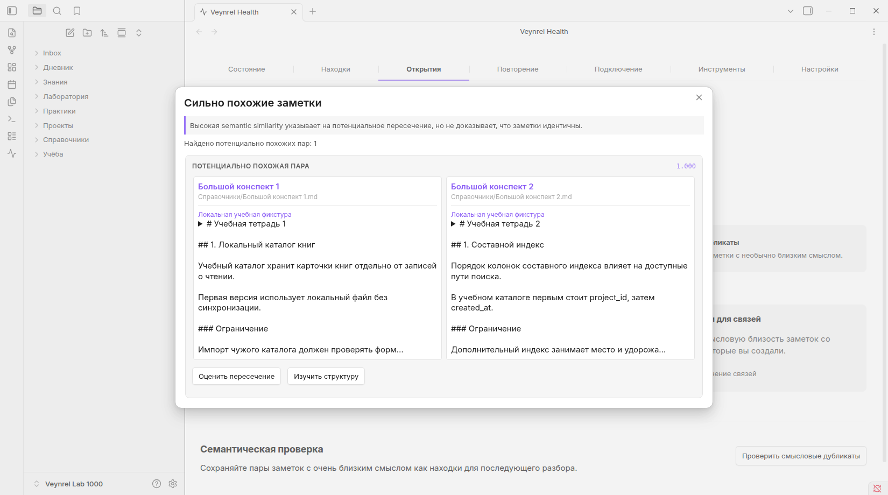
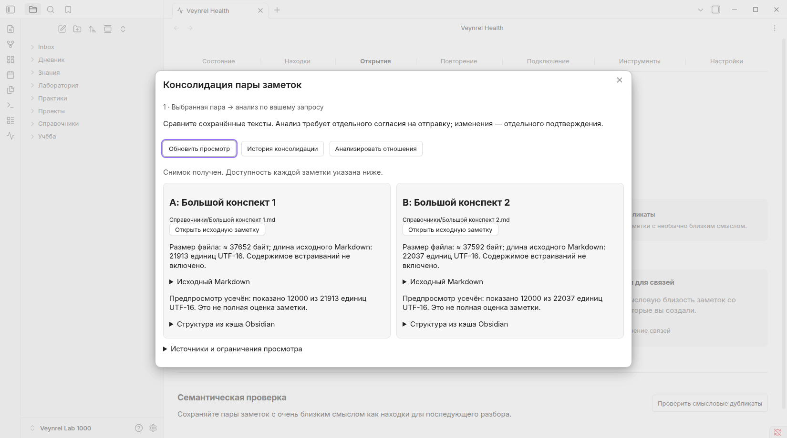

# Veynrel: Real-Vault UX & 1000-Note Acceptance Lab v2

Дата: 2026-10-20. Исходный `main`: `0df3167977a2a255b0faaaca998fdfa593d2971c`, включает PR #103. Исправления продукта вынесены в [PR #104](https://github.com/zinverno/veynrel/pull/104); генератор и этот отчёт — в отдельной ветке `test/acceptance-lab-1000` от того же `main`. Версия 2.1.0 не меняется. Релиз, слияние и auto-merge не выполняются.

Проверяемая сборка продукта: `59e57842d8772b5804f7421428e9af5e53b31fa6`; SHA-256 `main.js`: `02f34f2930a0b0b30510fb4b071bbb535b66724381efaf5dd39c82bc8a56b747`. Сборка устанавливалась только в отдельный синтетический vault с чистыми настройками и локальными контрольными ответами.

## Исправления продукта

| Область | До | После |
| --- | --- | --- |
| UX-01 Potential Duplicates | Узкий внешний modal, высокие колонки, тесные кнопки | Отдельный класс внешнего modal: до 1000 px в пределах viewport; промежутки 12 px, перенос действий, отдельная прокрутка текста, раскрытие полного уже доступного фрагмента, одна колонка при 390 px |
| UX-02 Pair Inspector | Повторяющиеся инструкции и списки метаданных до анализа | Краткий этап/граница согласия, действия, две заметки; метаданные и технические ограничения в закрытых disclosures |
| UX-03 LLM consent | Раскрытый JSON и повторяющиеся предупреждения | Провайдер, модель, обе заметки, фактический размер тела; короткое предупреждение о полных текстах и оплате; точный JSON и endpoint доступны в закрытых деталях; отдельные кнопки внизу |
| UX-04 диагностика | Одна общая ошибка | Раздельные timeout, abort, network, HTTP/status, provider error, empty response, invalid envelope, strict JSON contract, quote/evidence и inconsistent recommendation; только безопасные категории, без сырых ответов и заголовков |
| Остальной маршрут | Кнопки после длинных технических панелей | Переносимые панели действий в финальных Apply/Undo reviews; состояние и фокус остаются у существующих владельцев |

Сохраняются все прежние доступные данные: исходный preview Inspector по-прежнему ограничен 12 000 единицами UTF-16 и явно сообщает об усечении; кнопка открытия точной заметки даёт доступ ко всему Markdown. Внешние картинки, HTML и содержимое embeds не подгружаются. Исполнители, форматы журналов, recovery, поиск, точные цитаты и ограничения неподдерживаемых структур не изменены.

Native-проверка дополнительно обнаружила, что на 390 px подтверждение могло оставаться ниже видимой области. Коммит `59e5784` прокручивает Inspector к текущему анализу при переходе в consent/result/error/cancelled. Повторная матрица подтвердила видимость кнопок без прокрутки JSON.

### BUG-01: медленный ответ

Только Relationship Analyzer передаёт `timeoutMs: 120000`. Остальные buffered-вызовы сохраняют 30 секунд; streaming не меняется. Fake timers и управляемый Promise проверяют успешный полный ответ через 38,6 секунды, ожидание до 119,999 секунды, timeout на 120-й, единственный запрос на согласие и подавление позднего результата. Существующие API-тесты покрывают стандартные 30 секунд и abort.

В официальном [Obsidian API](https://github.com/obsidianmd/obsidian-api/blob/master/obsidian.d.ts) `requestUrl` не предоставляет гарантированной отмены отправленного HTTP-запроса. Остановка ожидания не подтверждает отмену генерации или оплаты; это отражено в UI. Автоматического повтора нет. Исходное наблюдение пользователя о модели и оплате не воспроизводилось платным вызовом; исправление проверяет механизм ожидания, а не успешность следующего ответа этой модели.

### BUG-02: evidence альтернативы

Новая обезличенная SQL-фикстура воспроизводит структуру ошибки: `partial_overlap` / `consider_merge`, альтернатива `consider_embed_b_in_a` с одними `unique_b` c6/c7. Исходный вариант отклоняется. Явно исправленный вариант с настоящим shared c1 принимается; выдуманная цитата c1 снова отклоняется. Это заново написанная синтетическая фикстура, а не приватный ответ пользователя. Prompt объясняет требования отдельно для каждой основной и альтернативной рекомендации. Валидатор не ослаблен, скрытой коррекции ответа нет.

## Корпус и приватность

[CLI и процедура воспроизведения](../scripts/acceptance-lab/README.md), [схема manifest](../scripts/acceptance-lab/manifest.schema.json), [сводные метрики](acceptance-lab-v2/metrics.json).

Оригинальный vault использовался локально и только для чтения. В генерацию передаются фиксированные категории тем; приватный Markdown используется лишь для локального сравнения хешей 12-словных фрагментов. Личные события, имена, исходные записи, настройки и ключи не копируются. В Git нет полного сгенерированного vault, исходных записей или полного частного manifest.

Проверка исходного хранилища: 375 файлов до/после; размеры и `mtime_ns` всех файлов совпали, SHA-256 всех 186 Markdown-файлов совпали. Добавлений, удалений и изменений не обнаружено. Это проверка содержимого Markdown и метаданных остальных файлов, не утверждение о побайтовом хешировании приватных настроек.

| Характеристика | Результат |
| --- | ---: |
| Markdown-файлы / корректный UTF-8 | 1000 / 1000 |
| Суммарный размер | 719 854 байта |
| Размер p10 / медиана / p90 / максимум | 260 / 582 / 922 / 37 652 байта |
| Темы: SQL / программирование / English | 193 / 193 / 129 |
| Темы: проекты / знания / продуктивность | 212 / 144 / 129 |
| Полностью английские заметки | 60 |
| Внутренние ссылки / намеренно неразрешённые | 831 / 42 |
| Изолированные заметки | 293 |
| Пустые файлы / большие документы | 7 / 3 |
| Файлы с frontmatter / aliases | 242 / 240 |
| С кодом / таблицами / чекбоксами | 74 / 123 / 183 |
| С callout / embed / block ID | 61 / 23 / 44 |
| Случайные точные дубли / найденные приватные 12-словные фрагменты / секретные шаблоны | 0 / 0 / 0 |

Присутствуют H1–H6, цитаты, wiki-ссылки на заголовки/блоки, одинаковые имена в разных папках, MOC, черновики, решения, задачи, конспекты, примеры кода/SQL и вымышленные учебные дневники. Отдельные сложные структуры предназначены для безопасного отказа. Метрики ссылок считают ссылки по пути файла; существование конкретного заголовка/блока дополнительно проверяется нативным MetadataCache, а не объявляется генератором доказанным.

Авторская библиотека содержит 60 тем с разными фактами, переформулировками, ограничениями и упражнениями. Просмотрены все 50 заметок детерминированной случайной выборки: 13 форм, включая 3 английские и 2 пустые. Исправлены обрезанные английские заголовки, одинаковые заключительные фразы, неудачные названия секций решений и несколько формулировок упражнений. Добавлены длинные списки/таблицы. [Квитанция проверки выборки](acceptance-lab-v2/sample-review.json) фиксирует seed, состав и итоговые хеши без приватных текстов.

Корпус SHA-256: `f2f45eba446b3f76a7eb98fc07c65946bbc4090bb385b39ca3c9fa6da60311b3`. Нулевой exact-duplicate count не означает отсутствие естественных повторов отдельных фактов. Корпус ограничен конечной авторской библиотекой; это не независимая оценка разнообразия человеческой базы за годы.

## Разметка и реальные операции

120 пар: 15 почти дубликатов, 15 частичных пересечений, 15 самостоятельных связанных знаний, 16 версий идеи, 15 противоречивых условий, 15 лексических ловушек, 15 переформулировок и 14 случаев «оставить отдельно». Для неоднозначных пар установлен `expertReview`. Ожидания сопровождаются объяснениями; допустимые сценарии являются кандидатами, а не разрешением исполнителя.

Отдельные восемь сценариев проходят через реальные планировщики: Single, Multi, Merge, Group, Bundle, Atomization Preview, Empty Atom и отказ. Для Merge/Group/Bundle проверяется цепочка Archive → перезапуск → Archive Undo → отдельный Undo родителя. Архивирование помечает вторичную заметку и сохраняет её содержимое; неизвестные зависимости не объявляются доказанно отсутствующими.

Итоговый native-прогон `veynrel-lab-native-11` завершён с кодом 0: **153 проверки PASS**. [Машиночитаемая сводка](acceptance-lab-v2/native-summary.json) содержит условия, измерения и результаты каждого сценария. Все 1000 файлов после Undo совпали с исходными SHA-256.

| Проверка | Наблюдаемый результат |
| --- | --- |
| Инициализация и Health | Реальный Obsidian видит 1000 файлов и cache; scan завершён, freshness verified, 606 существующих findings обновлены |
| Findings → Discover → History | Навигация, открытие/закрытие и история после перезапуска доступны |
| Duplicates / Inspector / consent | RU/EN × light/dark × 1650/390 px; внешняя ширина, отсутствие горизонтального overflow, закрытые details, видимая кнопка подтверждения |
| Клавиатура / приватность | Enter раскрывает точный JSON, открытие и отмена consent не вызывают completion |
| Длинный Markdown | Два документа около 37,6 КБ; bounded preview и клавиатурная прокрутка; отдельные списки и таблицы в корпусе |
| Popout | Настоящее отдельное окно Obsidian, Inspector принадлежит его document, сохранён screenshot |
| MetadataCache | 50 отправленных событий + 20 настоящих `Vault.modify` с 20 событиями changed; Inspector становится stale без completion; fixture отдельно восстановлена |
| Single / Multi / Merge / Group / Bundle / Empty Atom | По одному полному Apply/Undo в RU и EN: 12 циклов; реальный `Vault.process`, точные результаты, неизменность остальных заметок |
| Archive | 3 полных цепочки после Merge/Group/Bundle; перезапуск сохраняет применённое состояние; родительский Undo блокируется до Archive Undo |
| Atomization Preview | RU/EN, план существует, новый файл не создаётся |
| Неподдерживаемая структура | RU/EN: HTML/dataview/footnote-заметка отказана до выбора Group и Apply; точное покрытие MetadataCache не подтверждено |
| Повторный запуск | История открывается после настоящего перезапуска процесса; финальные 1000 хешей совпадают |

Все применяемые выборки взяты из manifest; локальные ответы проходят реальный JSON/quote validator. Ни разрешения исполнителя, ни MetadataCache, ни журнал не заменяются моками. Проверка не утверждает, что все 120 пар совместимы с Apply: исполняются только отдельно размеченные сценарии с успешным настоящим планировщиком.

### Производительность

Obsidian 1.13.7 / Electron 43.6.0, Linux 6.12.108-1-MANJARO x64, 12 логических CPU, 7,08 GiB RAM. Обычный X11 desktop, `--disable-gpu`, без ослабления sandbox. Новое приложение-профиль, существующий локальный corpus/cache и сохранённые журналы предыдущих прогонов. Это одиночные наблюдения wall-clock с polling стенда, не статистический benchmark и не холодный disk-cache запуск.

| Измерение | Факт |
| --- | ---: |
| Запуск до layout + plugin commands + cache 1000 заметок | 3881 мс |
| Последний перезапуск до той же готовности | 1626 мс |
| Health scan, до завершённого outcome | 685 мс |
| Discover с загрузкой двух synthetic vectors | 74 мс |
| History, 21 существующая запись при старте | 545 мс |
| Inspector двух длинных документов | 57 мс |
| 50 dispatched MetadataCache resolved events | 1,73 мс |
| 20 реальных изменений + восстановление fixture | 242 мс |
| Renderer RSS после старта / после последнего restart | 368,0 / 372,5 MiB |
| JS heap used в конце | 48,2 MiB |

RSS относится к renderer-процессу, а не сумме main/GPU/всех процессов и не пику. В финальной истории 36 записей; журналы не очищались ради ускорения. Discover измерен на двух контрольных векторах; эта цифра не описывает полноценный семантический индекс 1000 заметок.

### Найденные дефекты и сохранённые неуспешные попытки

1. Реальный UX-дефект: кнопка LLM на 390 px уходила ниже viewport. Исправлен в PR A, последующая полная матрица PASS.
2. Ошибки раннего стенда: Discover открывался до явной загрузки индекса; попытка сериализовать native `TFile` создавала циклический объект; неправильно ожидались момент готовности и CDP URL popout. Исправлен стенд, не продукт.
3. Положительная Bundle-фикстура сначала содержала заголовки. Производственный планировщик корректно отказал; из положительной фикстуры убраны heading scopes. Ограничение сохранено. Сложная отказная Group-фикстура отвергается до появления selection — стенд теперь проверяет именно этот исход.
4. В прогоне 10 стенд переоткрыл History до освобождения общего владельца предыдущим чтением. Продукт показал занятость, новые записи не выполнялись. Сохранены failure/report/journals; отдельно проверенные штатные Archive Undo и Group Undo восстановили все 1000 хешей. Попытки восстановления, остановленные до действий из-за фокуса сохранённых пустых popout, также сохранены. Стенд закрывает только свои пустые окна и ждёт освобождения владельца; итоговый прогон 11 полностью PASS. Автоматической файловой «починки» и изменения recovery нет.

### Скриншоты синтетического vault

До/после последней коррекции прокрутки consent: [до](acceptance-lab-v2/consent-before-scroll-fix.png), [после](acceptance-lab-v2/consent-narrow.png). «До» относится к промежуточной сборке PR A, не к скриншоту приватного хранилища.

[Узкое окно Duplicates](acceptance-lab-v2/duplicates-narrow.png) · [настоящий popout](acceptance-lab-v2/popout.png) · [Merge review](acceptance-lab-v2/merge-review.png) · [Empty Atom review на 390 px](acceptance-lab-v2/empty-atom-review.png) · [History после перезапуска](acceptance-lab-v2/history.png).

## Индексация и стоимость

Локально выполнено разбиение всего корпуса производственным `MarkdownChunker`: 1726 chunks из 993 непустых заметок, 428 137 единиц UTF-16 в исходящем тексте, максимальный chunk 1782 при лимите 1800. [Расчёт](acceptance-lab-v2/embedding-estimate.json) не подменяет tokenizer: стоимость внешнего индекса равна фактически тарифицируемым токенам / 1 000 000 × цене выбранной модели. Модель и тариф не выбраны, денежная оценка не выдумывается.

Veynrel поддерживает локальный Ollama, но read-only проверка `127.0.0.1:11434/api/tags` на хосте вернула `ECONNREFUSED`. Модель не скачивалась; полный локальный embedding-индекс не построен. Для интерфейса Discover сохранены ровно два явно синтетических вектора через настоящий LocalVectorStore. Это проверка маршрута, не качества поиска на 1000 заметках. Платные embedding/LLM-запросы требуют отдельного согласия и в эти испытания не входили.

## Автоматические проверки и ограничения

PR A: 4466 tests / 162 files, typecheck, lint, production build, proposal audit 5/5 и diff-check. PR B: 4455 tests / 162 files базового продукта плюс отдельный generator self-check: детерминизм, 1000 файлов, manifest schema, dry-run без записи, неизменность исходника, отказ от overwrite/overlap/symlink, обнаружение секретного шаблона, совпадения с приватным фрагментом и некорректного UTF-8. Typecheck/lint/build и proposal audit 5/5 пройдены. Lint сохраняет одно существующее предупреждение о streaming `fetch`; ошибок нет. Proposal audit запускался вне sandbox, поскольку вложенный Vitest в sandbox возвращал пустой stdout; проверки не изменялись.

Решение: **готово к ревью двух PR и следующему отдельно согласованному испытанию на реальных заметках**. Офлайн функциональный и UX-этап выполнен. Слияние, релиз и платный этап не запускались. Полный локальный embedding-индекс остаётся NOT RUN из-за отсутствия локального сервиса; качество LLM на 120 парах не измерялось. Расходы стенда на внешние API: 0 вызовов, $0.

Полные manifest, sample, планы, screenshots, журналы прогонов и исходные/итоговые хеши хранятся локально вне Git в соседнем каталоге `Veynrel Lab 1000 Reports`; публично сохранены только синтетические screenshots, агрегаты и проверяемый код стенда. Сам vault остаётся в `Veynrel Lab 1000` на компьютере пользователя.

Большой синтетический vault **не заменяет испытания на настоящих заметках пользователя**. Здесь нет доказательства семантической полноты, качества рекомендаций модели, поведения всех сторонних тем/плагинов, screen-reader acceptance или работы на физическом мобильном устройстве. 390 px — изменение viewport настоящего Linux desktop Obsidian. Наблюдение fetch/XHR и подмена completion — локальные счётчики стенда, не перехват всего сетевого трафика ОС.
