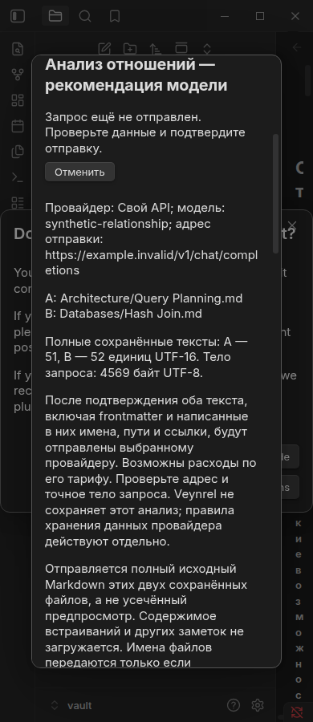
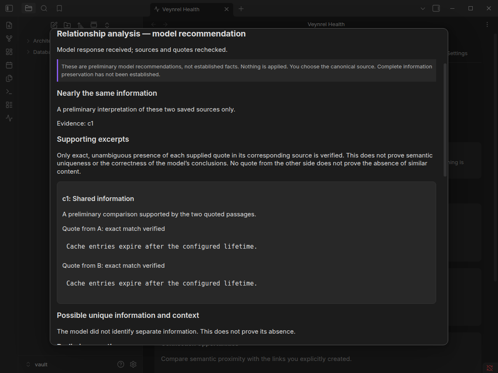

# Relationship Analyzer v1

This extends the [read-only Pair Inspector](pair-inspector.md) from PR #79.
Opening and refreshing the inspector remain local and free, with no model request
or Decisions requirement. Semantic similarity is candidate discovery, not evidence
of information duplication. Analysis is a **preliminary model recommendation**;
this feature cannot edit Markdown or apply an operation.

## Open and confirm

1. Open **Discover → Potential duplicates → Inspect structure**
   (RU: **Изучить структуру**). The duplicate list needs an existing usable semantic index.
2. Choose **Analyze relationship** / **Анализировать отношения**.
3. Inspect the provider, model, endpoint, A/B full paths, source lengths, serialized
   request size, privacy/cost warning and **complete exact request body**, including
   the system instructions. Preparation reads locally and sends nothing.
4. Choose **Confirm and send**. There is one request and no automatic retry.
5. Review the relation, explanation, cited excerpts, possible unique/contextual
   information, proposed action, alternatives and limitations. Open either source
   using the inspector. **Dismiss recommendation** only discards this window's result.
   **Analyze again** starts a fresh preview and requires new confirmation.

Provider/model/key settings are the existing **Deep Intelligence** configuration.
There is no new key, subscription, setting, model selector or connection probe.
The selected provider's retention policy and pricing apply. Cancellation or close
stops waiting and invalidates the result; Obsidian's buffered `requestUrl` cannot
guarantee cancellation at the provider once dispatched, so a charge may still occur.

## Fullness, provenance and uncertainty

Only the **two complete saved source Markdown files** are analysis inputs. The
12,000-unit inspector preview is never an input. Frontmatter and literal embed/link
markup are included. Embedded target contents, unsaved editor buffers, the semantic
index, MetadataCache, tags elsewhere and other notes are not analyzed. Paths are
shown locally; they are sent only if they already occur in the note text.

V1 accepts at most **20,000 UTF-16 units per note**, **32,000 per pair**, and
**131,072 UTF-8 bytes in the serialized request body**, including instructions and
JSON escaping. Larger inputs fail locally with no request: there is no truncation,
chunk selection, partial analysis or automatic summarization. `Vault.read` still
reads each file in full; these are context limits, not a streaming memory bound.
The chosen provider/model must support this input and up to 4,000 output tokens;
the character bounds do not guarantee compatibility with every model's token window.
Truncated or malformed responses fail validation rather than becoming recommendations.

The six relations are `same_information`, `partial_overlap`, `related_distinct`,
`conflicting`, `unrelated` and `insufficient_context`. The seven tentative actions
are considering merge, embedding B in A, embedding A in B, atomization, an ordinary
link, no change, and manual review. There are no scores, executable diffs or Apply,
Merge, Undo buttons. The user chooses any canonical source; information preservation
has not been proven. Contextual examples should remain in their original context;
atomization requires evidence of an independently useful section.

Every substantive claim carries evidence according to its type; explanations/actions
reference these claims. Both `quoteA` and `quoteB` keys are always present. An absent
optional quote is JSON `null`, not an omitted key, empty string or the string `"null"`.

| Claim kind | `quoteA` | `quoteB` |
| --- | --- | --- |
| `shared`, `conflict`, `version_difference`, `comparison` | Required string | Required string |
| `unique_a`, `context_a`, `standalone_a` | Required string | String or `null` |
| `unique_b`, `context_b`, `standalone_b` | String or `null` | Required string |

Every supplied quote, including an optional opposite-side quote, must occur exactly
once in its corresponding current Markdown. The opposite-side quote should only
be supplied when meaningful; a contextual example in A does not need an arbitrary
passage from B. The UI renders only supplied quotes, without a placeholder or a
verified label for a `null` side. Literal presence does **not** prove semantic
uniqueness, absence of similar information elsewhere or correctness of interpretation;
`null` means no excerpt supplied, not proof of absence.
The entire response is refused on missing required, invented, repeated or wrong-source quotes,
unknown fields, dangling references, invalid JSON or inconsistent actions. No raw
invalid response is displayed. Exact source presence is verified; **semantic
interpretation, classification accuracy and information completeness are not**.
Instructions inside notes remain untrusted model input, not executable instructions.

Merge/embed suggestions require a shared claim and overlap relation; atomization
requires a cited standalone-section claim. Conflict/version claims require
`conflicting` or `insufficient_context`; these and `unrelated` permit only manual
review or no change. `insufficient_context` may return no claims at all. Other
relations require evidence. These checks constrain structure and action eligibility,
not the truth of model prose. Any additional dependency/tag/source investigation
remains a limitation for a later, separately authorized step.

## Lifecycle and reused owners

- `consolidation/savedNote.ts` extracts the inspector's canonical-path, exact `TFile`
  lookup, `Vault.read`, file identity and stat checks. Both views use it. Only two
  selected files are read; no new vault scan or persistent index is created.
- `RelationshipSession` keeps consent and result in memory. It rereads both full
  sources immediately before sending and after receiving a reply, comparing file
  identity, path, content, size and modification time. Changes refuse publication.
  Model settings are also checked at async boundaries and via the existing settings
  subscription. Double-clicks cannot dispatch a second request.
- The existing `PairInspectorModal` invalidates on selected-file modifications,
  deletion, rename (including parent folders), explicit refresh and close. Closing
  or plugin unload releases subscriptions and prevents late UI updates. Unrelated
  cache events still invalidate the inspector metadata view; they do not send work.
- The existing `LanguageModelSettingsPort`, `PROVIDER_PROFILES`, validation and
  buffered `api.ts` transport own configuration and HTTP behavior. `buildChatBody`
  is shared so the preview is byte-for-byte the transmitted JSON body, without
  authorization headers/key. A shared pre-dispatch abort guard also prevents a
  cancelled queued request from starting.
- Existing exact-path source navigation, modal/cards, theme variables and RU/EN
  localization are retained. Model text and excerpts use literal text nodes.

No source, prompt or model response is added to a persistent index/log. Dismissal
is ephemeral. Decisions' overlap session, fragment selection and configuration
remain independent; Connection Opportunities, Deep Audit indexing and Health
Findings are not involved. Published version, release and settings defaults are unchanged.

## Verification and limits of evidence

`tests/fixtures/relationships.json` contains eight synthetic pairs with **scripted
fake responses**: near duplicates, partial overlap, shared theory with a contextual
example, an independently useful section beyond the inspector preview, contradictions,
version differences, unrelated topics and insufficient context. These exercise the
contract/UI; they do not measure how a real model would classify those notes.

Tests cover exact payload/explicit consent, quote validation by claim type (including
contextual examples with no opposite-side quote, missing required quotes, fabricated
optional quotes and bilateral contradictions), malformed responses,
input bounds, files/settings changing before/during/after a request, cancellation,
close/reopen, double-clicks, safe errors, no retries, no writes and existing
Pair Inspector/Discover/Decisions regressions. The shared HTTP transport is tested
with a fake `requestUrl`; native testing replaces only the completion dependency.

Run `npm test`, `npm run typecheck`, `npm run lint`, `npm run build`,
`npm run audit:proposals` and `git diff --check`.
Verified on 2026-10-16: **3,010 tests / 118 files**, typecheck, lint, build and
diff check passed. Lint retains only the existing streaming-fetch advisory in
`api.ts`. The proposal mutation audit passed **5/5** in a standalone host run.
For isolated Linux Obsidian acceptance, after building run:

```sh
node scripts/pair-inspector-native.mjs /tmp/pair-inspector-relationship-fresh --relationships
```

The output directory must not exist. This reuses PR #79's native Discover/Pair
Inspector harness and synthetic vault, with a fake LLM transport and no paid calls.
The [native report](relationship-analyzer-evidence/native.json) records results
and deliberate refusals: **18 inspector checks + 51 analyzer checks**, on Linux
Obsidian package 1.13.7-2 / Electron 43.6.0, with asset SHA-256 hashes and
zero plugin Markdown writes/network counters. Scripted contradiction/version responses choose manual
review; unrelated/insufficient-context responses choose no change. Missing required
quotes, fabricated optional quotes and invalid JSON produce no recommendation;
oversized input produces no request. Native checks also verify that contextual and
unique claims render only their supplied quotes while contradictions retain both sides.




Real-model quality, live billing/cancellation, other operating systems, physical
mobile devices, screen readers, popout windows and custom themes are **not verified**.
Native fetch/XHR/write counters supplement, not replace, fake transport unit tests.

## Deferred

No Markdown changes, merge/delete/embed insertion, atomic-note creation, tag
classification/normalization, transaction/rollback, background audit or Health
Findings integration. Operation planning and additional-note/dependency analysis
need separate PRs and explicit confirmation; this result is not ready to apply.

## Local planning follow-up

[Change Planner v1](change-planner-v1.md) adds an explicit **Prepare change** action
to a current result. It can preview a user-selected normal link, a direction-gated
embed replacement or no change, without applying Markdown or making another model
request. The analyzer’s recommendations remain preliminary.
