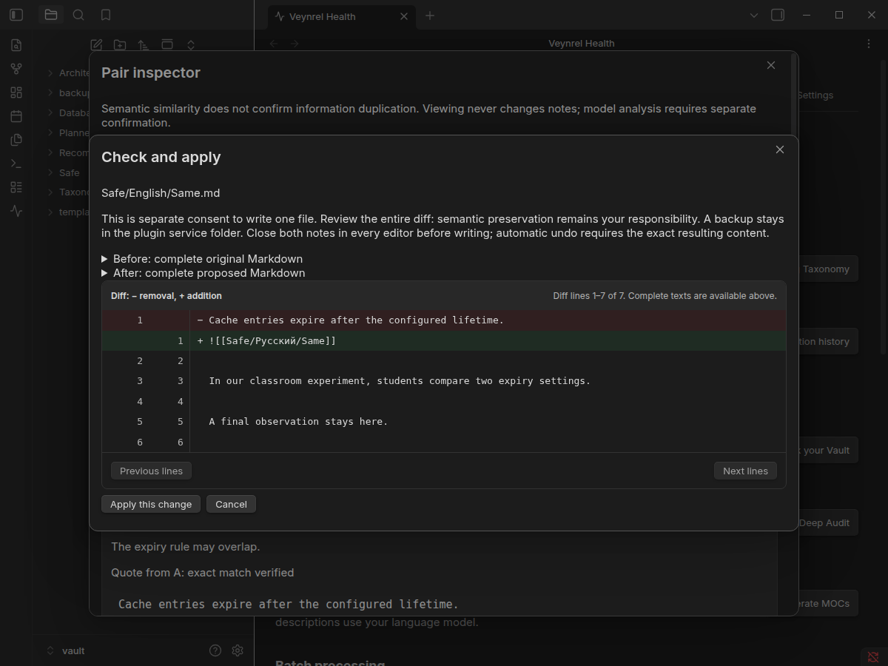
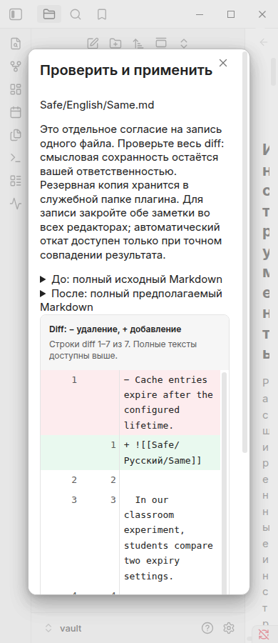

# Safe Apply & Undo v1: native acceptance

**PASS** in isolated Obsidian **1.13.7-2**, Electron **43.6.0**, Linux desktop.
Only synthetic notes and scripted model completions were used. No personal vault
or paid API was accessed. PR #83 was verified merged; this branch starts from
`main` at `b222a44fd95b38802253b02019544b7508683bb3`.

The [machine-readable report](safe-apply-evidence/native-report.json) contains
**289 checks**: 23 Safe Apply, 18 Pair Inspector, 51 Relationship Analyzer,
28 Taxonomy, 118 Tag Recommendations and 51 Change Planner checks. Its artifact
hashes match the exact `main.js`, `styles.css` and `manifest.json` installed in the
native vault and the final build. Manifest version remains **2.1.0**.

## Reproduce

Build first, then choose a new directory:

```sh
npm run build
node scripts/pair-inspector-native.mjs /tmp/pair-inspector-safe-apply-fresh \
  --relationships --taxonomy --tag-recommendations --change-planner --safe-apply
```

The harness creates an isolated vault and application profile, accepts the trust
dialog only there, waits for workspace/plugin readiness, and exercises actual
Discover → Potential duplicates. New mutation scenarios use two synthetic homonyms:
`Safe/English/Same.md` and `Safe/Русский/Same.md`. A has shared knowledge, a unique
classroom example and another observation. Only the existing completion dependency
is replaced with a fake response; the writer, DataAdapter and Obsidian UI are real.

The script kills **its own isolated Obsidian process with SIGKILL**, restarts the
same profile, reconnects and explicitly opens history. It checks the exact bytes
on disk and the particular interrupted operation ID, not merely any matching row.

## Observed

- Review and planning leave Markdown unchanged and require a separate final write
  confirmation. No additional completion occurs for apply or undo.
- A native `Vault.process` writes precisely the selected full-path `add_link` edit.
  After killing/restarting Obsidian, history offers a newly reviewed undo, which
  restores the original saved Markdown exactly.
- `replace_with_embed` changes only the selected paragraph. The contextual classroom
  example and subsequent text remain intact.
- A later simulated user edit produces conflict; automatic undo is unavailable.
  The saved original and proposed result remain viewable.
- An open native Markdown editor with an altered buffer prevents automatic writing.
- A kill after verified journal preparation but before note processing recovers
  `prepared`, with original bytes unchanged and no reapplication.
- A kill after note writing but before the applied marker recovers `applied` from
  exact `after`, without a second write.
- A kill after undo writing but before the final marker recovers `undone` from
  exact `before`, without a second undo.
- Corrupting one recovery record makes the entry a conflict; the valid second copy
  remains visible and no automatic undo is offered.
- RU/EN × standard light/dark × 1200/390 px: review text and diff fit without
  horizontal overflow. Source and diff use literal text nodes, not Markdown/HTML.
- The earlier passive-IO assertions still pass before the explicitly mutating
  scenario: no writes/provider calls from Tools, scanning, choosing, inspecting,
  or planning. No real network request occurred in the Safe Apply scenario.

## Automated checks

- `npm test`: **3,209 tests, 128 files**, including fault injection and UI lifecycle.
- `npm run typecheck`, `npm run lint`, `npm run build`, `git diff --check`: passed.
  Lint retains only the pre-existing streaming-fetch advisory in `api.ts:404`.
- `npm run audit:proposals`: **5/5 mutations killed**; restored tests passed.
  The sandbox attempt produced empty child Vitest output; the same command passed
  outside the sandbox. Companion Proposal sources remain unchanged.

Additional unit coverage includes two simultaneous confirmations, consumed-token
replay, no-change without IO, source/settings/cache/target changes before or inside
processing, clean/dirty/unknown editor views, failed backup write/copy/read-back,
changed source during backup IO, partial Markdown failure, failed undo intent/final
marker, undo interruption before/after writing, malformed hashes/paths/JSON,
incomplete records, closing during asynchronous preparation/writing, and disposal.
Every conflict preserves the current text and/or retains the known original backup;
there is no silent overwrite of subsequent user edits.

## Screenshots

| Locale | Light 1200 | Dark 1200 | Light 390 | Dark 390 |
| --- | --- | --- | --- | --- |
| RU | [View](safe-apply-evidence/safe-ru-theme-light-1200.png) | [View](safe-apply-evidence/safe-ru-theme-dark-1200.png) | [View](safe-apply-evidence/safe-ru-theme-light-390.png) | [View](safe-apply-evidence/safe-ru-theme-dark-390.png) |
| EN | [View](safe-apply-evidence/safe-en-theme-light-1200.png) | [View](safe-apply-evidence/safe-en-theme-dark-1200.png) | [View](safe-apply-evidence/safe-en-theme-light-390.png) | [View](safe-apply-evidence/safe-en-theme-dark-390.png) |

[User-edit conflict](safe-apply-evidence/safe-conflict.png) ·
[Prepared after interruption](safe-apply-evidence/safe-recovery-prepared.png) ·
[Applied after interruption](safe-apply-evidence/safe-recovery-applied.png) ·
[Undone after interruption](safe-apply-evidence/safe-recovery-undone.png)




## Limits

SIGKILL verifies process-crash recovery, **not physical power loss or fsync durability**.
Public DataAdapter has no fsync API. Both verified recovery copies live on the same
storage. No physical mobile device, other OS, multi-process/shared-vault writer,
popout, custom editor/theme, screen reader or real provider acceptance is claimed.
Native network counters cover fetch/XHR and fake completion/provider dependencies,
not a global interception of Obsidian's requestUrl. No paid requests were executed.
Structural checks cannot establish semantic completeness; see the
[protocol and intentional limitations](safe-apply-undo-v1.md).
