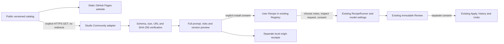

# Studio Community Library v1

Base: `f9501a27209207da296fe69676fecaf19a0f1711` (PR #122 merged). Separate branch `feat/studio-community-v1`; existing user worktrees/untracked files are preserved. No version/manifest ID change, merge, release or new dependency.

## Ownership

Catalog/site source: `zinverno/veynrel-recipes`. `catalog/v1/index.json` has strict bilingual metadata, examples, author/category/tags, stable public ID, stable SemVer, Studio API/Recipe schema compatibility, one supported operation, canonical version URL and hash. Immutable `entries/<id>/<version>.json` archives retain metadata after delisting. Catalog CI checks the complete Recipe and published Git baseline; a passing schema does not establish instruction quality.

The website is generated static HTML with real version URLs, sitemap, search and category filtering. Literal escaping and a restrictive CSP prevent recipe text from becoming HTML. The build publishes only verified JSON resources plus owned static assets; it never copies arbitrary catalog files. No notes, execution, analytics, accounts or backend. Pages requests disclose ordinary network metadata to GitHub, not vault content.

## Adapter and trust boundary

`studio/community/schema.ts` is the executable public contract, mirrored in the independent catalog project. Only the fixed `https://zinverno.github.io/veynrel-recipes/catalog/v1/` source is accepted. IDs, versions and paths must be canonical; no query, fragment, userinfo, custom ports, redirects, arbitrary host or LAN endpoints. No user-configurable source URL. `transport.ts` uses credential-free, referrer-free GET with `redirect: error`, exact final URL, MIME validation, a 15-second abort and streaming byte limits. Fetch is a documented lint advisory because `requestUrl` cannot veto redirects or bound a streaming response. Every exit aborts the transport.

Limits: index 512,000 UTF-8 bytes, 100 version entries; canonical metadata 64,000 bytes; downloaded recipe 96,000 bytes plus the existing 24,000-character Recipe parser limit. Only current Recipe v1 fields are accepted: `source:user`, one `llm_transform`, Markdown `replace` or `append`. The public ID must map to `user.<public-id>`. No external builtin impersonation, JS/shell/HTTP/tool handler, template evaluation or second prompt executor.

HTTPS protects transport; SHA-256 checks agreement with metadata delivered by the same publisher. It is **not** a digital signature and does not independently authenticate a compromised catalog. The user still trusts the catalog owner and must inspect all instructions. Displayed examples illustrate shape; they do not guarantee LLM factual accuracy or semantic prompt-injection resistance.

## Local installation and recovery

Opening Studio, Library or the Community tab sends nothing. **Open online catalog** or **Refresh** explicitly requests public data; opening a recipe downloads its pinned version if not cached. The complete prompt, constraints, limits, defaults, examples, source and hash are shown as literal text before **Confirm installation**. Installation has no Markdown/model/Review/Apply port.

Installed IDs are deterministic `user.community.<public-id>`; a preexisting unrelated local ID is refused. `RecipeRegistry` and its `{schemaVersion:1,recipes:[...]}` storage are unchanged. Provenance lives separately under the actual plugin config directory: `studio/community-installs/<uuid>.json` stores the validated public entry/raw recipe/local ID/sequence; a verified `.done` marker records completion after the Registry write. Local modification state is derived by exact comparison to the installed baseline, not assumed from its version string. Full-library capacity is checked before intent.

Same clean version installation is idempotent. Updates display installed/selected versions and before/after instructions, constraints/limits, defaults, output format/action. No automatic update. Modified local recipes require explicit replacement or preservation as a separate Registry copy. Consent is tied to the exact local recipe snapshot; a concurrent edit refuses the operation. Removing a public listing never removes a local recipe.

Completed installations survive restart. Torn origins, missing completion markers, malformed records, unexpected files or interrupted installation fail closed for further Community installs; local Registry recipes remain available. Startup does not complete or replay an interrupted operation. Preserve the `studio` directory for manual diagnosis; inspect the exact Registry and origin bytes before repairing receipts. Deleting uncertain metadata is not an offered automatic repair. This is adapter write/readback evidence, not a claim of portable fsync/power-loss atomicity or a cross-process lock. The origin log is bounded to 1,000 installation transactions; at that bound installation refuses pending explicit maintenance. Registry backup/recovery behavior remains its existing owner.

## Offline cache

One replaceable `studio/community-cache.json` contains only the public index, timestamp and up to 16 verified downloads (maximum 2.5 MB). On load every field, index and cached Recipe is revalidated. Any corrupt cache is discarded, never imported into installed recipes. Offline/failed refresh can show verified cached data with an explicit stale label. Refresh invalidates late downloads, and cache writes are serialized across tabs. No polling, startup network call or automatic retry. The cache is not an authentication anchor and is never required to run an installed recipe.

## Publication

Local user recipe → **Prepare community submission** → inspect recipe → manually author RU/EN examples, purpose/risks and author metadata → explicit review checkbox → **Validate & export package**. Save the displayed JSON as `submission.json`; nothing is uploaded. The package contains only the selected Recipe and typed public fields, removes local identity and default additional instructions, and has a 256 KB cap. Private text deliberately stored in the recipe itself requires author review; no semantic-redaction guarantee is made.

Follow the linked catalog CONTRIBUTING guide: fork, check out the published implementation branch during preview, import the package, run validation/build, inspect the diff and open a PR against that branch. After the initial catalog PR merges, use `main`. CI plus human moderation is the only publication path. No vault notes, Review content, keys or history are extracted automatically.

## Verification

`studio/community/*.test.ts` covers malformed/oversized/incompatible data, paths/URLs, redirect/status/stream handling, identity/hash mismatch, numeric versions, stale/corrupt cache, multi-tab refresh races, no passive HTTP/Markdown IO, collision/idempotence/update, local-edit preservation, full-library refusal, Registry compatibility, origin corruption/interruption and publication isolation. Existing Runner/Apply/Undo implementation is unchanged.

Native harness: `node scripts/studio-community-native.mjs /tmp/veynrel-community-native-<unique> /path/to/veynrel-recipes`. It creates its own synthetic vault/profile and injects a loopback HTTP catalog through the transport port. `COMMUNITY_PUBLIC=1` additionally exercises the production HTTPS transport and real deployed catalog. Model responses remain synthetic via the existing transport, so this proves workflow/IO boundaries, not model quality. Native evidence and final test counts are recorded in `studio-community-evidence/README.md`.
