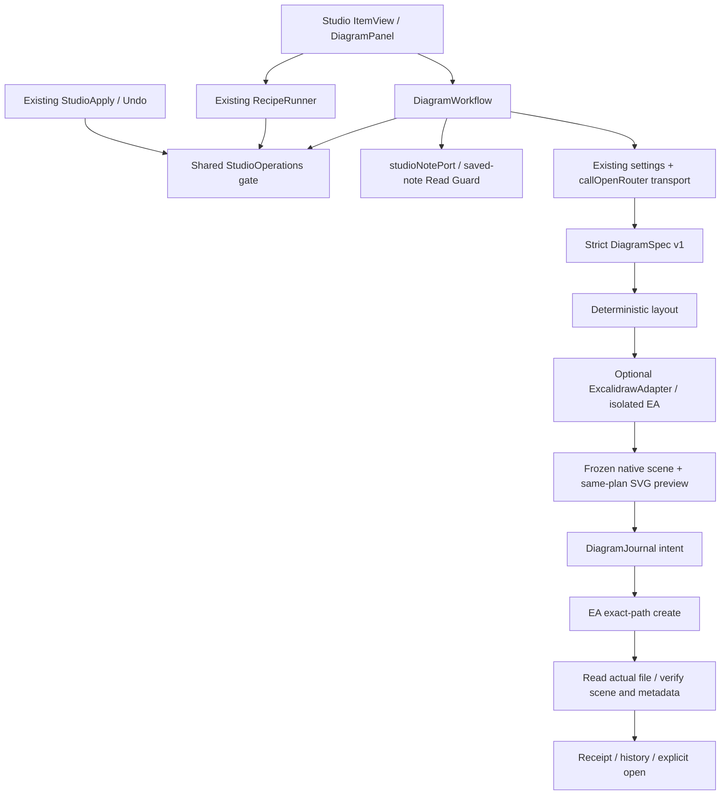

# Studio native Excalidraw output v1

Studio → Create diagram / Создать схему extracts either a note structure or an explicitly described process from one selected saved Markdown note. The user reviews the exact outgoing request, explicitly sends it, reviews a local visual diagram and its nodes/edges, then separately confirms one exact new `.excalidraw.md` path. The source is never a write target. Generated content requires human review; schema validation does not establish factual accuracy.

## Architecture



- `studio/operations.ts`: plugin-scoped exclusive ownership. Recipe generation, Apply, Undo/history and diagram operations share it. Only the explicit Runner → its writer call re-enters using the same owner. Closing a view does not silently cancel or duplicate the shared run. Plugin unload cancels subsequent actions and disposes subscriptions.
- `studio/diagram/spec.ts`: bounded, nonrecursive, strict data contract; safe text typography.
- `layout.ts`: graph geometry, text wrapping/measurement, styles. `preview.ts` uses safe SVG DOM primitives from this frozen plan; no HTML parsing, external fonts/resources, raster image, temporary vault file or second editor.
- `adapter.ts`: the only optional-plugin registry boundary and local EA interface. It obtains an independent instance, builds native elements, snapshots them, and destroys the instance in `finally`. Saving uses a fresh instance populated with that exact snapshot; it never resets the shared EA or selects an active canvas.
- `workflow.ts`, `journal.ts`: separate create-only proposal/result/history protocol. `StudioProposal` explicitly distinguishes Markdown and Diagram. The Markdown journal equations and Undo contract are unchanged.
- `view.ts`, `messages.ts`: RU/EN entry, consent, Review, local direction/style changes, exact path confirmation, creation/open states and recovery UI. Common form primitives moved unchanged into `studio/ui.ts`.

Recipe v1, Registry v1 and Community Catalog v1 remain Markdown-only. Diagram workflows are two local built-ins, with no import/export/editor/publication controls. No new runtime dependency, React editor, API client, credentials or command ID. No manifest/version change.

## Pinned optional API

Test target: **Obsidian Excalidraw 2.29.0**, upstream commit `4acaf9e375e1dfb731faec9c2dd3439bd52cc4cb`. Other versions fail closed as incompatible pending verification. Official references:

- [API declarations at the tested commit](https://github.com/zsviczian/obsidian-excalidraw-plugin/blob/4acaf9e375e1dfb731faec9c2dd3439bd52cc4cb/docs/API/ExcalidrawAutomate.d.ts)
- [ExcalidrawAutomate implementation](https://github.com/zsviczian/obsidian-excalidraw-plugin/blob/4acaf9e375e1dfb731faec9c2dd3439bd52cc4cb/src/shared/ExcalidrawAutomate.ts)
- [Native exact-path creation](https://github.com/zsviczian/obsidian-excalidraw-plugin/blob/4acaf9e375e1dfb731faec9c2dd3439bd52cc4cb/src/core/managers/FileManager.ts)
- [Text/link interpretation](https://github.com/zsviczian/obsidian-excalidraw-plugin/blob/4acaf9e375e1dfb731faec9c2dd3439bd52cc4cb/src/shared/ExcalidrawData.ts)
- [API introduction](https://zsviczian.github.io/obsidian-excalidraw-plugin/API/introduction.html), [utility documentation](https://zsviczian.github.io/obsidian-excalidraw-plugin/API/utility.html), [element skeleton background](https://docs.excalidraw.com/docs/@excalidraw/excalidraw/api/excalidraw-element-skeleton).

Used: `plugin.ea.getAPI()`, `measureText`, `addRect`, `addEllipse`, `addDiamond`, `addText`, `addArrow`, `getElements`, instance `elementsDict`/`style`/`canvas`, `create`, `decompressFromBase64`, `destroy`. The generated elements use reciprocal `containerId`/`boundElements`, and arrow `startBinding`/`endBinding` with `elementId`, `mode`, `fixedPoint`. Text and shapes are individually editable; no whole-scene group.

**Declaration drift:** `create({exactPath, validateBeforeCreate, silent, frontmatterKeys})` exists in the pinned implementation but the pinned `.d.ts` still lists the older options. The local interface deliberately records the implementation signature; version and methods are checked at runtime. `exactPath` bypasses default folder/compatibility naming, templates and automatic suffixes, and invokes the synchronous guard immediately before `Vault.create`. No monkey patching. Parent directories must already exist, so upstream folder preparation has no intended folder creation to perform.

`getSceneFromFile()` was inspected but is not used to inspect stored results: its `getTemplate` path parses text transclusions. Instead the adapter reads only the selected result, finds its `Drawing` block and decodes JSON. The EA decoder in 2.29.0 checks literal backslash-n rather than actual newline characters; the adapter strips actual CR/LF before calling it. This was found by native creation with compression enabled. No second compression library is bundled.

## DiagramSpec v1

All fields below are required; unknown fields at every level, unknown versions/kinds/shapes, wrong types and invalid references reject the entire response.

```json
{
  "schemaVersion": 1,
  "kind": "flowchart",
  "title": "Request validation",
  "nodes": [
    { "id": "receive", "label": "Receive request", "shape": "rectangle" },
    { "id": "check", "label": "Valid?", "shape": "diamond" }
  ],
  "edges": [
    { "id": "e1", "from": "receive", "to": "check", "label": "" }
  ]
}
```

| Field | Contract |
|---|---|
| `schemaVersion` | Numeric literal `1` |
| `kind` | `structure` or `flowchart`, exactly the selected mode |
| `title` | Nonempty, at most 120 UTF-16 code units |
| `nodes` | 1–30 objects; `id`, `label`, `shape` only |
| `shape` | `rectangle`, `ellipse`, `diamond` |
| node `label` | Nonempty, at most 240 code units |
| `edges` | 0–60 objects; `id`, `from`, `to`, `label` only |
| edge `label` | May be empty; at most 80 code units |
| IDs | ASCII letter followed by letters/digits/underscore/hyphen; 1–24 characters, globally unique across nodes and edges |
| endpoints | Must identify existing nodes; self edges, cycles and disconnected components are retained |

Labels support Cyrillic and line breaks. Control characters other than tab/CR/LF, Unicode format controls and unpaired surrogates are rejected. Response size is bounded at 32,000 characters before parsing, nesting at four levels before `JSON.parse`. Input is at most 24,000 characters; requested output limit is 8,192 tokens. The user supplies the model's verified context budget; UTF-8 request bytes + 128 + output tokens are a conservative allowance, not tokenizer discovery. No truncation, sampling, extra note reads, model-based repair or automatic retries.

The prompt requires only source-described relationships, preservation of uncertainty, and no invented steps/causality. It forbids programs, commands, provider settings, arbitrary scene JSON and resources. The schema controls field structure rather than treating the model as trusted. UI model strings are literal text. Rendered labels replace ASCII `[ ] < > : backtick backslash ^ % # $` with visible fullwidth equivalents, preventing Excalidraw's wiki/Markdown/URI/transclusion and Markdown section/block parsing. Review exposes the original model labels alongside the inert scene; it does not conceal the conversion.

## Layout and rendering

Measured at 20 px with Excalidraw's installed Helvetica font (font family 2). Words and long words wrap within 220 px for nodes / 160 px for edge labels. Rectangle padding is explicit; diamonds and ellipses reserve twice the text rectangle. Font size never shrinks to conceal overflow. Ordered DFS identifies back edges; longest paths in the remaining DAG determine layers. Weak components occupy separate bands; back/self edges route outside the main flow. Both down and right directions use the same algorithm. Themes are Neutral and Graphite & Amethyst; shape, text and arrows carry meaning independently of color.

At most 24,000 units on either canvas axis; oversized layouts fail explicitly. Deterministic ordering and measured geometry for the same input/options/environment. This is a bounded diagram layout, not a general crossing-minimizing graph router: crossings and edge-label congestion remain possible on dense graphs. Pan/zoom and fit are available in Review. Local changes generate a new immutable proposal ID and invalidate previous write confirmation; no new model request.

## Read, send and create boundaries

1. Explicit mode, one saved note and exact destination; optional Excalidraw and existing model settings checked before reading/sending.
2. Only that note's saved bytes are read. Existing Studio Read Guard inspects all loaded views including popouts. A saved open Markdown editor is permitted; divergent or unverifiable buffers block. Metadata inventories are used for selection/path collision checks, not other note content.
3. Frozen model settings, body and source snapshot; zero provider calls until consent. Existing transport requires a complete `stop` completion and rejects refusal/tool calls/truncation.
4. Validated graph → immutable native scene/geometry → visible Review. No diagram or temporary vault file yet.
5. Fresh source identity/stat/content check before creation; Read Guard repeated in upstream `validateBeforeCreate`. Source is not a write target and need not be closed. Changes require a new explicit generation.
6. Exact canonical target path ending `.excalidraw.md`; existing visible parent only. Existing repository path policy rejects traversal, hidden/service paths, reserved/ambiguous punctuation and config directory. Each ancestor/final name is checked against loaded inventory and direct directory listings using NFKC + lowercase. Existing files and folders are never overwritten and names never change after consent.
7. Durable verified intent before creation, then exact-path EA create, actual file reread, scene + Markdown metadata verification, receipt. Only then an explicit Open action.

The code-generated source link resolves to the actual selected `TFile`; unsafe/ambiguous source names fail before sending. Source names must satisfy the same visible canonical path policy (e.g. no `:`, brackets, `|`, `#`, `^`, control characters). No inferred/model-provided path or link enters the scene.

The native file contains no embedded resources, images, iframe, executable SVG/HTML or onload script and inherits no template. Per-file `excalidraw-autoexport: none` disables PNG/SVG export; `excalidraw-open-md: false` selects the editor. Excalidraw's separate global legacy `.excalidraw` autoexport setting does not honor `none` in this version: if enabled the adapter reports incompatible until the user disables it. Studio never changes that global setting. Arbitrary user-installed hooks and other plugins remain outside these guarantees, especially when explicitly opening a drawing.

Creation is an in-process guarded operation, not a universal filesystem transaction. The shared Studio gate, exact-path native create and callback checks protect this plugin's operations; external processes, symlink/filesystem semantics, other plugins and hooks cannot be made universally transactional through Obsidian's API. No cross-process atomicity is claimed.

## Journal, normalization and recovery

`<vault.configDir>/plugins/<manifest.id>/studio/diagrams/<operation UUID>/` contains:

- `intent.json`: version/operation ID, target, tested Excalidraw version, timestamp, exact source snapshot + SHA-256/stat, complete expected native scene. Payload has its own SHA-256 and is reread after creation of the intent.
- `receipt.json`: `created` or `not-created`, observed payload SHA-256 (for created), and whether confirmation was manual. Intent is reread before adding the receipt.

One proposal permits one attempt. Repeat confirmation returns its cached outcome; opening failures never regenerate or recreate. Any issued create with missing/failed readback or receipt remains `unconfirmed`, even if the file appears present. Restart only loads history and never replays, deletes, renames or attempts rollback.

History distinguishes `created`, `not-created`, `unconfirmed`, `changed-unavailable`, and damaged evidence. Receipt plus canonical scene/metadata comparison recognizes unchanged native content across compression, ordering, native bookkeeping and text metric normalization and the observed native 6 px orbit-binding endpoint gap (bounded to 8 px; interior route coordinates still match to 0.01 px). Actual text, shapes, links, colors, geometry or binding changes are not dismissed as serialization noise. An unresolved intent can offer a read-only observation ticket: existing matching scene → created; verified absent file → not-created. Confirmation rereads evidence and current result; a changed ticket fails. This records the observed state, not provenance certainty about an external writer. No deletion follows a matching filename/hash.

There is **no automatic diagram Undo/delete**. The created drawing is independent and may contain later user work. Markdown Undo remains intact. Changed drawings remain available through Obsidian's file explorer; Studio's verified-open action only opens results whose receipt and scene are still verified.

## Native and automated validation

See [evidence summary](studio-excalidraw-evidence/README.md). Unit/integration tests use a synthetic DiagramSpec through the actual existing transport (`callOpenRouter → requestUrl`) with the HTTP boundary mocked, alongside the real Studio Read Guard, shared ownership, creation journal and adapter. Native harness uses a real local HTTP server, not a bypass of generation.

Reproduction (desktop Linux, Node with WebSocket, installed `/usr/bin/electron43` and `/usr/lib/obsidian/app.asar`):

```sh
npm ci --ignore-scripts
npm run build
# Download official 2.29.0 main.js, styles.css and manifest.json into an isolated /tmp assets directory.
node scripts/studio-excalidraw-native.mjs /tmp/veynrel-diagram-native-UNIQUE /tmp/veynrel-excalidraw-2.29.0-assets
```

Harness refuses an existing root, uses only synthetic Markdown and a disposable vault/profile, and records runtime versions/build hashes, HTTP bodies, screenshots, native scene and editable output. Intermediate failed runs are retained separately; only the final reported run is acceptance evidence. No models/downloads, paid APIs or personal vault installation. The user-facing manual smoke and real-model semantic quality remain separate later gates.

## Next manual smoke

1. In a disposable vault enable Veynrel and tested Excalidraw. Select each mode with a saved source open. Inspect provider/model, exact text and budget; cancel once and confirm there was no request.
2. Generate with your chosen model, then inspect every relationship against the source, including uncertainty, branch labels and any missing concepts. Record semantic mistakes separately from schema acceptance.
3. Review both directions/styles, a cycle/disconnected component, RU/EN, light/dark, a narrow pane and keyboard navigation. Change parameters and verify the final exact path anew.
4. Create once, open in Excalidraw, edit one label, move a block and check attached arrows/labels. Save, close, reopen and follow Source. Confirm source bytes and unrelated drawings remain unchanged and no extra exports appear.
5. Repeat negative cases: unsaved source, change after Review, occupied/case-equivalent name, disable/reload Excalidraw, stop generation. Inspect history; never expect automatic deletion/Undo of the drawing.
6. If Open fails, retry opening from history. For an unconfirmed create, inspect the exact file and history's observation ticket; do not retry creation blindly. Keep the diagram journal for diagnosis.
