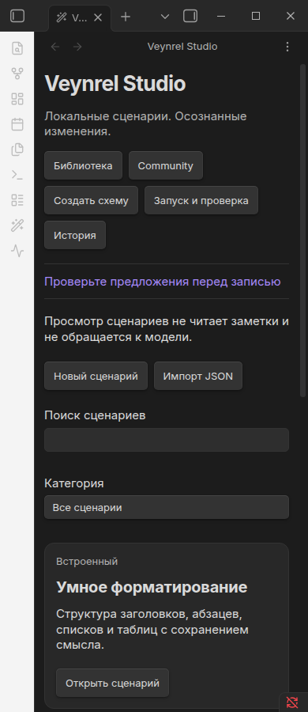
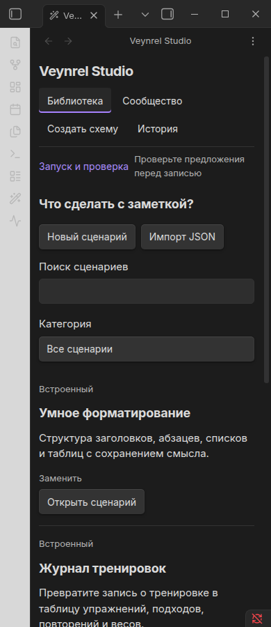
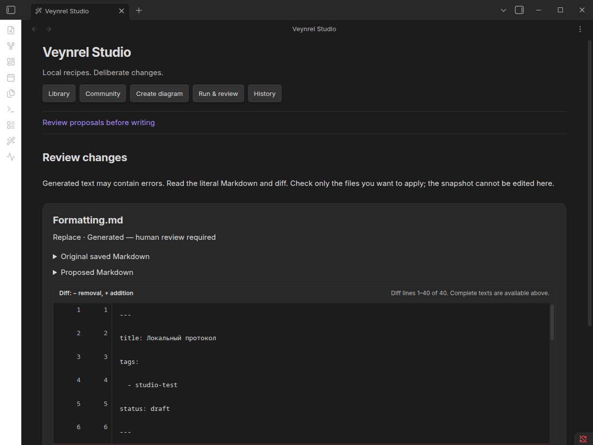
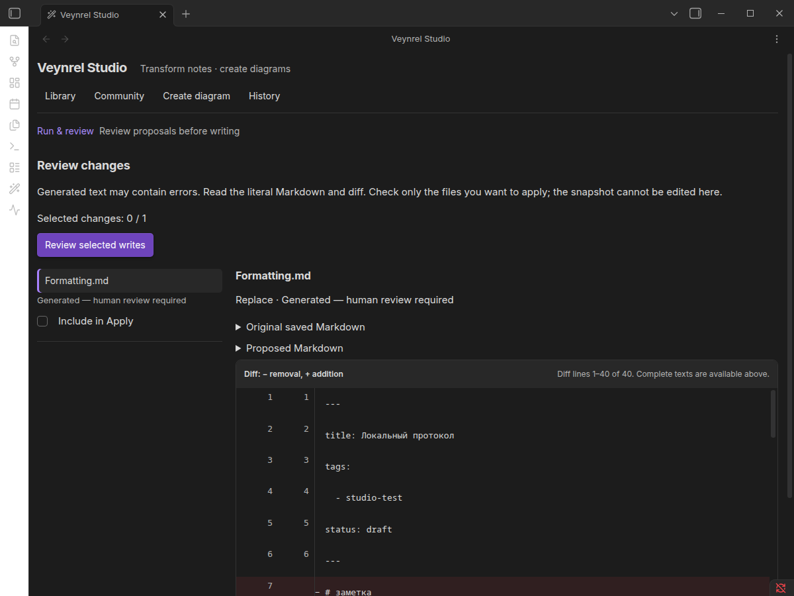
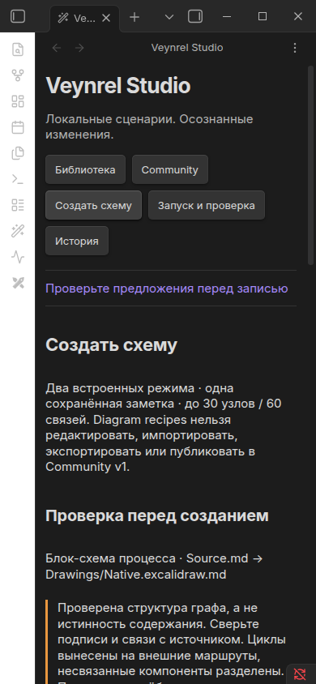
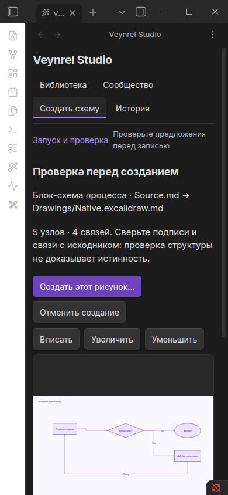
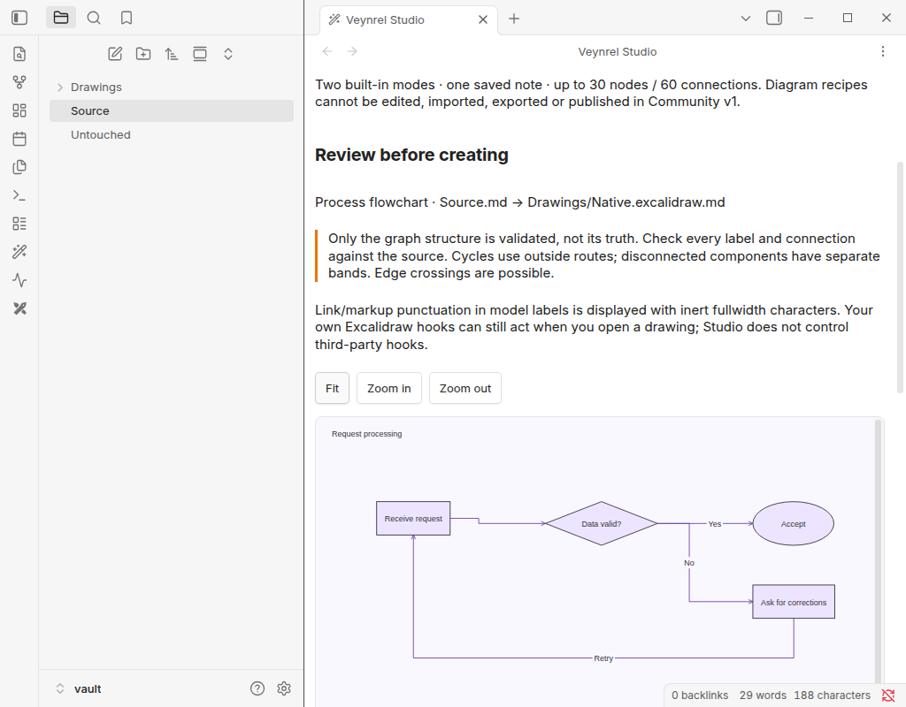
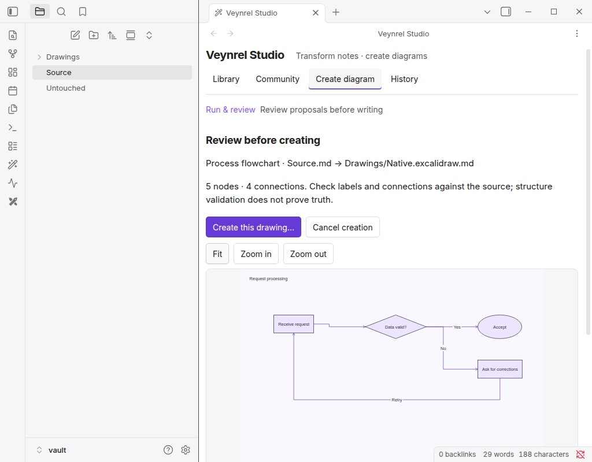
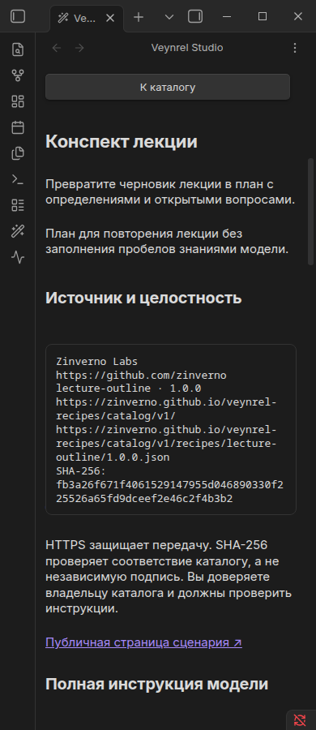
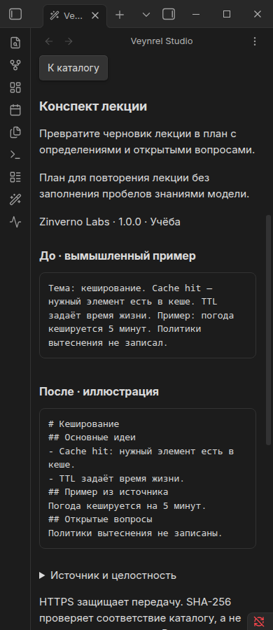

# Studio UX reset evidence

Runtime source: `bd811f262fab37db70651f8ce954a7e18b111037`. Plugin base/PR dependency: `e3651e4bf805ddd4d73c5e55195a63ded4a06101` (#124). Evidence-only changes after the runtime commit do not alter the bundle: all three final native reports and the delivered build have identical SHA-256 values in [SHA256SUMS](SHA256SUMS).

## Gates

| Gate | Observed result |
|---|---|
| npm test -- --maxWorkers=4 | 5,030 tests / 185 files passed |
| typecheck, build, lint, diff --check | Passed; lint retains only the two pre-existing fetch advisories |
| audit:proposals | 5/5 mutations killed; restored tests passed |
| Native Markdown Studio | 83 checks, 47 screenshots, zero captured renderer exceptions |
| Native Diagram + actual Excalidraw 2.29.0 | 29 checks, 9 screenshots, zero captured renderer exceptions |
| Native Community, local synthetic catalog | 39 checks, 21 screenshots, zero captured renderer exceptions |
| Catalog | 29 tests, both immutable baselines, build and local browser smoke passed; separate PR #2 |

[Summary](summary.json), [Markdown raw report](markdown-native.json), [Diagram raw report](diagram-native.json), [Community raw report](community-native.json). Runtime versions and exact source/build hashes are recorded by the native harnesses. This is the installed Obsidian application, not an HTML reconstruction.

The three native runs were sequential to avoid window-focus competition. All use disposable synthetic vaults/profiles and loopback completions through the existing transport. Markdown verifies all six original hashes restored; Diagram checks source hashes, one create-only file, real text/arrow edits, block movement/bindings and save/reopen. Community verifies local edits/update/copy, stale cache, offline and damaged storage. The final Community run did not opt into the optional public HTTPS catalog test; transport/origin/hash boundaries also retain their automated tests.

## Coverage and limits

- RU/EN × native light/dark × 1200/390 for library, consent, Markdown Review, history and Community/list/detail. Diagram includes EN dark split/light and RU 390 light/dark. These are desktop leaf/viewport checks, not physical mobile.
- Additional EN native checks at 1440/1024/390, actual split near 720px, 200% Electron zoom. Existing native tests cover actual popout saved/unsaved editor guards. This is not a full Cartesian matrix of every state, width, language and window type.
- Draft return preserves search/selection/instructions; status preserves caret/focus; dirty modal close offers continue/discard. No passive note read/provider call. Review default selection remains empty, including 20 real loopback results with one rendered diff.
- 100 synthetic metadata recipes rendered 628 DOM elements in 23.6 ms in one measured local run. Zero-result search and long Russian result paths also checked. This is not a low-end-hardware benchmark or sustained-memory profile.
- Computed primary-action text contrast: 6.53:1 dark, 6.69:1 light. Focus, native labels and keyboard paths visually inspected; no full WCAG certification or screen-reader speech claim.
- Diagram preview status event retains the same DOM/zoom; changed options remain dirty and creation blocked until local revise, without a provider call. Modifier shortcuts are not consumed by preview.
- Inert output assertions remain; no MarkdownRenderer, model HTML, embeds, remote images or postprocessors.
- Owner manual acceptance, real-model factual quality/usefulness, physical mobile, third-party themes/hooks and full assistive-technology audit: NOT RUN.

## Visual iteration

Baseline on original HEAD was captured before edits with the same fixtures/harness. Inspection found the library below repeated chrome and diagram canvas absent from the initial split screen. Iteration 1 exposed checkbox stretching and direction/appearance fields still pushing the canvas down at 390px. Iteration 2 fixed control sizing, moved parameters into the inspector and brought create/Apply actions before the work area. Full screenshots were viewed after both iterations; no images were retouched/cropped.

| Same-data comparison | Before | After |
|---|---|---|
| Library RU dark 390 |  |  |
| Markdown Review EN dark 1200 |  |  |
| Diagram RU dark 390 |  |  |
| Diagram EN light |  |  |
| Community card RU dark 390 |  |  |

Also inspect [real split](after-ux-library-real-split.png), [200%](after-ux-200-percent.png), [100 recipes](after-ux-100-recipes.png), [20 results](after-ux-20-results.png), [offline](after-offline-cached.png), [native canvas](after-diagram-native-open.png) and [edited native drawing](after-diagram-native-edited-moved.png). Full final screenshot sets are included in the separate review artifact.

## Earlier failures retained

[Attempt ledger](earlier-attempts.json) records failed native attempts rather than calling them PASS. An early focus-restoration implementation could refocus controls outside the Studio body; restoration was restricted to owned fields. New UX-test failures included selecting Obsidian's search outside Studio and synthetic non-bubbling input missing delegated dirty handling; selectors and event realism were corrected, with assertions retained. Initial CSS tests rejected literal colors and a forbidden column-gap pattern; semantic tokens/gap fixed implementation, tests unchanged. Sandbox loopback/child-process restrictions required host execution. The final runs above supersede these attempts; no protective assertion, timeout or engine call was weakened to pass.
