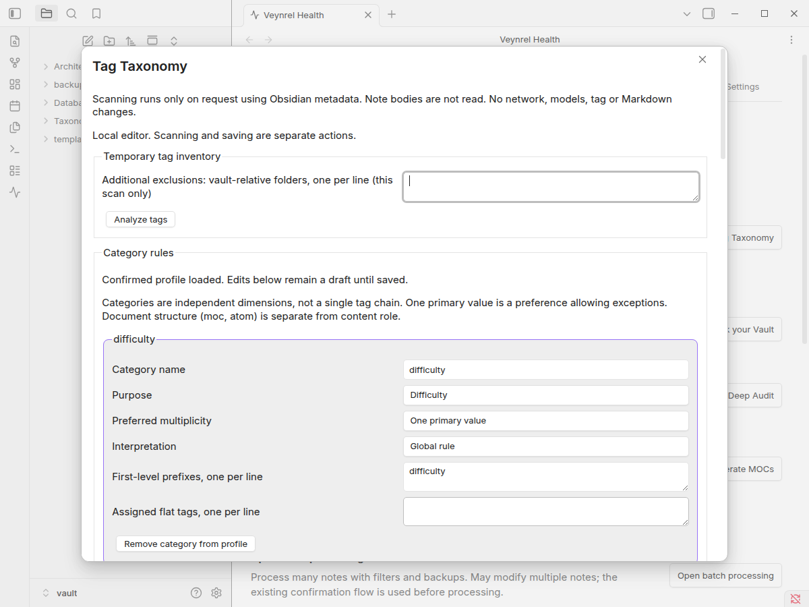
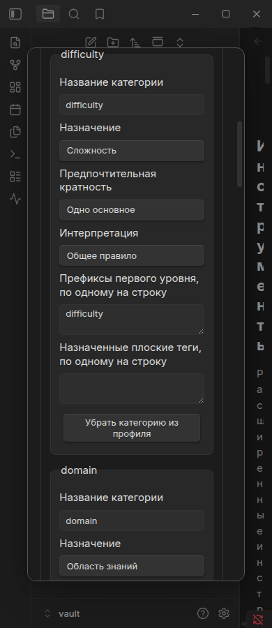
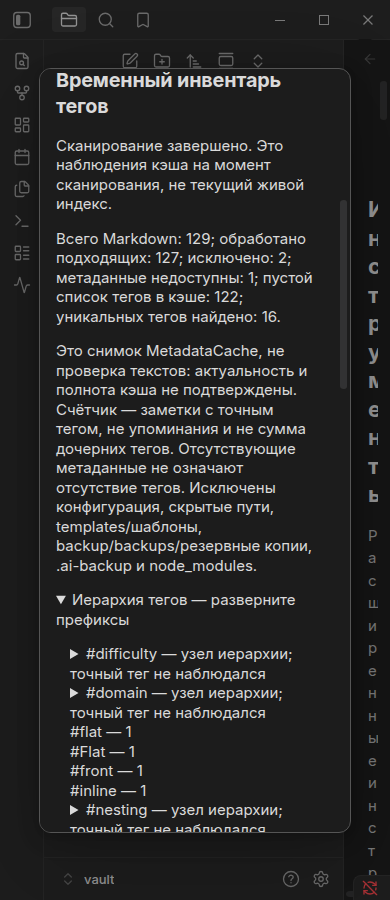

# Tag Taxonomy Profile v1

Open **Veynrel → Tools → Tag Taxonomy** (RU: **Таксономия тегов**).
Opening Tools or this modal reads only the already loaded profile. It does not
enumerate notes, read Markdown, call a provider, or create a profile. This feature
requires neither Deep Intelligence configuration nor Decisions nor embeddings.

Optional [Tag Recommendations v1](tag-recommendations-v1.md) now extends this
dialog with a separately confirmed LLM request for one selected note. Local
scanning and profile editing retain the boundaries described here.

## Inventory and structure

**Analyze tags / Проанализировать теги** explicitly enumerates
`Vault.getMarkdownFiles()`, obtains `MetadataCache.getFileCache(file)` and uses
Obsidian's public `getAllTags` helper for inline and YAML frontmatter tags. There
is no new Markdown parser and no note-body fallback. A tag repeated inline and
in frontmatter counts once per note. Literal case, Unicode and nesting are
preserved: `Flat`, `flat`, `роль/теория` and `role/theory` remain separate observed
spellings. This literal inventory does not override Obsidian's case-insensitive
tag lookup or infer equivalence between differently named values.

The temporary inventory shows examined eligible notes, exclusions, missing cache
entries, cached empty tag lists and unique tags. Missing metadata is **unknown**,
not evidence of no tags. Counts describe available cached observations, not a
verified reading of every note's current source. Embedded content is not read.

The expandable tree follows actual slash-separated paths. Each count belongs to
the **exact tag**, not the sum of its children. An intermediate prefix without an
observed exact tag is labeled as a hierarchy node, with no invented count.
Flat tags and currently unassigned tags have separate lists. Tree branches are
expanded on demand; lists show 100 entries per page. This preserves hierarchical
browsing without turning independent categories into a combined search chain.
Global search and filtering are unchanged.

The existing Deep Audit eligibility predicate is reused without changing its
behavior. Taxonomy additionally excludes unsafe/noncanonical paths, hidden path
segments, `templates`, `шаблоны`, `backup`, `backups`, `резервные копии`, and
`node_modules` folders, as well as the configured vault configuration directory
and `.ai-backup` paths. Additional vault-relative folders can be excluded for the
current scan; they are not saved as profile rules. There is no arbitrary external
path access. Custom service folders cannot be inferred reliably; exclude those
explicitly before scanning.

## Category proposals and confirmation

Nested tags are grouped by their **literal first-level prefix**. The names remain
the user's existing names. A small RU/EN lookup proposes a purpose for `role` /
`роль`, `difficulty` / `сложность`, `domain` / `область`, and `topic` / `тема` /
`тематика`. All other prefixes start as **Other**. These are editable structural
hypotheses, not semantic classification. In particular `type` and `тип` are not
automatically interpreted as a content role; YAML `type: moc` or `type: atom`
is not a tag and is not used.

**Add proposals to draft** does not confirm or persist them. For each category,
edit its name and independent policy:

| Purpose | Initial multiplicity | Initial interpretation |
| --- | --- | --- |
| Content role | One primary value | Global |
| Difficulty | One primary value | Relative to knowledge domain |
| Knowledge domain | Multiple allowed | Global |
| Topic | Multiple allowed | Global |
| Other | Multiple allowed | Global |

All policies are editable, including difficulty that is global and roles that
allow multiple values. One primary value is a preference, **not a prohibition of
exceptions**. Changing purpose does not silently overwrite other edited policies.
V1 records the domain-relative policy, not a separate scale for each domain.

Assign first-level prefixes and flat tags using one literal value per line.
For example, remove the separate `тип` draft category and add `тип` beside `role`
in the same category's prefix field. Both prefixes then belong to one logical
dimension; their tag values are not renamed or asserted to be equivalent.
A prefix owns only nested descendants: the flat `#role` requires its own explicit
flat-tag assignment. Bindings may refer to tags absent from the current snapshot
(for example because metadata is unavailable); this does not create any tag.

Duplicate category IDs/names, a prefix assigned more than once, or a flat tag
assigned more than once are rejected. A nested tag cannot be entered as a flat
assignment, and a nested prefix cannot be entered as a first-level prefix. Several
separate categories may share a purpose without claiming that their values are
equivalent. No synonym matching or automatic tag normalization occurs.

Choose **Review changes**, inspect before/after category rules, then explicitly
**Save profile**. Closing before saving discards the draft. Reopen to use confirmed
rules without another scan; a new scan refreshes only the temporary inventory.
**Discard draft and reload saved rules** also resolves an edit conflict with
another open taxonomy editor.

## Persistence and lifecycle

The optional `AIHubSettings.tagTaxonomyProfile` is the only new persisted field:

```json
{
  "version": 1,
  "categories": [{
    "id": "category-1",
    "name": "Роль",
    "purpose": "role",
    "multiplicity": "one_primary",
    "interpretation": "global",
    "prefixes": ["role", "тип"],
    "tags": ["Практика"]
  }]
}
```

The profile stores **only explicitly confirmed rules and bindings**. The inventory
stores observations and counts **only in the open session**. Neither full texts,
note paths, full-vault tag inventory, counts, model output, nor unconfirmed
proposals are copied into the profile. Existing credentials/settings are untouched.

Saving reuses `AIHubPlugin.saveSettings` and its existing serialized persistence
queue. The candidate is validated and cloned; the current settings are merged
inside the queue. A comparison with the editor's starting profile rejects stale
editors without overwriting newer rules. Concurrent ordinary, Health and model
settings edits keep their own values. There is no separate settings file, index,
database, migration scan or background audit.

Old installations have no profile until explicit confirmation. Strict validation
rejects unknown fields, schema versions, invalid enums and conflicting assignments.
A malformed profile is ignored in memory and does not break plugin load or cause
a new write on load; unrelated settings continue to load through existing logic.
A later explicit settings save can omit that invalid field. V1 bounds profiles to
64 categories, 100 prefixes and 100 flat bindings per category, 100 characters per
name, 512 per binding, and 131,072 UTF-16 code units in serialized form.

Scanning yields to the UI at most every 50 files (or after about 8 ms of processing)
and every 250 distinct tags in a large cached note. Native enumeration and the
native tag helper themselves are synchronous. Cancel or close aborts remaining
work; a partially processed note contributes no partial tag counts. Temporary
vault/cache listeners exist only during the scan. An observed change marks the
result stale; no proposals are generated from stale, cancelled or limited scans.
After completion the inventory remains a historical snapshot, not a live index.

To bound memory/rendering, a scan stops at 20,000 distinct tags, 10,000 cached tag
entries per note, 512 characters per tag or 32 nesting levels. Malformed cached
tags also produce an explicitly incomplete result. Missing cache entries are
reported separately even on a completed scan. They do not prevent hypotheses
about the tags actually observed, and never establish complete coverage.

Saving has explicit pending/error states and rejects double submission. Closing
aborts a save still waiting in the queue; a settings write already dispatched may
finish, as the UI states. Closed sessions cannot publish late UI updates. No
operation in this feature writes, renames, creates or deletes Markdown or tags.

## Verification

Unit tests cover native-helper inputs, note-level deduplication, flat/nested and
RU/EN literal names, missing metadata, scope, cancelled/stale/limited scans,
conflicting assignments, editable multiplicity/domain policy, strict persisted
schema, legacy settings, reload, concurrent settings edits, failed saves and
closed/double-submitted sessions. Existing Tools, Deep Audit, Pair Inspector and
Relationship Analyzer tests remain in the full suite.

The synthetic native runner extends the existing isolated Pair Inspector host:

```sh
npm run build
node scripts/pair-inspector-native.mjs /tmp/pair-inspector-taxonomy-fresh --taxonomy
```

Use a fresh directory each time. The fixture has English/Russian YAML and inline
tags, duplicate mentions, independent dimensions, flat case variants, excluded
folders and enough files for cancellation between batches. It exercises the real
Tools route, MetadataCache helper, review/save queue, reopening, keyboard tree
navigation, 1200/390 px, RU/EN and both built-in themes. One cache entry is
deliberately unavailable and the stale-scan event is synthetic. This is desktop
acceptance, not a physical mobile or screen-reader certification.

Recorded native run: **PASS, 46 recorded checks**, Obsidian 1.13.7 / Electron 43.6.0.
The fixture contained 129 Markdown files: 127 processed, 2 excluded, 1 deliberately
unavailable cache entry, 122 cached empty lists and 16 distinct tags. All eight
language/theme/width combinations passed overflow checks; keyboard expansion,
field labels, conflict/review/save/reload, concurrent ordinary settings, scan
cancellation/staleness and Pair Inspector regressions passed. The **taxonomy
phase** recorded 0 note-body reads, 0 Markdown writes and 0 network calls. Whole
harness read counts also include Obsidian ingesting the externally seeded fixture
and explicit Pair Inspector reads; those are not taxonomy scans. Network counters
cover fetch/XHR and Decisions/Rerank factories, not `requestUrl`.

See the [machine-readable report and tested artifact hashes](tag-taxonomy-evidence/native.json).
Automated gates: 122 test files / 3043 tests, typecheck, lint, build,
`audit:proposals` (5/5 mutations detected) and `git diff --check` passed. Lint has
one pre-existing reviewed streaming-fetch warning in `api.ts`. The audit's final
run used the host environment after a sandbox child returned empty test output.







## Deferred

No LLM, embeddings, Decisions, content-based tag recommendations, new semantic
tags, synonym merging, note-level policy enforcement, tag edits, atomization,
consolidation, Relationship Analyzer application, Markdown transactions or undo.
The confirmed independent dimensions are a foundation for later opt-in workflows;
v1 does not automatically apply them to notes or rebuild global search.
