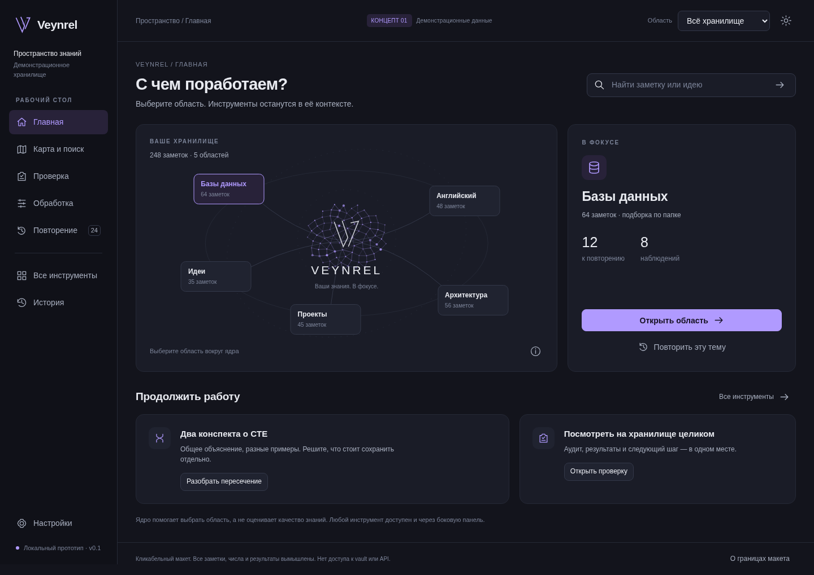
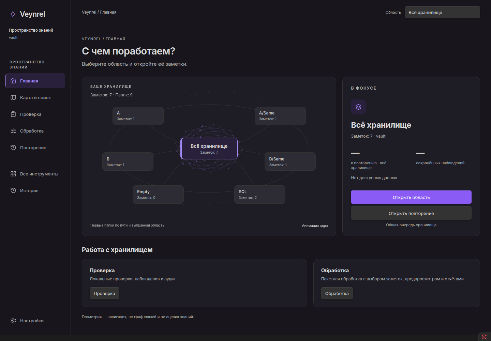
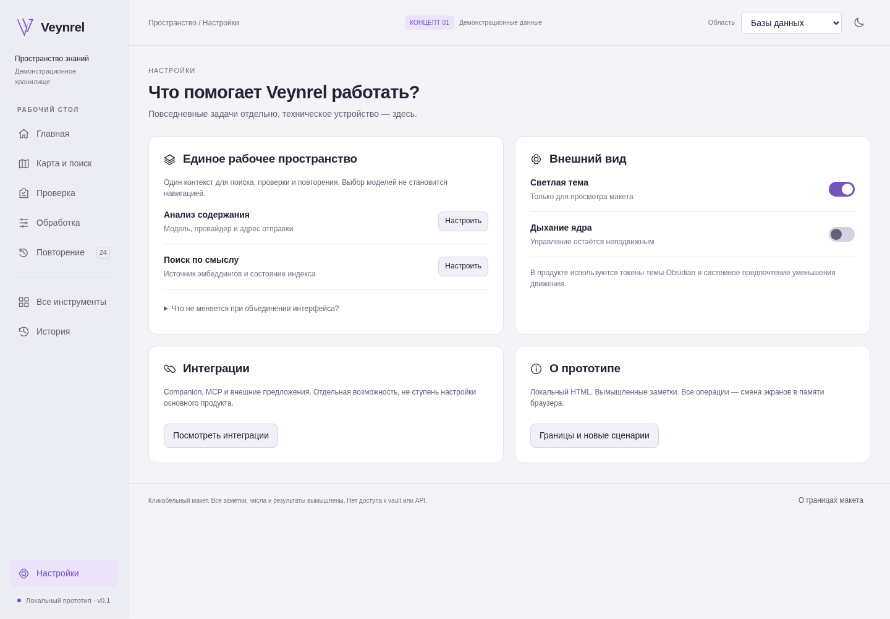
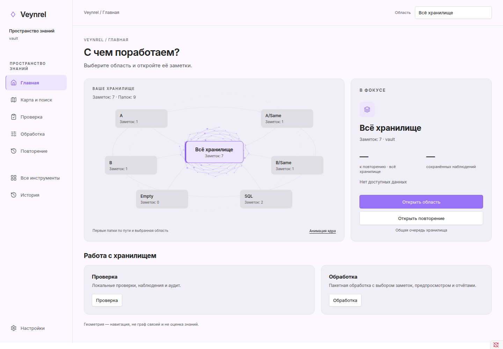
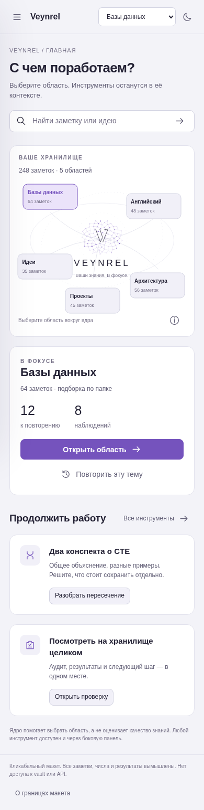
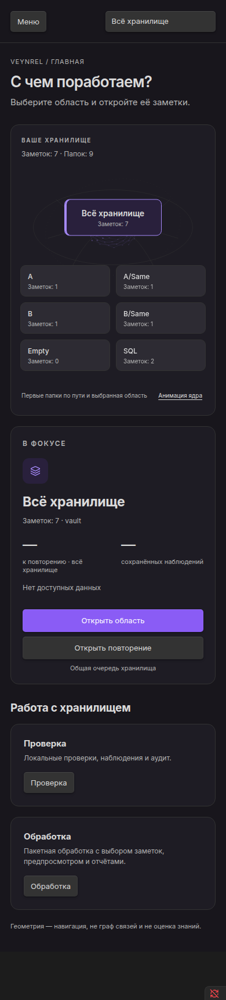

# UX Reboot — Stage 1

Implementation and acceptance report for the approved Graphite & Amethyst composition.

## Base and dependencies

- Remote main inspected: `0df3167977a2a255b0faaaca998fdfa593d2971c`.
- Implementation base: `59e57842d8772b5804f7421428e9af5e53b31fa6` (open PR #104).
- Implementation/source HEAD: `ef6ce69501904179e6d9e4e0d9bcfd399e43b9a3`. The following evidence commit changes documentation and captures only; CI must use the final PR head.
- Branch: `feat/ux-reboot-native-home-v1`. #104 must land first; its UX/Analyzer fixes are preserved by ancestry. No changes to that PR or #105.
- #105 (`75f4c3aac179bad416eea1f3f902b036976bd5f7`) supplies an existing synthetic lab; only a new isolated copy is used. Its product branch is not merged.

## Feature inventory and acceptance routes

| Capability | Existing owner / command | New entry | Actual scope | Access check |
| --- | --- | --- | --- | --- |
| Health, Knowledge Health | HealthPluginController / veynrel-open-health | Check → Health | Vault / existing profile | Native route + controller tests |
| Findings | FindingStore / Findings inbox | Check → Findings | Existing vault inbox filters | Native route + inbox tests |
| Full / Single Audit | getToolsPort.openDeepAudit → AuditModeModal | Check → audit selector; Tools | Existing audit modes | Native mode selector, no run |
| Batch, reports, backups | openBatchProcessing → BatchProcessModal / ai-batch-process, ai-hub-open-panel | Process; Tools | Modal's own explicit selection | Native modal, no processing |
| Search, related, duplicates | SemanticIntelligencePort | Map and search → existing Discover | Existing index / selected source | Native navigation, no index build |
| Topology | VaultTopologyPort | Check → topology | Existing vault metadata | Route test |
| Global map, neighborhood, comparison | Existing semantic ports | Map and search → Discover | Existing index, cap unchanged | Route tests |
| Ask Vault, MOC, legacy audit | VeynrelToolsPort | Tools | Existing index / saved clusters / vault | Shared launcher tests |
| Cards / Recall | RecallProductPort, RecallAuthoringPort | Review; Process → cards | Global queue; existing generation source | Native entry, no generation |
| Editor writing, selection, vault writing, Dataview, legacy atomization | Existing editor callbacks | Tools → explicit editor instructions; command/context menu | Concrete Markdown editor / selection | Existing command contracts |
| Safe consolidation / Empty Atom | Existing Pair Inspector, planners and executors | Map and search → duplicates → inspector | Explicit pair / target | Preserved owners; existing regressions |
| History, recovery | OperationHistoryModal; Health/Recall recovery; Batch backups | History; existing recovery surfaces | Existing journal / batch report | Native history + existing recovery tests |
| Companion / MCP / proposals | ConnectPort | Settings → Connect; Tools | Existing integration scope | Native settings/Connect |
| All provider/output settings | Existing product and native settings | Settings | Existing configuration | Existing settings contracts |

All existing public command IDs and `veynrel-health` view type remain unchanged.

## Scope and data semantics

`VaultScopeIndex` is a view-local UI projection, not a new engine. It enumerates
`Vault.getMarkdownFiles()` and `getAllFolders()` once on opening, then refreshes
on coalesced create/delete/rename events. It never reads note bodies. Folder
counts include descendants, with a `/` boundary; root notes belong to All.
The total is unique Markdown paths, not a sum of overlapping folder counts.
Canonical paths come from Obsidian, not basenames or generated topic names.

The initial six folders are sorted by exact full path. A selection outside the
first six replaces the sixth visible folder, so the selected area stays visible.
The native picker includes every folder, including empty and nested folders.
Deletion/rename of the selected folder or its ancestor creates an explicit missing
selection. Recreating the old path does not silently revive it. The user must
select again. Each leaf has its own selection, menu and motion state; nothing is
persisted in settings. Closing returns the next view to All.

The right panel counts **stored open Findings**, once per finding ID, when any
recorded `notePaths` member belongs to the selected area. It separately reports
findings whose recorded paths also cross the area boundary. This is a projection
of recorded evidence, not a fresh scan or exhaustive inferred dependency set.
It explicitly does not establish freshness or coverage. Missing/unavailable
storage has no numeric count. A known stored count is not a health score.

Due comes only from the existing Recall Health projection and refers to tracked
active cards in the global queue. Uninitialized/recovery/first-run state is `—`.
No inventory scan is triggered to fill this number. Folder due is unavailable;
“Open review” explicitly enters the global queue, with a scope handoff. A due
boundary uses the existing one-shot UI wakeup, in the view's owning window;
there is no scheduling algorithm change or polling loop.

“Open area” renders a local path list with a name/path filter, initially 80 rows
and explicit “Show more”; selecting a row delegates to existing safe note opening.
This list does not require an index. Existing semantic exploration remains below
it, with its real index states and limits. The decorative scene has no vectors,
model ranking, health score or note graph semantics.

## Routing and safety

The old primary tab rail is replaced by the sidebar. Check retains explicit
Findings and full/single audit entries; Process delegates to the existing batch
modal and MOC owner, with their existing scope and consequences disclosed.
History delegates to OperationHistoryModal and separately links to batch reports
and backups. Settings retains Connect/Companion/MCP and every provider setting.
Editor tools retain their concrete editor/selection command entries; the catalog
explains that context instead of guessing a previously active editor.

A folder is never passed to a service that has no scoped API. Such a transition
first explains the actual scope and requires an explicit Continue. The folder
selection stays visible and is recovered on returning Home. Scope handoffs are
single-use; switching scope, path invalidation, navigation or close invalidates
stale handoffs and late launcher feedback. Existing analysis/write permissions
are never inferred from selecting a folder. Onboarding and recovery retain
priority over the scene.

UI uses native DOM/SVG and the view's ownerDocument. SVG has no shared IDs or
external resources. Animation is CSS-only, with an accessible per-view toggle,
`prefers-reduced-motion`, and an IntersectionObserver that disables decoration
when the view is hidden; close disconnects it and removes metadata subscriptions.
Responsive layout uses **container width**, including narrow splits in a wide
window. New copy is RU/EN, names are text nodes, and focus is retained when
metadata or service snapshots update.

No changes to Apply/Undo executors, receipt/journal formats, strict evidence
validation, prompts, semantic algorithms, FSRS, manifest ID, command IDs,
dependencies or versions are part of the Stage 1 delta from #104.

## Next bounded stage

Scoped Recall remains required next. Its missing contract must accept an explicit
scope or frozen path set, expose scoped due/eligible counts and inventory freshness,
filter sessions without creating new card IDs or resetting schedules, leave skipped
cards untouched, invalidate deleted/renamed source paths and stale scope responses,
and retain the current single-session owner and persisted rating semantics.
Full maps, audit/batch surfaces and complex reviews can then move into the approved
visual system in separate bounded changes. Stage 1 does not complete the entire
UX Reboot.

## Acceptance evidence — 2026-10-20

Automated gates: **4,482 tests / 163 files passed**, typecheck, production build,
lint (zero errors; the pre-existing `api.ts:414` fetch advisory), proposal mutation
audit **5/5 killed**, and `git diff --check` passed. No assertions or timeouts were
weakened. Existing screen tests now explicitly enter Check/Settings because Home
is the new initial route. New tests cover scope identity, 0/1/2/6/80/1000 folders,
unique counts, unknown data, external dependencies, races, view independence,
resource cleanup and zero note/network IO. Logs: [tests](ux-reboot-stage-1-evidence/tests.txt),
[lint/typecheck/build](ux-reboot-stage-1-evidence/lint.txt),
[proposal audit](ux-reboot-stage-1-evidence/audit-proposals.txt).

The final local suite used `npm test -- --maxWorkers=4`. An earlier concurrent
unbounded run had one timeout in unchanged deep-settings tests; the complete
serially scheduled run above passed. CI uses the repository's unchanged default
`npm test` and validates the final PR head independently. A redirected sandbox
audit produced empty child output; the supported standalone command above passed.

Native **Obsidian 1.13.7 / Electron 43.6.0, Linux desktop**, normal Electron sandbox,
fresh isolated profiles, no credentials, no paid requests/model downloads. The
same production bytes were installed in all three runs:

| Fixture | Notes / folders | Result | Machine-readable report |
| --- | --- | --- | --- |
| Empty | 0 / 0 | PASS | [empty](ux-reboot-stage-1-evidence/empty-report.json) |
| Small edge-case set | 7 / 9 | PASS | [small](ux-reboot-stage-1-evidence/small-report.json) |
| Isolated Lab copy | 1000 / 93 | PASS | [lab](ux-reboot-stage-1-evidence/lab-report.json) |

Each run covered RU/EN, dark/light, 1440 px content, 390 px content, a true
720 px split in a wide window, actual popout DOM ownership, reduced motion,
hidden-view animation stop, close/reopen, main routes, audit mode selector,
batch filters/preview and journal history. The small set additionally covers
SQL vs SQL-old, descendants, duplicate basenames, an empty folder, a rare long
Unicode path, exact source-note opening, folder/ancestor rename and deletion.
Keyboard menu/Escape/focus behavior was driven through native input events.

Opening and scope/navigation checks assert zero Markdown reads/writes and zero
renderer fetch/XHR calls; selecting areas does not re-enumerate metadata.
Later explicit batch preview/editor opening can read notes, and the small test
intentionally renames/deletes its own empty test folder. Those later operations
are included in the reports' final IO counters, so they are **not** the passive
navigation counters. The network tripwire covers renderer fetch/XHR, not a
system-wide packet trace. All Markdown hashes before/after match, including
fresh re-reading of the original synthetic Lab source. The personal vault was
never opened. Existing Lab reports, settings and journals were not copied or
modified. Only spawned test processes were closed.

Reproduce with a built checkout and the installed Linux Obsidian runtime:

```sh
node scripts/ux-reboot-stage1-native.mjs /tmp/veynrel-stage1-new-small small
node scripts/ux-reboot-stage1-native.mjs /tmp/veynrel-stage1-new-empty empty
node scripts/ux-reboot-stage1-native.mjs /tmp/veynrel-stage1-new-lab lab
```

Each destination must be new. The lab mode copies only the 1000 Markdown files
from the existing `Veynrel Lab 1000`, never its plugin state. Native source runs
are retained locally in `/tmp/veynrel-stage1-native-11`,
`/tmp/veynrel-stage1-empty-01` and `/tmp/veynrel-stage1-lab-01`.
Preliminary failed native runs remain in their own directories; only these
completed reports are acceptance evidence.

### Observed timings

No parallel test/build workload during these observations. Opening is command
invocation to rendered Home (includes CDP/readiness overhead); scope switching
measures the synchronous selection/render path, 20 samples. Idle is renderer
CDP TaskDuration over one 1.5 s interval with motion on and one with it off.
These are diagnostic observations, not a benchmark or whole-application CPU/RSS.
The raw reports also contain five switches through two animation frames.

| Fixture | Open ms | Switch median / max ms | Idle task ms, motion on / off |
| --- | ---: | ---: | ---: |
| empty | 266.8 | 5.4 / 7.6 | 14.17 / 6.14 |
| small | 425.7 | 6.9 / 7.5 | 7.14 / 0.86 |
| lab | 216.7 | 8.4 / 11.4 | 27.46 / 20.61 |

### Visual comparison

Original task-kit screenshots are reproduced unedited alongside native captures.
The HTML reference was also opened in Chromium; that browser render is not the
native acceptance. Native screenshots are unretouched CDP captures cropped to the
Veynrel content rectangle, except popout, which includes its native window chrome.
The comparison uses **1440 px** content in both wide images and **390 px** in both
narrow images; capture heights differ to expose the complete narrow page.

| Approved reference | Native Obsidian |
| --- | --- |
|  |  |
|  |  |
|  |  |

Visual review: 208 px sidebar, 74 px topbar, 32 px wide content inset, 18 px card
gap, 14 px radii and approximately 1.85:1 scene/context proportions preserve the
approved composition. At 1440 px the reference scene begins at x=240/y≈220;
native begins at x=240/y≈225. The reference scene is 439 px tall; the Russian
native card stretches to about 468 px to fit honest data/scope labels. Thin
geometry, stationary area buttons, matte surfaces and accent selection remain.
Native theme tokens account for palette/font differences. Intentional changes:
“All vault” replaces the central logo, six real folders replace five demo topics,
unknown metrics are dashes, and genuine Check/Process entries replace invented
recent work. At 390 px areas form a two-column grid and context follows below.

Additional unedited captures: [selected folder](ux-reboot-stage-1-evidence/home-folder-ru.png),
[rare long path](ux-reboot-stage-1-evidence/home-long-folder-390.png),
[English](ux-reboot-stage-1-evidence/home-en-dark-1484.png),
[narrow split](ux-reboot-stage-1-evidence/home-wide-window-split.png),
[popout](ux-reboot-stage-1-evidence/home-popout.png),
[empty vault](ux-reboot-stage-1-evidence/empty.png),
[1000-note Lab](ux-reboot-stage-1-evidence/lab-1000.png).

### Build and safe test installation

Frozen local build directory:

/home/zinvernix/projects/veynrel-stage1-artifacts/ef6ce69501904179e6d9e4e0d9bcfd399e43b9a3

| File (relative to that directory) | SHA-256 |
| --- | --- |
| `main.js` | `32f0f76519ee4f6d65c05022b37effa9d5a46b6bda4bc12c234f4467ece56055` |
| `manifest.json` | `1d701d48f24d7303b0f9c1657756260f9f72b3227a07bedeb239c64bd55a8282` |
| `styles.css` | `992bb54a25923867bc099ed2a2d925f62a7c9627719a617ff06ef63ec9ffea22` |

The complete paths are that directory plus `/main.js`, `/manifest.json`, and
`/styles.css`. `SHA256SUMS` and `SOURCE_COMMIT` accompany them. The same files are
also built in `/home/zinvernix/projects/veynrel-ux-stage-1/`; use the frozen copy
for this review. Version and plugin ID remain `2.1.0` / `ai-knowledge-hub`.

1. Use a disposable **test vault** only. Disable Veynrel there and close its views.
2. Back up its existing three plugin files outside the vault. Preserve `data.json`,
   indexes, journals, receipts and batch backups in place.
3. Verify the frozen files against `SHA256SUMS`; copy only these three files into
   `<test-vault>/.obsidian/plugins/ai-knowledge-hub/`, then enable the plugin.
4. For rollback, disable Veynrel, restore those same three backed-up files, and
   enable it again. Do not delete/reset plugin data or recovery artifacts. There
   is no configuration or storage migration in this Stage 1 change.

Physical mobile, screen-reader speech, third-party themes and live provider/model
quality were not tested. Existing complex tools are reachable through their
owners; this PR does not claim new live execution acceptance for Apply/Undo or
paid analysis. Scoped Recall is still unavailable, with the required next
contract described above. Keep the PR open, auto-merge off; no release.
