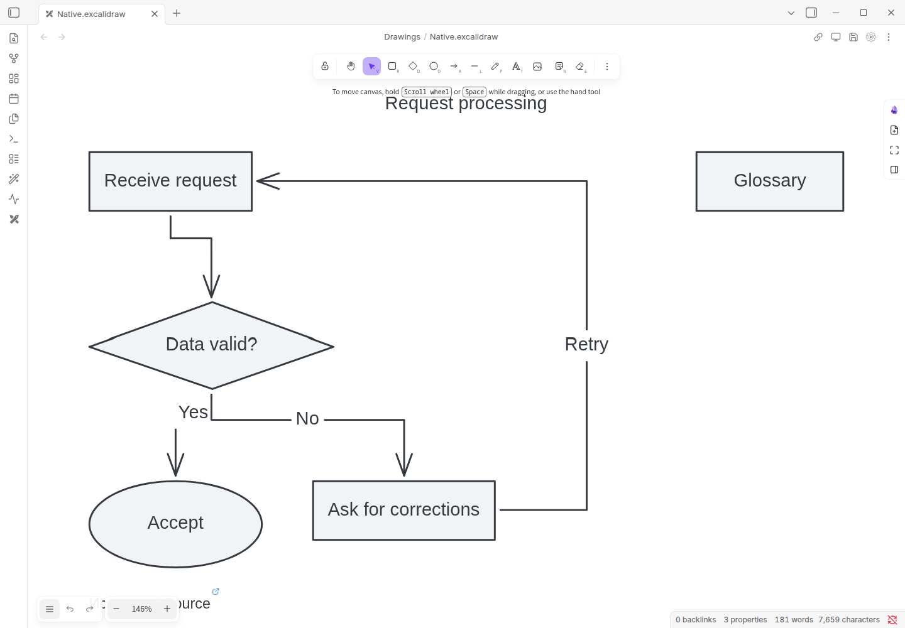

# Editable Excalidraw diagrams

> **2.3.0 release candidate; stable release is 2.2.1.**

## Prerequisites

Enable **Excalidraw 2.29.0**. Diagram generation currently requires **public OpenRouter** and verified endpoint support for structured outputs and the required parameters. A custom endpoint or a provider that works for Markdown does not establish diagram support. Capability discovery fetches metadata without note text; generation is a separate consented request.

## Create and edit

1. Open **Veynrel Studio → Diagrams** and choose Structure or Flowchart.
2. Select one saved note, an existing destination folder and a new `.excalidraw.md` path. Confirm the model context budget.
3. Prepare, inspect the recipient and source, then explicitly generate.
4. Review the graph. Change layout direction or drawing theme locally if useful; recheck the updated preview.
5. Confirm creation of the separate file, then open it in Excalidraw.
6. Drag a shape, double-click its text to edit, save and reopen. Bound arrows remain attached.

[Native movement and label editing](../../assets/showcase/2.3.0/diagram.gif) · [Static edited result](../../assets/showcase/2.3.0/diagram-edited.png)

Workflow demonstration with synthetic notes and controlled responses; not a model-quality benchmark. Native shapes/text/arrows are editable. The screenshot is not generated artwork.

## Limits

One note, at most 24,000 input characters, 30 nodes, 60 edges, 32,000 response characters and an 8,192-token output request. All edge labels must exist, though ordinary transitions may have empty labels. Invalid, incomplete or unsupported outputs fail closed; no automatic repair or provider fallback. A valid schema does not prove correct relationships.

Creation refuses collisions and stale/unsaved sources. The source is preserved; new diagrams have no automatic delete/Undo. First open fits the scene once; larger/dense graphs may need manual zoom and can have crossings. The source caption is attribution, not a graph node. Later edits can make history report changed/unavailable; that does not mean your edits should be overwritten.

[Troubleshooting](Troubleshooting.md) · [Recovery](Safety-history-and-recovery.md)
