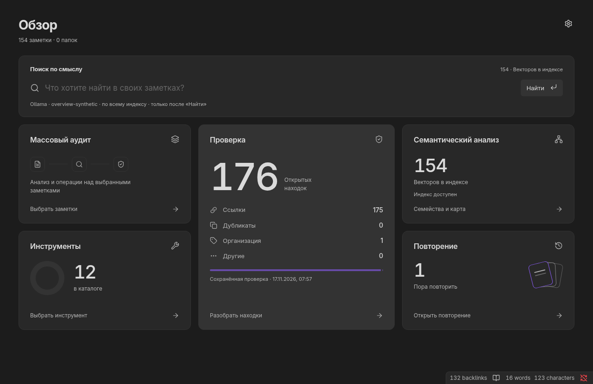

# Getting started

> **2.4.0 release candidate.** Check the [published releases](https://github.com/zinverno/veynrel/releases/latest) for the stable download. The [2.3.1 guide](https://github.com/zinverno/veynrel/tree/2.3.1/docs/wiki) covers the earlier interface.

## Local first

No model or API key is needed for local Health checks or authored-card Recall.

1. Enable Veynrel in your vault.
2. Open the command palette and run **Veynrel: Open Veynrel**, or click its ribbon icon.
3. From **Overview**, open **Check**, select an area and explicitly run local checks.
4. Inspect findings and their source evidence. A small or disconnected note may be intentional.
5. Add your own cards and open **Recall** on Overview for [Recall](Recall.md).

Expected result: local findings and a navigable source list. Synthetic example; no model result is pictured.

## Optional setup paths

- **Semantic discovery:** Veynrel settings → embedding connection → explicit first index build. Note chunks go to that endpoint. A model for writing is a different connection.
- **Writing and Recall generation** use a separate model connection. Open a Markdown editor and use the floating toolbar for Style preview or card generation. Review the source before sending.

[What is sent](Providers-and-privacy.md)
