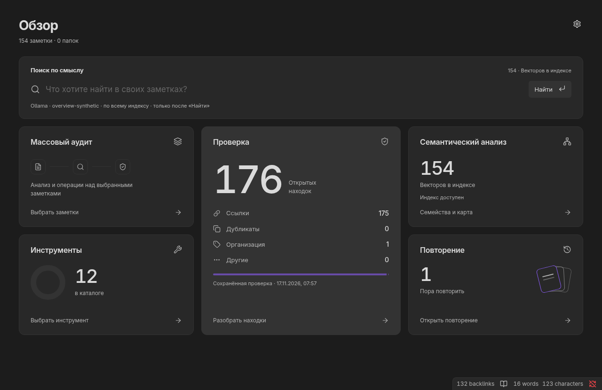

# Veynrel user guide

> **2.4.0 release candidate.** Check the [published releases](https://github.com/zinverno/veynrel/releases/latest) for the stable download. The [2.3.1 guide](https://github.com/zinverno/veynrel/tree/2.3.1/docs/wiki) covers the earlier interface.

Open **Veynrel → Overview** for Vault Check, semantic exploration, Tools, Bulk Audit and Recall. The floating toolbar operates on its original Markdown editor.

[Start without an AI key](Getting-started.md) · [Install or update](Installation-and-updates.md)

| I want to… | Guide |
| --- | --- |
| Inspect a vault and possible connections | [Health and connections](Vault-health-and-connections.md) |
| Archived 2.3.1 Studio recipes | [Studio recipes](Studio-recipes.md) |
| Archived 2.3.1 online catalog | [Community library](Community-library.md) |
| Use diagrams in public 2.3.1 only | [Legacy Excalidraw guide](Excalidraw-diagrams.md) |
| Review authored flashcards | [Recall](Recall.md) |
| Understand what leaves my device | [Providers and privacy](Providers-and-privacy.md) |
| Understand writes and recovery | [Safety and history](Safety-history-and-recovery.md) |

Synthetic vault in real Obsidian; counts describe this fixture only. Model demonstrations elsewhere use controlled responses, not a quality benchmark.

[Help](Troubleshooting.md) · [Contributing](Contributing.md) · [Release notes](../releases/2.4.0.md)
