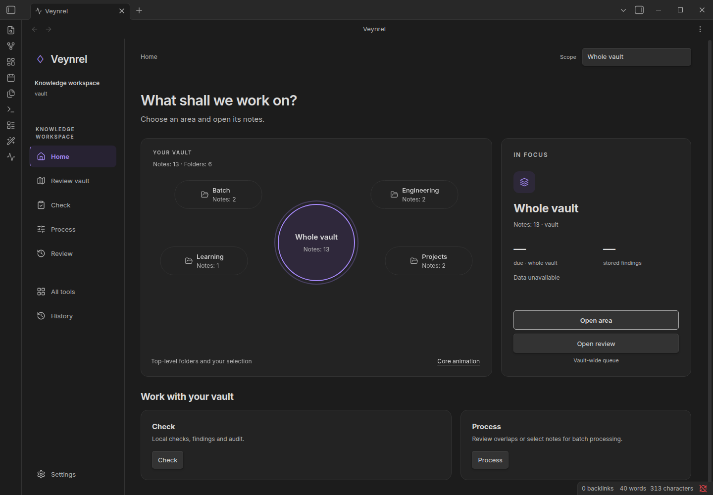

# Veynrel user guide

> **Public stable: 2.3.1. Development: unpublished intermediate 2.4.0.** R02 removes diagram generation from the next release, preserving drawings and archived journals. [Development changes and legacy data](../studio-diagram-removal.md).

Veynrel has two entry points: the **workspace** for vault health, connection review and Recall, and **Studio** for selected-note Markdown recipes. Public 2.3.1 additionally includes the legacy diagram workflow; development no longer does.

[Start without an AI key](Getting-started.md) · [Install or update](Installation-and-updates.md)

| I want to… | Guide |
| --- | --- |
| Inspect a vault and possible connections | [Health and connections](Vault-health-and-connections.md) |
| Structure a saved note | [Studio recipes](Studio-recipes.md) |
| Install a shared recipe | [Community library](Community-library.md) |
| Use diagrams in public 2.3.1 only | [Legacy Excalidraw guide](Excalidraw-diagrams.md) |
| Review authored flashcards | [Recall](Recall.md) |
| Understand what leaves my device | [Providers and privacy](Providers-and-privacy.md) |
| Understand writes and recovery | [Safety and history](Safety-history-and-recovery.md) |

Synthetic vault in real Obsidian; counts describe this fixture only. Model demonstrations elsewhere use controlled responses, not a quality benchmark.

[Help](Troubleshooting.md) · [Contributing](Contributing.md) · [Release notes](../releases/2.3.1.md)
