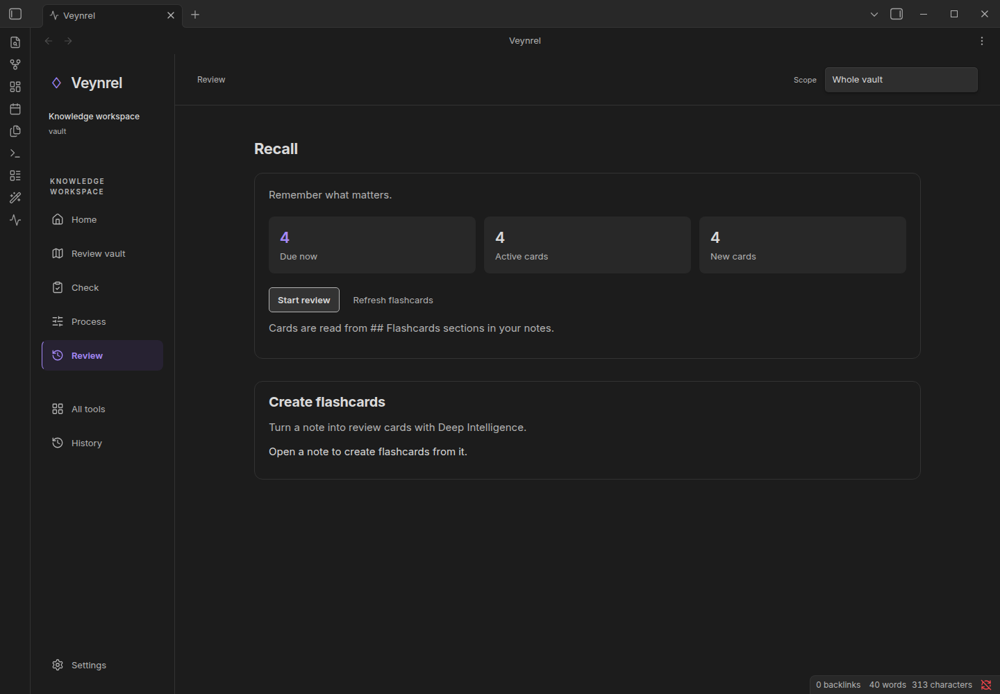

# Recall

> **Veynrel 2.3.0 Stable.**

Recall schedules your authored cards locally. It does not require an LLM.

1. Add one `Question::Answer` per line under a heading named exactly `Flashcards` in a saved Markdown note.
2. Open **Veynrel: Open Veynrel**, then **Review** in the sidebar (the Recall screen).
3. Find flashcards and start a review session.
4. Reveal the answer, then choose Again / Hard / Good / Easy, or keys 1–4.

```markdown
## Flashcards
What does a cache store?::Reusable results.
Why invalidate it?::The source may have changed.
```



Expected result: a local FSRS schedule that survives restart. Counts in the screenshot belong only to the synthetic fixture; they are not user learning statistics. AI card generation is optional and has a separate provider/data flow. Scheduling cannot guarantee learning outcomes.

[Getting started](Getting-started.md) · [Privacy](Providers-and-privacy.md)
