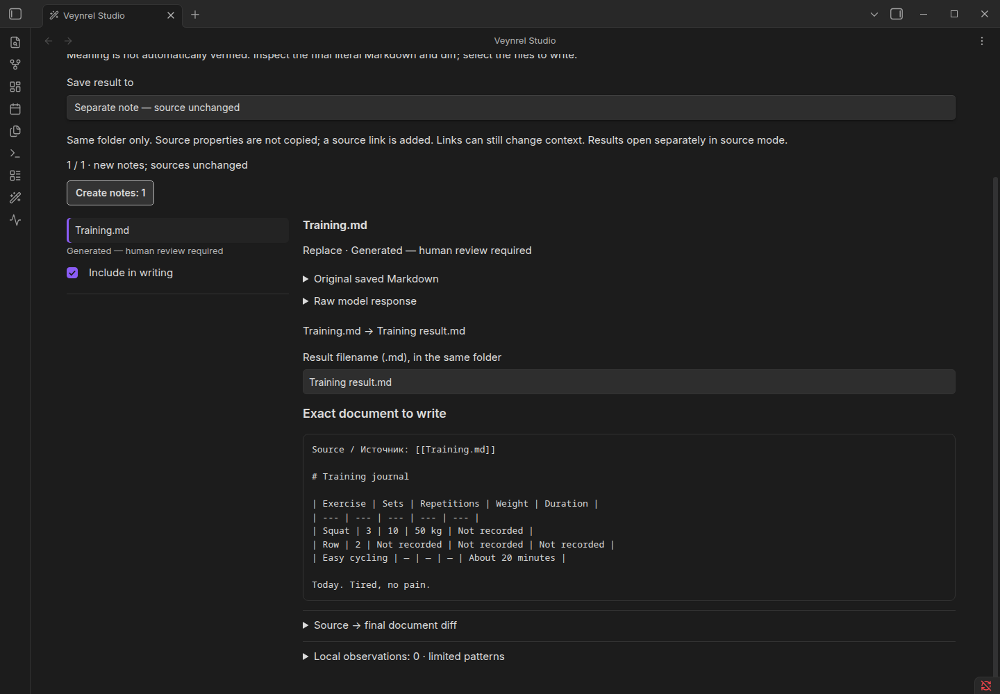

# Safety, history and recovery

> **Public stable: 2.3.1.** In unpublished development, R02 removes diagram actions and safely ignores their archived journals. [Locations and preservation procedure](../studio-diagram-removal.md#legacy-data-and-updating).

## Choose the correct contract

| Operation | Recovery boundary |
| --- | --- |
| Studio explicit source Apply | Journaled, exact guarded source change; separate guarded Undo |
| Studio separate Markdown result | New file; no automatic delete/Undo |
| Studio diagram (public 2.3.1 only) | New file; no automatic delete/Undo; development preserves it and the archived journal |
| Supported consolidation | Operation-specific Apply/Undo and dependencies |
| Batch, MOC, generative atomization | Separate contracts; no universal rollback |

Studio preparation and generation do not write notes. Review is immutable. Changes to source identity/content, destination collisions, unsaved or unsupported editors, or damaged journals can block writes. Supported original YAML is retained literally for source changes. A separate Markdown result does not copy the source's properties.

Synthetic workflow, not an assurance that a model preserved every fact.

## History and interruption

Open **Studio → History** to inspect Markdown runs and applicable recovery. In development this view does not load or alter legacy `studio/diagrams/` records; retain/copy them from the filesystem when needed. An interrupted generation never automatically resumes. An unconfirmed write must not be replayed: first inspect the actual file and preserve the journal. Later edits can block Undo. Restore from your own verified backup when automatic recovery is unavailable; do not delete journal evidence to unlock a button.

Studio data lives under `<Vault.configDir>/plugins/ai-knowledge-hub/studio/`, including recipes, retained recipe backups, run receipts, operations and creation history. Operation records can contain full before/after text in plaintext. There is no automatic retention cleanup or encryption. Preserve settings, indexes and journals during updates. Other plugins/OS processes can introduce races beyond the tested in-process guards.

For corrupted or uncertain data, stop writes and follow [Troubleshooting](Troubleshooting.md). Detailed storage contracts: [Studio safety reference](../studio-safety-and-recovery.md), [creation recovery](../studio-source-preservation-v1/create-recovery.md).
