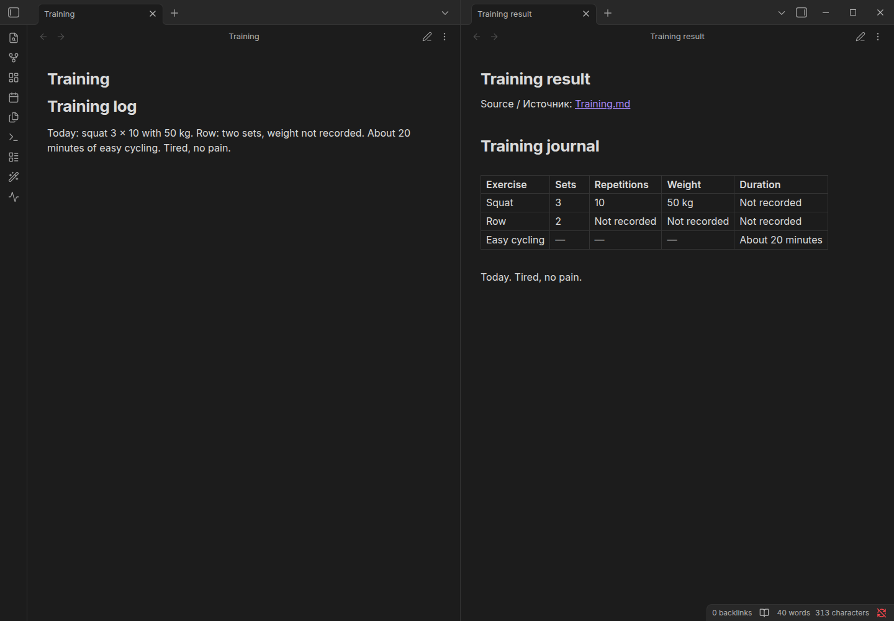

# Studio recipes

> **2.3.0 release candidate; stable release is 2.2.1.**

## Turn a saved note into a useful structure

Prerequisites: a configured language-model connection and saved Markdown notes. Open **Veynrel: Open Veynrel Studio** from the command palette, then **Library**.

1. Choose Smart Formatting, Training Journal, Nutrition Journal or a validated local recipe.
2. Select notes or a bounded folder selection; set parameters and the model context allowance.
3. Prepare and inspect the recipient, selected text and request. Preparation does not send it.
4. Confirm generation. Responses become an immutable Review; inspect each successful result.
5. Check local preservation observations and the exact final output. They flag lexical differences, not factual accuracy or complete meaning preservation.
6. Keep **separate note** selected, check the destination and confirm creation. Open the result beside the original.

Workflow demonstration with synthetic notes and controlled responses; not a model-quality benchmark. The source remains unchanged in the separate-result route. The new note contains a source link and result body, not a complete clone with source YAML. New files have no automatic delete/Undo.

## Explicit source changes

Select the source destination only deliberately. Supported original frontmatter is retained literally; unsafe envelopes are refused for source changes. Review the full planned text and acknowledge the warning. Source Apply and Undo use exact rereads, editor checks and local journals. Save and close affected editable views when required. Changes since Review can block writing or Undo; do not force it.

Limits: at most 20 selected files, 24,000 input characters per note, 48,000 output characters, and recipe-specific token limits. Context allowance is a conservative bound, not tokenizer discovery. No automatic retries or repair calls. Training/nutrition structure is not an accuracy or calorie guarantee.

[Native workflow](../../assets/showcase/2.3.0/studio.gif) · [Community](Community-library.md) · [History and recovery](Safety-history-and-recovery.md)
