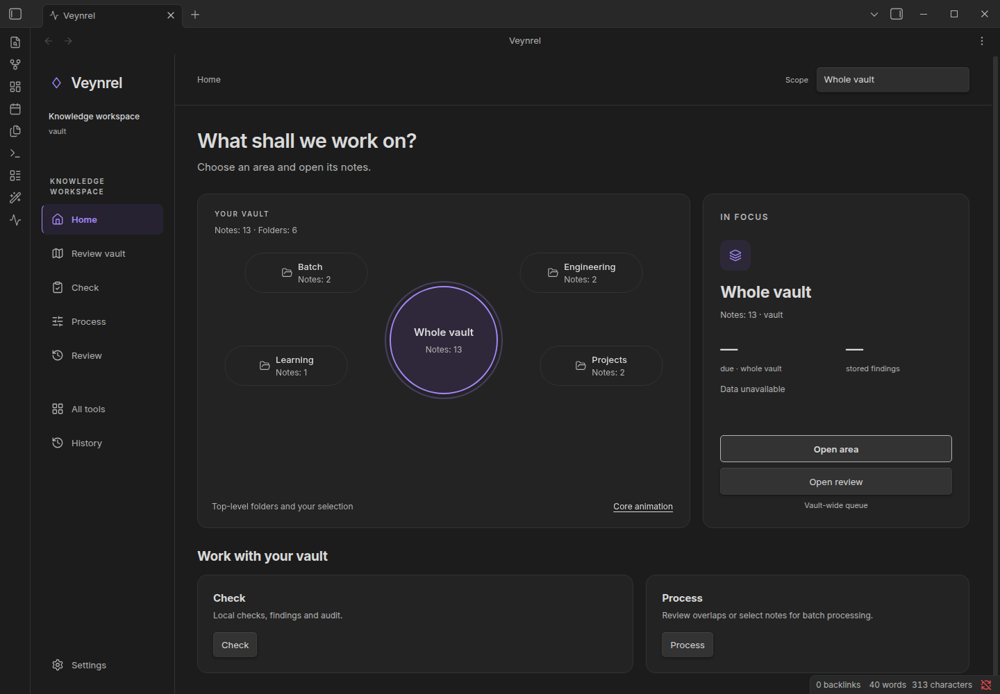
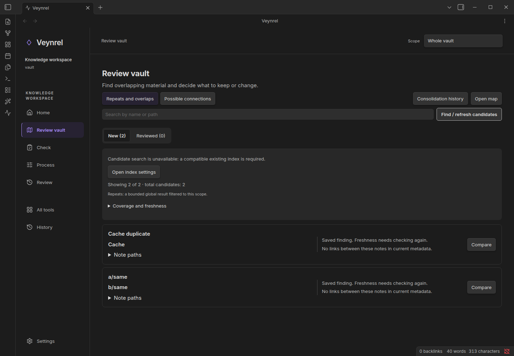

# Vault health and connections

> **2.4.0 release candidate.** Check the [published releases](https://github.com/zinverno/veynrel/releases/latest) for the stable download. The [2.3.1 guide](https://github.com/zinverno/veynrel/tree/2.3.1/docs/wiki) covers the earlier interface.

## Inspect an area

Open **Veynrel: Open Veynrel**. On **Overview**, open **Check** and select an area for local analysis. Local checks cover structural issues such as broken links, isolated notes and exact duplicates. Inspect coverage and stale/error states before interpreting the findings.

Synthetic notes, real local facts. Expected result: findings you can inspect and source notes you can open. These are prompts for review, not a verdict that a note should be removed.

## Review connections

For semantic candidates configure embeddings and build the first index. Open the semantic workspace and choose **Notes & Pairs** or **Connection Opportunities**. Read both sources. Optional model analysis has an explicit request confirmation. Prepare a supported change only after reviewing the recommendation, then inspect the exact change and separately confirm Apply.

Synthetic fixture. Similarity is not a probability or proof of duplication. Connection rules act before top-K; duplicate discovery is separate. The exact semantic overview/connection comparison has a 500-eligible-note limit; choose a smaller area above it.

Supported consolidation operations include links, embeds and bounded copying/grouping. Their guards and Undo depend on the operation and unchanged sources/dependencies. Batch, MOC and generative atomization have separate contracts. [Safety](Safety-history-and-recovery.md) · [Privacy](Providers-and-privacy.md)
